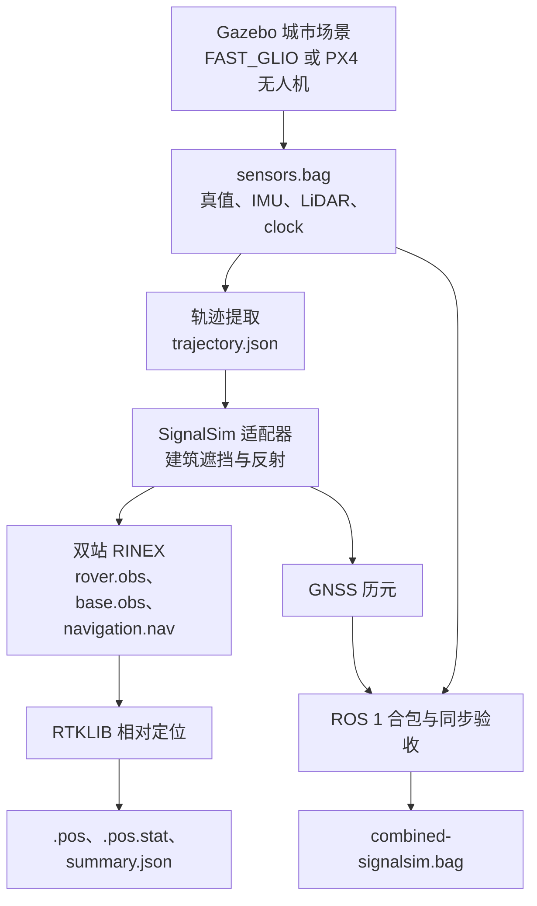

# msim：FAST_GLIO 无人机与 SignalSim GNSS

本仓库以 **ROS 1 Noetic 的城市 Gazebo 仿真**为运行场景，支持原有 FAST_GLIO 无人机采集和 PX4 SITL 飞控实验。Gazebo 提供真值、IMU、LiDAR、`/clock`；本仓库根据真值轨迹驱动 SignalSim 生成四星座双频基站与无人机观测，写出 RINEX，合并为 ROS 1 bag，并用 RTKLIB 离线解算。无人机模型目前没有相机话题。

PX4 SITL 可在同一 Gazebo world 中沿预设航线飞行。当前采集默认保留 Gazebo 原生 GPS 的误差与延迟，通过中继增加接收机误差和在线欺骗，并向 PX4 与 ROS 提供同一次测量；`--gazebo-viz` 会在 Gazebo 画出真值、假 GPS 和检测估计的彩色虚线，配合 `--flight-pattern route` 还会显示预设航线及欺骗偏移示意。浏览器监看页提供实时二维／三维轨迹及 PNG 导出。SignalSim 观测仍在采集后离线生成。完整数据流见 [当前架构图](docs/px4/ARCHITECTURE.md)，运行命令和输入边界见 [PX4 接入说明](docs/px4/README.md)。

在线欺骗实验现在把现有 LiDAR 点云按 Gazebo 仿真时间与每个 GPS 历元配对，逐历元记录扫描时间差，并在浏览器显示同步状态。LiDAR 尚未参与欺骗报警判定。

Gazebo 现在支持 `--scene complex_urban`（错落建筑、立柱、高架桥）和 `--scene industrial_yard`（导入 PX4 货架、货箱、托盘，并补充多高度结构），也可用 `--world` 加载自定义 world。[场景运行方法](scenes/README.md)与[六组场景对照实验](docs/px4/COMPLEX_SCENES_20261116.md)包含实际截图、ENU 误差和三维轨迹。场景几何只影响当前激光与物理仿真，在线 GNSS 保留原生误差、接收机误差及脚本攻击偏移，尚无建筑驱动的多路径模型。

新增 `--scene ksql_airport`，接入约 2.87 km × 2.78 km 的机场周边地形、卫星底图与建筑碰撞网格，选定 1 km × 1 km 测试区域。已完成 300 秒航线及带欺骗双窗口实测；首次下载、启动命令、场景配置与精度边界见 [KSQL 接入报告](docs/px4/KSQL_INTEGRATION_20261122.md)。

要同时看左侧 Gazebo 飞机仿真和右侧 FAST_GLIO 松组合 RViz 三维轨迹，运行 `./tools/px4-uav-capture.sh --duration-s 60 --fastglio-live --flight-pattern route --spoof-start-s 20 --spoof-east-rate-mps 0.18`。运行后保存 `fastglio-live-3d.png` 效果图；设置和输入边界见 [PX4 接入说明](docs/px4/README.md)。

传感器可通过 `--lidar-model vlp16|hdl32|os1-64|mid360`、`--imu-model mems-baseline|low-noise`、`--gps-model standalone|native|ideal` 快速切换。Mid-360 自动选择原生 Livox 前端，其他型号选择 Velodyne 前端。默认 LiDAR 为带 0.02 m 径向噪声的分时扫描，点时间覆盖约 98 ms；[配置、处理延迟与验收说明](docs/px4/SENSOR_SWITCHING.md)。

## 预设航线中途加入 GPS 欺骗

```bash
cd /home/wzb/msim
./tools/px4-uav-capture.sh --duration-s 60 --gazebo-viz \
  --flight-pattern route --spoof-start-s 20 --spoof-east-rate-mps 0.18
```

另开终端运行 `/usr/bin/python3 tools/spoof-live-dashboard.py --follow-latest /home/wzb/msim/runs`，然后打开 [本机监看页](http://127.0.0.1:8765/)。向东虚报 GPS 位置会使 PX4 向西纠偏，真实飞机因此离开航线。当前二维检测原型可能漏检这种缓慢拖移；报警仅显示和记录，不接管飞控。

## 离线 GNSS 观测链路



## 目录

| 路径 | 内容 |
| --- | --- |
| `adapters/ros1_noetic/fast_glio_uav/` | Gazebo 启动、PX4 航线控制、GPS 注入、检测与可视化、ROS 1 录制、轨迹提取和合包。 |
| `adapters/signalsim/`、`core/` | SignalSim C++ 适配器、坐标变换和建筑传播几何。 |
| `apps/fastglio/` | 轨迹插值、SignalSim 观测生成及 RINEX/清单校验。 |
| `scenarios/fastglio_signalsim.json` | 默认 GNSS 场景、地理原点、基站与建筑参数。 |
| `tools/` | 一键采集、实时监看、SignalSim 构建、RTKLIB 解算和绘图真值导出。 |
| `runs/`、`build/` | 本机采集结果与构建产物，不纳入版本控制。 |

## 准备环境

需要已构建的 `/home/wzb/FAST_GLIO/devel/setup.bash`、其中的 Pixi ROS Noetic 环境、C++17 编译器和本机的 SignalSim 固定版本：

```bash
cd /home/wzb/msim
git clone https://github.com/globsky/SignalSim.git build/deps/SignalSim
git -C build/deps/SignalSim checkout baba9deb68ed193efb9fd9a362b431ae8c491fa4
./tools/build-signalsim-adapter.sh
```

若 `build/deps/SignalSim` 已存在，只需检查其提交并构建。SignalSim 上游源码仅放在本机 `build/deps/`，不在本仓库复制。RTKLIB 构建指纹在 `docs/rtklib/build-manifest.json`；重建命令见 [SignalSim 集成指南](docs/gnss/SIGNALSIM-FASTGLIO.md)。

## 采集与验收

```bash
cd /home/wzb/msim
./tools/fastglio-uav-capture.sh --duration-s 300 --flight-mode patrol_s --gui
```

默认结果位于 `runs/uav-fastglio-时间戳/`。脚本完成后检查 `verification-signalsim.json` 中的 `pass_quality_gate`。它核对 1500 个 5 Hz GNSS 历元、GPST 与仿真时钟映射、IMU/LiDAR 最近时间差、消息数和真值误差。已有原始采集可按以下命令继续处理：

```bash
./tools/fastglio-uav-capture.sh --postprocess-only \
  --run /home/wzb/msim/runs/你的采集目录 --duration-s 300
```

`--flight-mode` 可选 `patrol_s`、`patrol_8`、`patrol_boustrophedon`、`patrol_sprint`、`patrol_spiral`。`--scenario` 指定场景 JSON；`--retain-nlos` 保留仅反射信号用于压力测试。详情与既有 300 秒结果见 [SignalSim 集成指南](docs/gnss/SIGNALSIM-FASTGLIO.md)。

## RTKLIB 解算与绘图

```bash
cd /home/wzb/msim
RUN=$PWD/runs/你的采集目录
OUT=$RUN/rtklib-$(date +%Y%m%d-%H%M%S)
/usr/bin/python3 tools/rtklib/rtklib_runner.py \
  --rinex-dir "$RUN/signalsim" --output-dir "$OUT" \
  --build-manifest docs/rtklib/build-manifest.json \
  --mode relative_fixed --navsys 45 --with-stat --timeout 300
cat "$OUT/summary.json"
/usr/bin/python3 tools/fastglio-export-plot-reference.py \
  --rinex-dir "$RUN/signalsim" --output "$OUT/reference.csv"
```

把 `$OUT/relative_fixed.pos`、`$OUT/relative_fixed.pos.stat` 和 `$OUT/reference.csv` 导入 `/home/wzb/rtklib-plot-python`。bag 内 `/rtklib_odom` 是码差分辅助位置；RTK FIX/FLOAT 以离线 `.pos` 的状态码为准。

## 查看 ROS 1 话题和回放

```bash
export PATH=/home/wzb/FAST_GLIO/.pixi/envs/default/bin:$PATH
source /home/wzb/FAST_GLIO/devel/setup.bash
rosbag info "$RUN/combined-signalsim.bag"
roscore
# 另一个已加载相同环境的终端：rosbag play --clock "$RUN/combined-signalsim.bag"
# 第三个已加载相同环境的终端：rostopic list
```

城市反射参数尚未用实测材料和接收机标定；已有运行的高 FIX 率只证明此仿真设置的内部一致性。SignalSim 许可与 RTKLIB 来源记录见 `docs/third_party/`。

## 本机代码检查

```bash
cmake -S . -B build/core -DCMAKE_BUILD_TYPE=Release
cmake --build build/core
ctest --test-dir build/core --output-on-failure
/usr/bin/python3 -m unittest discover -s tests/fastglio -p 'test_*.py'
```
