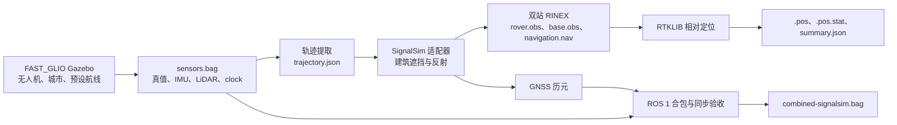

# msim：FAST_GLIO 无人机与 SignalSim GNSS

本仓库以 **ROS 1 Noetic 的 FAST_GLIO 无人机城市仿真**为唯一运行主线。FAST_GLIO 的 Gazebo 场景和预设航线提供真值、IMU、LiDAR、`/clock`；本仓库根据真值轨迹驱动 SignalSim 生成四星座双频基站与无人机观测，写出 RINEX，合并为 ROS 1 bag，并用 RTKLIB 离线解算。无人机模型目前没有相机话题。

PX4 SITL 现可作为这条 ROS 1 城市仿真流程的飞控与动力学选项，使用同一 Gazebo world 并通过 MAVLink 预设航线飞行。`--online-gnss` 可停用 Gazebo GPS 插件，改由实时真值加可控偏移向 PX4 注入 `HIL_GPS`；SignalSim 观测仍在采集后离线生成。安装、采集命令及输入边界见 [PX4 接入说明](docs/px4/README.md)。



## 目录

| 路径 | 内容 |
| --- | --- |
| `adapters/ros1_noetic/fast_glio_uav/` | Gazebo 启动、ROS 1 录制、轨迹提取、合包和同步检查。 |
| `adapters/signalsim/`、`core/` | SignalSim C++ 适配器、坐标变换和建筑传播几何。 |
| `apps/fastglio/` | 轨迹插值、SignalSim 观测生成及 RINEX/清单校验。 |
| `scenarios/fastglio_signalsim.json` | 默认 GNSS 场景、地理原点、基站与建筑参数。 |
| `tools/` | 一键采集、SignalSim 构建、RTKLIB 解算和绘图真值导出。 |
| `runs/`、`build/` | 本机采集结果与构建产物，不纳入版本控制。 |

## 准备环境

需要已构建的 `/home/wzb/FAST_GLIO/devel/setup.bash`、其中的 Pixi ROS Noetic 环境、C++17 编译器和本机的 SignalSim 固定版本：

```bash
cd /home/wzb/msim
git clone https://github.com/globsky/SignalSim.git build/deps/SignalSim
git -C build/deps/SignalSim checkout baba9deb68ed193efb9fd9a362b431ae8c491fa4
./tools/build-signalsim-adapter.sh
```

若 `build/deps/SignalSim` 已存在，只需检查其提交并构建。SignalSim 上游源码仅放在本机 `build/deps/`，不在本仓库复制。RTKLIB 构建指纹在 `docs/rtklib/build-manifest.json`；重建命令见 [SignalSim 集成指南](docs/gnss/SIGNALSIM-FASTGLIO.md)。

## 采集与验收

```bash
cd /home/wzb/msim
./tools/fastglio-uav-capture.sh --duration-s 300 --flight-mode patrol_s --gui
```

默认结果位于 `runs/uav-fastglio-时间戳/`。脚本完成后检查 `verification-signalsim.json` 中的 `pass_quality_gate`。它核对 1500 个 5 Hz GNSS 历元、GPST 与仿真时钟映射、IMU/LiDAR 最近时间差、消息数和真值误差。已有原始采集可按以下命令继续处理：

```bash
./tools/fastglio-uav-capture.sh --postprocess-only \
  --run /home/wzb/msim/runs/你的采集目录 --duration-s 300
```

`--flight-mode` 可选 `patrol_s`、`patrol_8`、`patrol_boustrophedon`、`patrol_sprint`、`patrol_spiral`。`--scenario` 指定场景 JSON；`--retain-nlos` 保留仅反射信号用于压力测试。详情与既有 300 秒结果见 [SignalSim 集成指南](docs/gnss/SIGNALSIM-FASTGLIO.md)。

## RTKLIB 解算与绘图

```bash
cd /home/wzb/msim
RUN=$PWD/runs/你的采集目录
OUT=$RUN/rtklib-$(date +%Y%m%d-%H%M%S)
/usr/bin/python3 tools/rtklib/rtklib_runner.py \
  --rinex-dir "$RUN/signalsim" --output-dir "$OUT" \
  --build-manifest docs/rtklib/build-manifest.json \
  --mode relative_fixed --navsys 45 --with-stat --timeout 300
cat "$OUT/summary.json"
/usr/bin/python3 tools/fastglio-export-plot-reference.py \
  --rinex-dir "$RUN/signalsim" --output "$OUT/reference.csv"
```

把 `$OUT/relative_fixed.pos`、`$OUT/relative_fixed.pos.stat` 和 `$OUT/reference.csv` 导入 `/home/wzb/rtklib-plot-python`。bag 内 `/rtklib_odom` 是码差分辅助位置；RTK FIX/FLOAT 以离线 `.pos` 的状态码为准。

## 查看 ROS 1 话题和回放

```bash
export PATH=/home/wzb/FAST_GLIO/.pixi/envs/default/bin:$PATH
source /home/wzb/FAST_GLIO/devel/setup.bash
rosbag info "$RUN/combined-signalsim.bag"
roscore
# 另一个已加载相同环境的终端：rosbag play --clock "$RUN/combined-signalsim.bag"
# 第三个已加载相同环境的终端：rostopic list
```

城市反射参数尚未用实测材料和接收机标定；已有运行的高 FIX 率只证明此仿真设置的内部一致性。SignalSim 许可与 RTKLIB 来源记录见 `docs/third_party/`。

## 本机代码检查

```bash
cmake -S . -B build/core -DCMAKE_BUILD_TYPE=Release
cmake --build build/core
ctest --test-dir build/core --output-on-failure
/usr/bin/python3 -m unittest discover -s tests/fastglio -p 'test_*.py'
```
