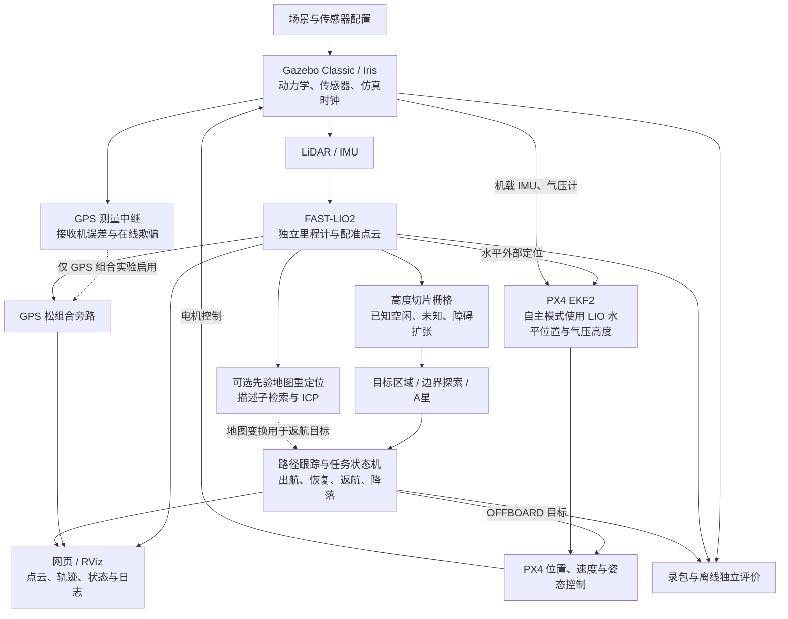
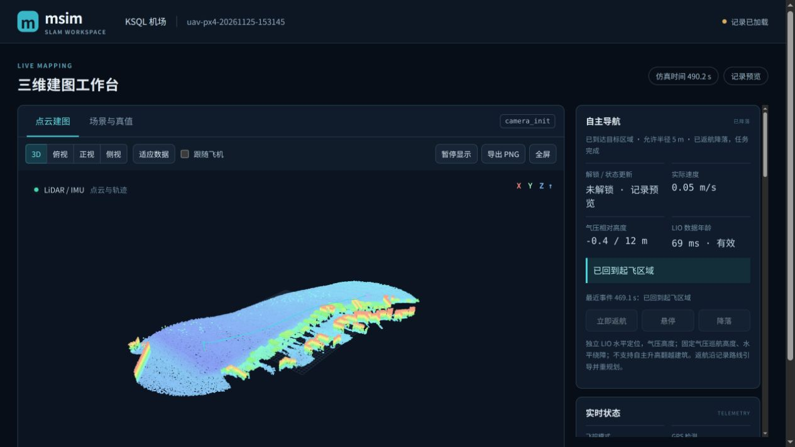
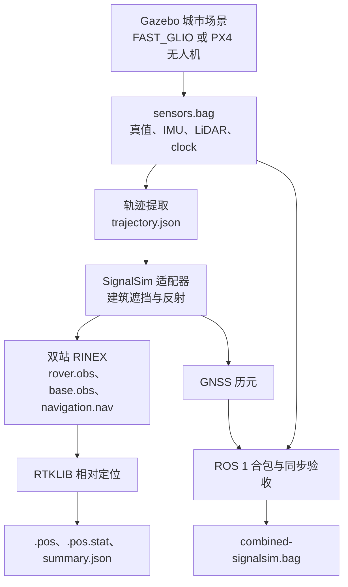

# msim：无人机多传感器仿真与自主导航平台

基于 **Gazebo Classic、PX4 SITL、ROS 1 Noetic 和 FAST-LIO2**，用于多传感器采集、GPS 欺骗与定位组合对比，以及无人工方向控制的目标探索、重定位和返航实验。网页和 RViz 显示实时点云、轨迹与运行状态；飞行结束后可独立核验真值误差和飞控定位源。

## 当前能力

| 能力 | 当前实现 |
| --- | --- |
| 场景 | 城市走廊、复杂街区、工业场地、KSQL 机场，也可加载自定义 world。KSQL 资源约 2.87 × 2.78 km；场景范围不等于已验证的自主航程。 |
| 传感器 | LiDAR 可选 VLP-16、HDL-32、OS1-64、Mid-360 参数模型；IMU 可选基线 MEMS、低噪声模型；GPS 可选文献 DGNSS 基线、原生、理想及历史经验模型。 |
| 采集与展示 | 自动航线、键盘/网页手动采集；Gazebo、RViz 或网页三维工作台；地图 PCD、轨迹、PNG 和 bag 导出。 |
| 定位与组合 | 独立 LiDAR / IMU 定位，以及可选的 LiDAR / IMU / GPS 松组合对比；原始 LIO 与 GPS 修正分支分开保存。 |
| GPS 欺骗 | 在线位置偏移与渐变拖移、IMU/GPS 新息检测；记录同一次飞行的正常旁路与受攻击测量。 |
| 自主导航 | 指定目标中心和允许半径，实时点云探索、水平绕障、返航与降落；固定气压巡航高度。 |
| 重定位 | 可选独立先验地图，描述子检索、ICP 配准、歧义拒绝与两次一致确认。 |
| 离线 GNSS | SignalSim 生成双站 RINEX，RTKLIB 解算，合包与同步验收。 |

## 平台架构



图中主闭环为当前目标自主模式；完整的模式分支、GPS 注入与检测、先验地图坐标关系和离线链路见 [详细架构](docs/px4/ARCHITECTURE.md)。

- **GPS 航线实验**：最终 GPS 测量进入 PX4，并可进入外部 GPS 松组合；用于观察欺骗如何改变真实飞行。
- **自主探索模式**：从起飞前关闭 PX4 的 GPS 组合，使用独立 LIO 水平定位和气压高度。GPS 仍记录、显示，检测报警可触发返航策略。该模式没有验证飞行中从受骗 GPS 切换定位源的接管。
- **离线观测链路**：SignalSim 与 RTKLIB 在采集后运行，不是本轮自主控制的实时定位来源。
- **真值边界**：导航规划、重定位和 LIO 不读取真值；Gazebo 真值用于展示、传感器/离线观测生成和独立评价。

### 各模块采用的方法

| 模块 | 算法与来源 |
| --- | --- |
| LiDAR / IMU | FAST_GLIO 工作区中的 FAST-LIO2：IMU 传播、运动补偿、点到平面匹配、迭代误差状态卡尔曼滤波与 ikd-Tree。 |
| GPS 松组合 | GNSS 位置量测的 EKF 风格更新、残差门限与修正平滑；当前配置不向独立 LIO 反馈。 |
| 重定位 | 自行实现的 Scan Context 思路描述子、KD-Tree 最近邻、分阶段点到点 ICP/SVD、多候选与多帧确认；未集成完整 Scan Context++。 |
| 探索与路径搜索 | 射线更新二维栅格，Dijkstra 风格可达区域搜索、目标引导边界评分与 A*；未知空间不直接作为飞行通道。 |
| 跟踪与返航 | 单段前视、比例速度指令、限速与制动检查；反向记录点引导与在线重规划、有限状态机。 |
| 底层飞控 | PX4 EKF2，以及原生串级位置、速度、姿态控制。 |
| 传感器误差 | 分时射线 LiDAR＋测距噪声；IMU 白噪声、上电偏差与一阶高斯—马尔可夫慢变项；GPS 使用指定接收机位置域误差模型。 |
| 网页与地图保存 | Three.js/WebGL 展示；配准点云体素累积保存 PCD，不额外执行全局回环优化。 |

当前规划为固定高度的水平导航，尚未接入 EGO-Planner、完整三维轨迹优化或自主爬升越障。算法对比入口保留 LIO-SAM、LIGO 等方法，但不代表当前自主任务同时使用了这些算法。[研究方案与参考资料](docs/px4/RELOCALIZATION_RETURN_HOME_RESEARCH.md)。

## 准备环境

本机默认使用 `/home/wzb/FAST_GLIO/devel/setup.bash` 及其 Pixi ROS Noetic 环境、Gazebo Classic、PX4 SITL 与 C++17 编译器。换机后需准备对应依赖；PX4 采集脚本支持 `FAST_GLIO_ROOT` 和 `PX4_ROOT` 环境变量。

- PX4 安装、构建和检查：[PX4 接入说明](docs/px4/README.md)。
- 场景资源下载与自定义 world：[场景说明](scenes/README.md)。
- 传感器参数与切换：[传感器配置](docs/px4/SENSOR_SWITCHING.md)。
- 离线 SignalSim 构建：[集成指南](docs/gnss/SIGNALSIM-FASTGLIO.md)，固定版本为 `baba9deb68ed193efb9fd9a362b431ae8c491fa4`。该依赖仅放在本机 `build/deps/`，不随本仓库上传。

## 快速开始

以下命令在仓库根目录执行。`--web` 启动无窗口仿真及网页，访问终端打印的地址，默认 `http://127.0.0.1:8766/`；直接用 `file://` 打开 HTML 不会连接数据服务。同一套 PX4/ROS 实例不要重复启动采集。

### 指定目标区域，自主探索并返航

```bash
./tools/px4-uav-capture.sh --web --scene ksql_airport \
  --goal-enu 100 300 12 --goal-radius-m 5 --mission-speed-mps 2 \
  --autonomy-timeout-s 900 --lidar-model vlp16 --point-filter-num 2
```

`100 300 12` 表示相对起飞点的目标东、北坐标和固定巡航高度，单位为米；当前 KSQL 起飞朝向按 ENU 约定使用，尚未标定为精确的大地坐标。允许半径 5 m 内的已观测安全位置可视为到达，中心被占据时不强求到中心。整个区域不安全或不可达时，任务可能中止。

网页侧栏顶部显示阶段、速度、气压高度、LIO 数据年龄和受阻原因；“运行日志”可切换控制器、PX4、FAST_GLIO、启动与录包日志，支持刷新和下载片段。紫色圆圈是目标允许区域，浅绿色线是返航引导。网页修改目标只影响下次生成的启动命令。

2026-11-25 的上述目标完整实测：到达事件真实水平误差 **4.794 m**，最终落点距起飞点 **0.443 m**，任务完成且独立验收通过。这是一轮验证，不代表任意场景和目标的成功率。[参数、修复和验收报告](docs/px4/GOAL_EXPLORATION.md)。



### 手动飞行并实时建图

```bash
./tools/px4-uav-capture.sh --web --teleop --scene ksql_airport \
  --teleop-height-m 12 --lidar-model vlp16 --point-filter-num 2
```

在网页起飞、启用键盘后操纵。使用“降落并保存”结束；去掉 `--web` 可使用键盘窗口、Gazebo 和 RViz。[操作与保存说明](docs/px4/TELEOP_MAPPING.md)。

### 预设航线中途注入 GPS 欺骗

```bash
./tools/px4-uav-capture.sh --web --duration-s 60 --flight-pattern route \
  --route-clock sim --skip-signalsim \
  --spoof-start-s 20 --spoof-east-rate-mps 0.18
```

向东虚报位置可能使飞控向西纠偏。当前 IMU/GPS 新息检测是工程原型，可能漏检缓慢拖移；普通航线模式下报警仅显示和记录。需要 Gazebo 与 RViz 双窗口时，将 `--web` 换成 `--fastglio-live`；Gazebo 轨迹标记和旧监看页说明见 [PX4 实验入口](docs/px4/README.md)。

### 场景、传感器和先验地图切换

```bash
./tools/px4-uav-capture.sh --list-scenes
./tools/px4-uav-capture.sh --list-sensors
```

- 场景：`--scene simple|complex_urban|industrial_yard|ksql_airport`，自定义场景使用 `--world`。
- LiDAR：`--lidar-model vlp16|hdl32|os1-64|mid360`；默认滚动扫描，可用 `--lidar-timing snapshot` 对照。
- IMU：`--imu-model mems-baseline|low-noise`。
- GPS：`--gps-model f9p-dgnss-ucr|standalone|native|ideal`。默认文献基线统一生成噪声、慢变项和报告方差，保留原生采样节奏与延迟，不重复叠加原生位置噪声；天空遮挡误差模型在该基线中关闭。历史 `standalone` 遮挡模型为未标定经验模型。[接收机参数来源](docs/px4/GNSS_RECEIVER_MODEL_20261123.md)。
- 先验地图：在自主模式加入 `--localization-map 地图包目录`；地图应来自相同场景的独立采集，并覆盖任务区域。[地图制作与重定位](docs/px4/AUTONOMOUS_RETURN.md)。

## 结果、存储与复现

PX4 默认写入 `/media/wzb/Elements/msim/runs`，本地 `runs/` 保留兼容入口；配置见 `config/run-storage.json`。外置盘未挂载会停止启动，单次可用 `--run` 指定目录。

| 文件 | 用途 |
| --- | --- |
| `capture-settings.json`、`sensor_profile.json`、`world.sdf` | 本次运行参数、传感器配置与场景快照 |
| `sensors.bag`、`map.pcd` | 传感器与算法话题、累计点云地图 |
| `navigation-status.json`、`navigation-events.jsonl` | 自主任务状态、阶段转换与异常原因 |
| `navigation-report.json`、`autonomy-verification.json` | 任务是否完成，以及真值与飞控日志独立验收 |
| `mesh-clearance-verification.json` | KSQL 巡航轨迹到碰撞网格的采样间距，非连续无碰撞证明 |
| `controller.log`、`fastglio-live.log`、`launch.log`、`ros-home/log/**/*.ulg` | 控制、定位、启动及 PX4 完整日志 |
| `injected-gps.jsonl`、`fastglio-live-lio-error.json` | GPS 注入记录与独立 LIO 误差 |
| `goal-mission-result.png`、`teleop-trajectory.png` | 任务轨迹与距离图 |

已完成记录可重新打开网页，无需启动飞控：

```bash
/usr/bin/python3 tools/web-sim-console.py --run 采集目录 --port 8770
```

原始 bag、运行目录、构建依赖及大型场景资源不纳入 Git；文档保留小型报告和展示图片。

## 离线 GNSS 观测链路



## 采集与验收

```bash
cd /home/wzb/msim
./tools/fastglio-uav-capture.sh --duration-s 300 --flight-mode patrol_s --gui
```

默认结果位于 `runs/uav-fastglio-时间戳/`。脚本完成后检查 `verification-signalsim.json` 中的 `pass_quality_gate`。它核对 1500 个 5 Hz GNSS 历元、GPST 与仿真时钟映射、IMU/LiDAR 最近时间差、消息数和真值误差。已有原始采集可按以下命令继续处理：

```bash
./tools/fastglio-uav-capture.sh --postprocess-only \
  --run /home/wzb/msim/runs/你的采集目录 --duration-s 300
```

`--flight-mode` 可选 `patrol_s`、`patrol_8`、`patrol_boustrophedon`、`patrol_sprint`、`patrol_spiral`。`--scenario` 指定场景 JSON；`--retain-nlos` 保留仅反射信号用于压力测试。详情与既有 300 秒结果见 [SignalSim 集成指南](docs/gnss/SIGNALSIM-FASTGLIO.md)。

## RTKLIB 解算与绘图

```bash
cd /home/wzb/msim
RUN=$PWD/runs/你的采集目录
OUT=$RUN/rtklib-$(date +%Y%m%d-%H%M%S)
/usr/bin/python3 tools/rtklib/rtklib_runner.py \
  --rinex-dir "$RUN/signalsim" --output-dir "$OUT" \
  --build-manifest docs/rtklib/build-manifest.json \
  --mode relative_fixed --navsys 45 --with-stat --timeout 300
cat "$OUT/summary.json"
/usr/bin/python3 tools/fastglio-export-plot-reference.py \
  --rinex-dir "$RUN/signalsim" --output "$OUT/reference.csv"
```

把 `$OUT/relative_fixed.pos`、`$OUT/relative_fixed.pos.stat` 和 `$OUT/reference.csv` 导入 `/home/wzb/rtklib-plot-python`。bag 内 `/rtklib_odom` 是码差分辅助位置；RTK FIX/FLOAT 以离线 `.pos` 的状态码为准。

## 查看 ROS 1 话题和回放

```bash
export PATH=/home/wzb/FAST_GLIO/.pixi/envs/default/bin:$PATH
source /home/wzb/FAST_GLIO/devel/setup.bash
rosbag info "$RUN/combined-signalsim.bag"
roscore
# 另一个已加载相同环境的终端：rosbag play --clock "$RUN/combined-signalsim.bag"
# 第三个已加载相同环境的终端：rostopic list
```

城市反射参数尚未用实测材料和接收机标定；已有运行的高 FIX 率只证明此仿真设置的内部一致性。SignalSim 许可与 RTKLIB 来源记录见 `docs/third_party/`。

## 目录与文档

| 路径 | 内容 |
| --- | --- |
| `adapters/gazebo_classic/` | 分时 LiDAR、GPS 中继与接收机位置误差模型 |
| `adapters/ros1_noetic/msim_sensors/` | 型号配置、ROS IMU 误差与传感器格式接口 |
| `adapters/ros1_noetic/fast_glio_uav/` | 仿真启动、采集、GPS 检测、探索规划、重定位与自主控制 |
| `web/sim-console/`、`tools/web-sim-console.py` | 三维网页、状态/日志接口与启动命令生成 |
| `adapters/signalsim/`、`core/`、`apps/fastglio/` | GNSS 观测、城市传播几何、轨迹及 RINEX 处理 |
| `tools/`、`tests/` | 实验入口、独立验收、绘图与回归测试 |
| `runs/`、`build/` | 本机采集数据、场景与构建产物，Git 忽略 |

- [完整架构与模式边界](docs/px4/ARCHITECTURE.md)
- [网页工作台](docs/px4/WEB_CONSOLE.md) · [目标探索与返航](docs/px4/GOAL_EXPLORATION.md) · [先验地图重定位](docs/px4/AUTONOMOUS_RETURN.md)
- [KSQL 场景接入](docs/px4/KSQL_INTEGRATION_20261122.md) · [LiDAR 对比与修复](docs/px4/LIDAR_COMPARISON_FIXED_20261122.md)
- [SignalSim 集成](docs/gnss/SIGNALSIM-FASTGLIO.md) · [算法选型与研究方向](docs/px4/RELOCALIZATION_RETURN_HOME_RESEARCH.md)

## 本机代码检查

Python 测试依赖见 `tests/fastglio/requirements.txt`，可使用已配置的 Pixi Python 环境。完整仿真另需 Gazebo/PX4/ROS，单元测试通过不等于飞行任务验收通过。

```bash
cmake -S . -B build/core -DCMAKE_BUILD_TYPE=Release
cmake --build build/core
ctest --test-dir build/core --output-on-failure
python -m unittest discover -s tests/fastglio -p 'test_*.py'
node tests/fastglio/test_web_flight_input.mjs
node tests/fastglio/test_scene_command.mjs
```

网页测试需要支持现代 JavaScript 的 Node.js。2026-11-25 版本通过 95 项 Python 测试；完整机场闭环与独立核验见目标任务文档。SignalSim 与 RTKLIB 来源、许可及构建记录见 `docs/third_party/` 和 `docs/rtklib/build-manifest.json`。
