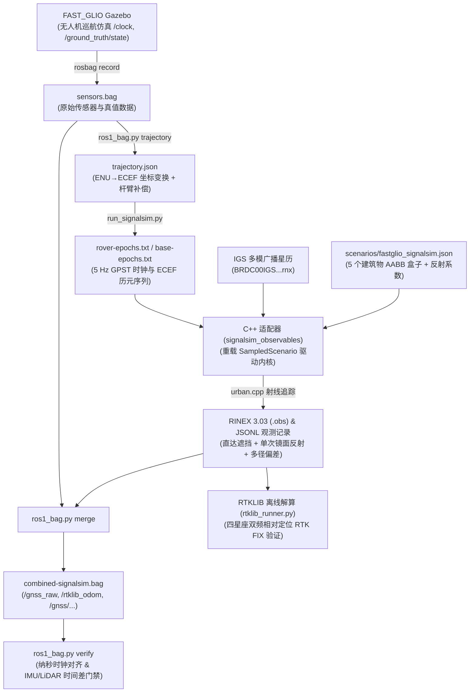

# Gazebo 轨迹驱动 SignalSim 仿真全流程解析

本文档详细解析 `msim` 仓库中如何从 Gazebo 无人机仿真中提取真实运动轨迹，并驱动 SignalSim 生成高保真 GNSS 观测数据，最终完成多传感器数据合包与验证的完整流水线。

---

## 1. 架构总览与核心设计思想

在本项目中，Gazebo 中的无人机轨迹**并非**通过运行时的实时网络通信（如 Socket、ROS 话题回调等）直接推送给 SignalSim，而是采用了**“离线真值录制 $\to$ 大地坐标/杆臂解耦转换 $\to$ C++ 适配器逐历元接管驱动 SignalSim 内核 $\to$ 城市环境遮挡/多径射线追踪 $\to$ 回流合包为 ROS 1 Bag / RINEX”**的解耦管线设计。



### 为什么采用此架构？
1. **真实动力学匹配**：原生 SignalSim 依赖其内置的数学 DSL 脚本（仅支持宏观匀速直线、加减速和匀速圆弧转弯），无法表达旋翼无人机在 Gazebo 物理引擎中的位姿微动、风扰与非线性控制响应。
2. **多径几何解耦**：三维城市建筑物的射线遮挡和单次镜面反射计算量较大，离线高保真计算可以保证仿真计算精度，不受实时仿真帧率波动的干扰。
3. **确定性重放与验证**：全链路参数可重放，确保生成的 GNSS 观测与 LiDAR、IMU 具有严格的纳秒级时间一致性。

---

## 2. 详细执行流程拆解

完整流水线由主驱动脚本 [`tools/fastglio-uav-capture.sh`](file:///home/wzb/msim/tools/fastglio-uav-capture.sh) 统一编排调度。

### 阶段一：Gazebo 仿真运行与传感器/真值录制

- **执行入口**：[`adapters/ros1_noetic/fast_glio_uav/ros1_bag.py`](file:///home/wzb/msim/adapters/ros1_noetic/fast_glio_uav/ros1_bag.py) 的 `capture()` 函数。
- **动作**：
  1. 通过 `roslaunch` 启动 FAST_GLIO 的城市无人机仿真环境（`uav_world.launch`），通过巡航脚本控制无人机执行预设航线（如 `patrol_s` 蛇形巡航，时长通常为 300 秒）。
  2. 启动 `rosbag record` 录制关键话题至 `sensors.bag`：
     - `/clock`：Gazebo 仿真时钟（用于后续纳秒时间轴对齐）；
     - `/ground_truth/state`：无人机在 Gazebo 局部东北天（ENU）坐标系下的位置、四元数姿态、线速度和角速度；
     - `/imu/data`：高频 IMU 惯导数据；
     - `/velodyne_points`：3D 激光雷达点云。

---

### 阶段二：轨迹提取、坐标系转换与天线杆臂补偿

- **执行代码**：[`ros1_bag.py`](file:///home/wzb/msim/adapters/ros1_noetic/fast_glio_uav/ros1_bag.py#L178-L289) 中的 `trajectory()` 与 [`apps/fastglio/trajectory.py`](file:///home/wzb/msim/apps/fastglio/trajectory.py#L43-L81) 中的 `antenna_state()`。
- **大地坐标转换（ENU $\to$ ECEF）**：
  - 场景定义了地理原点（武汉大学附近）：
    $$\text{Origin}_{\text{LLA}} = [30.5312^\circ\text{N},\ 114.3601^\circ\text{E},\ 50.0\text{ m}]$$
  - 将 Gazebo 局部的 ENU 相对坐标转换为 WGS-84 地心地固直角坐标系（ECEF）：
    $$P_{\text{ECEF}} = P_{\text{origin, ECEF}} + R_{\text{ENU}\to\text{ECEF}} \cdot P_{\text{ENU}}$$
  - 同时将无人机机体姿态四元数变换到地球固联坐标系。
- **天线杆臂效应（Lever Arm）与速度补偿**：
  - GNSS 天线安装位置并不在无人机质心，存在刚体安装偏差：
    $$\vec{r}_{\text{lever}} = [0.005, -0.05, 0.15] \text{ 米}$$
  - 利用插值后的机体姿态四元数旋转杆臂向量，获得天线相位中心的真实 ECEF 坐标：
    $$P_{\text{antenna}} = P_{\text{body}} + q \cdot \vec{r}_{\text{lever}} \cdot q^{-1}$$
  - 考虑机体旋转角速度 $\vec{\omega}$ 对天线产生的切向线速度：
    $$\vec{v}_{\text{antenna}} = \vec{v}_{\text{body}} + q \cdot (\vec{\omega} \times \vec{r}_{\text{lever}}) \cdot q^{-1}$$
- **输出成果**：标准化轨迹文件 [`trajectory.json`](file:///home/wzb/msim/runs/uav-fastglio-20261104-120848/trajectory.json)。

---

### 阶段三：时间基准对齐与 5 Hz 离散历元序列生成

- **执行代码**：[`apps/fastglio/run_signalsim.py`](file:///home/wzb/msim/apps/fastglio/run_signalsim.py)。
- **时间系统映射**：
  - 读取场景起始 UTC 时间（如 `2021-06-19T08:58:30Z`），结合国际跳秒表（Leap Seconds），计算出对应的 GPS 时间基准（GPS Week 和周内毫秒 TOW）。
  - Gazebo 仿真时间起点经过 1 秒预热后，按照 5 Hz 频率（每 200 ms 一个历元，300 秒共 1500 个历元）进行网格化采样。
- **生成历元驱动文件**：
  - `rover-epochs.txt`：流动站无人机天线的各历元 ECEF 位置与速度；
  - `base-epochs.txt`：固定基准站的固定 ECEF 坐标；
  - 数据格式：`<week> <tow_ms> <X> <Y> <Z> <Vx> <Vy> <Vz>`。

---

### 阶段四：C++ 适配器接管 SignalSim 核心内核

- **执行代码**：[`adapters/signalsim/observables.cpp`](file:///home/wzb/msim/adapters/signalsim/observables.cpp) 编译出的二进制程序 `build/signalsim/signalsim_observables`。
- **接管机制**：
  适配器声明派生类 `SampledScenario` 继承 SignalSim 的 `CScenarioData`，逐行读取 `epochs.txt`，在每个历元循环中重写当前状态：
  ```cpp
  class SampledScenario : public CScenarioData {
   public:
    void set_epoch(int week, int tow_ms, const KINEMATIC_INFO& position) {
      CurTime = {week, tow_ms, 0.0};
      UtcTime = GpsTimeToUtc(CurTime);
      CurPosEcef = position;           // 将 Gazebo 天线 ECEF 状态强行覆盖进去
      CurPosLla = EcefToLla(position);
      UpdateSatList();                 // 驱动 SignalSim 计算可见卫星
      UpdateSatelliteParam(0);
    }
  };
  ```
- **卫星轨道与测距解算**：
  适配器加载 IGS 多模广播星历（`EphData/BRDC00IGS_R_20211700000_01D_MN.rnx`），驱动 SignalSim 计算 GPS、BDS、Galileo、GLONASS 四大星座在当前历元对接收机可见的所有卫星位置、几何距离、电离层/对流层延迟、多普勒频移及无遮挡载噪比（C/N0）。

---

### 阶段五：城市三维建筑遮挡与单次镜面反射仿真

- **执行代码**：[`core/src/gnss/urban.cpp`](file:///home/wzb/msim/core/src/gnss/urban.cpp)。
- **射线追踪与多径注入**：
  1. **建筑物包围盒**：读取场景配置（`scenarios/fastglio_signalsim.json`）中的 5 个建筑物轴对齐包围盒（AABB），并设定墙体与屋顶反射系数（默认 0.35）。
  2. **视线阻挡判定（LOS Blocked）**：从天线向卫星方向引出射线，利用线段与 AABB 相交测试（`segment_hits_box`）判定直达信号是否被建筑物遮挡。
  3. **单次镜面反射计算（Specular Reflection）**：计算 4 面墙体和楼顶的镜面镜像点，判断反射径在建筑面上的落点以及反射路径是否被其他建筑遮挡。
  4. **观测量偏差合成（`urban_channel_effect`）**：
     - 若直达与反射信号共存，根据多径反射信号的超额路径差与载波相位差，计算合成信号在跟踪环路上的响应，生成伪距偏差（Code Bias）、载波相位偏差（Phase Bias）以及载噪比扰动（C/N0 change）；
     - 默认过滤无直达路径的纯反射极端 NLOS 信号（也可通过 `--retain-nlos` 保留用于压力测试）。
- **生成产物**：
  - 标准 RINEX 3.03 观测值文件：`rover.obs` 与 `base.obs`
  - 详细观测值事件流：`rover-observations.jsonl` 与 `epochs.jsonl`

---

### 阶段六：合包回流至 ROS 1 Bag 与时间同步门禁

- **执行代码**：[`adapters/ros1_noetic/fast_glio_uav/ros1_bag.py`](file:///home/wzb/msim/adapters/ros1_noetic/fast_glio_uav/ros1_bag.py) 的 `merge()` 与 `verify()`。
- **合包操作（`merge`）**：
  将生成的 GNSS 观测按纳秒级时间戳归并插入原始 `sensors.bag`，输出最终的 [`combined-signalsim.bag`](file:///home/wzb/msim/runs/uav-fastglio-20261104-120848/combined-signalsim.bag)：
  - `/gnss_raw`（ROS 格式 `rtklib/GNSS_Info`）：包含双频多星座原始伪距、载波相位、多普勒及粗分差分码定位解；
  - `/rtklib_odom`：使用 Python 内部解算的双基站伪距差分辅助位置（米级精度，`stat=4` 为 DGPS 码解）；
  - `/gnss/signalsim_observations`：完整的逐历元原始几何与多径 JSON 字符串；
  - 原始传感器：同步保留 `/clock`、真值姿态、IMU 和 LiDAR。
- **时间同步质量门禁（`verify`）**：
  - 检查 1500 个 5 Hz 历元的完备性与递增单调性；
  - 验证 GNSS 历元到最近 IMU 历元的最大时差 $\le 2\text{ ms}$；
  - 验证 GNSS 历元到最近 LiDAR 历元的最大时差 $\le 12\text{ ms}$；
  - 生成质量验收报告 `verification-signalsim.json`。

---

## 3. 关联第三方模块定位与依赖关系

| 模块 | 源码存放位置 | 编译产物位置 | 在流水线中的作用 |
| :--- | :--- | :--- | :--- |
| **SignalSim** | [`build/deps/SignalSim`](file:///home/wzb/msim/build/deps/SignalSim)<br/>*(锁定 Commit: baba9deb)* | [`build/signalsim/signalsim_observables`](file:///home/wzb/msim/build/signalsim/signalsim_observables) | 后端卫星轨道解算与观测值生成内核，由 C++ 适配器联合编译并驱动。 |
| **RTKLIB** | `/home/wzb/FAST_GLIO/rtklib`<br/>*(锁定 Commit: 3600edee)* | `build/p4-repair-v1-catkin/.../rtklib_rinex_processor` | 独立 ROS 节点，用于对生成的 `rover.obs` 和 `base.obs` 执行离线四星座相对定位（RTK FIX）评估。 |

> [!IMPORTANT]
> **关于 RTK FIX 定位精度的说明**：
> - Bag 内的 `/rtklib_odom` 仅为供 FAST_GLIO 接口测试用的**粗分差分码解（米级）**，其 `stat=4` 不代表 RTK FIX。
> - 真正的 RTK 厘米级定位精度是以离线运行 [`tools/rtklib/rtklib_runner.py`](file:///home/wzb/msim/tools/rtklib/rtklib_runner.py) 输出的 `relative_fixed.pos` 为准（1482 / 1500 历元 FIX，FIX 误差 95% 分位数约 0.0154 米）。
