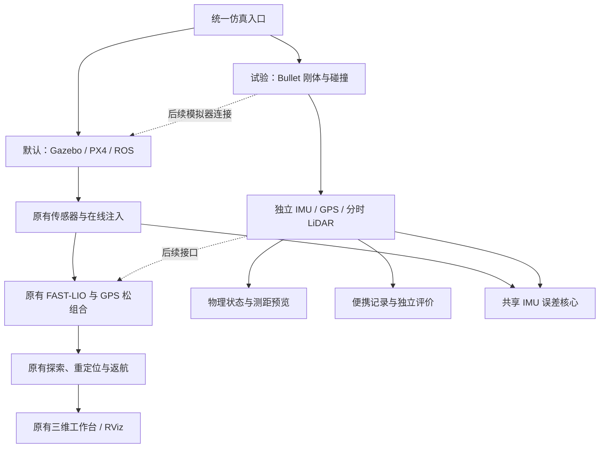
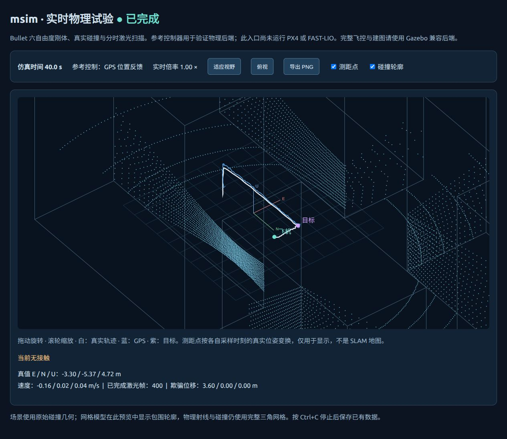
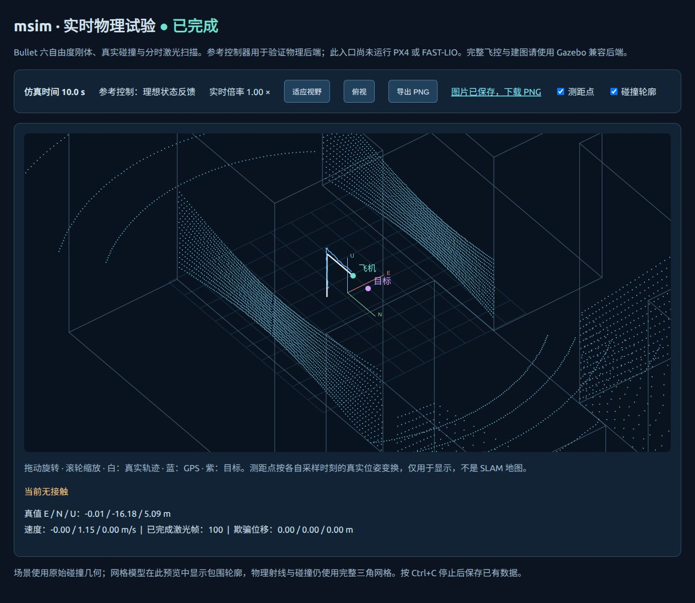

# 实时物理后端：保留完整功能，逐步替换依赖

2026-11-26，分支 `codex/portable-replay-core`。

本轮遵循“完整保留飞控、建图、传感器与网页功能，逐步替换依赖”。默认仍是原有 Gazebo/PX4/FAST-LIO 完整后端；新增 Bullet 入口用于验证轻量动力学和传感器。它们不能被称为已经等价的两个仿真器。

## 两个入口的边界

| 项目 | `gazebo` 默认兼容后端 | `bullet` 试验后端 |
| --- | --- | --- |
| 飞控 | 原有 PX4 EKF2、控制与 OFFBOARD | 验证刚体的参考控制器，未接 PX4 |
| 建图与导航 | 原有 FAST-LIO、松组合、探索与返航 | 尚未执行 FAST-LIO、规划、返航或重定位 |
| 物理 | 原有 Gazebo/ODE 与 Iris 模型 | Bullet 六自由度刚体、电机一阶响应、逐电机推力/力矩与碰撞 |
| 场景 | 原有全部场景与网页模型 | 静态 SDF 碰撞体；KSQL 完整三角网格可读；预览显示碰撞轮廓 |
| IMU | 原有 ROS 发布，调用共享误差模型 | 同一个 `ImuNoiseModel`，使用刚体加速度、重力和 IMU 杆臂 |
| LiDAR | 原有分时扫描插件 | 在每个真实物理时刻分批射线，保存原始逐点时间与 ring |
| GPS | 原有采样/延迟、接收机模型、注入和飞控接口 | 同一 F9P DGNSS 位置域参数与 OU 方程；单独配置采样/延迟；正常和欺骗旁路 |
| 网页 | 原有 Three.js 实时建图工作台、飞行控制、日志 | 只显示物理真值、GPS、目标、测距点与接触；支持旋转、缩放和保存 PNG |
| 依赖 | 仍需现有 Linux 环境 | Python、NumPy、可选 PyBullet，无 ROS/Gazebo/PX4 运行时 |

用户原来的采集命令仍可使用。没有将新参考控制器替换到原有飞行流程。



## 运行完整链路，保留原来的功能

在仓库根目录执行，`--` 后的参数原样转交既有脚本：

```bash
python -m msim simulate --backend gazebo -- \
  --web --teleop --scene ksql_airport \
  --teleop-height-m 12 --lidar-model vlp16 --point-filter-num 2
```

与直接运行 `./tools/px4-uav-capture.sh` 相同：端口、运行目录、PX4、ROS、传感器配置、FAST-LIO、网页和保存逻辑都由原有脚本处理。此处没有将参数重新解释成另一套控制设置。

可先检查最终命令：

```bash
python -m msim simulate --backend gazebo --dry-run -- \
  --web --duration-s 30 --flight-pattern route --route-clock sim --skip-signalsim
```

安装包不在源码目录内时，增加 `--root 仓库路径`。此兼容后端仍只支持已准备好完整依赖的 Linux 主机，并非已将 PX4/ROS 原生移植到 Windows/macOS。

## 运行轻量物理试验

建议使用 Python 3.10，它在本机可直接安装 PyBullet 3.2.7 二进制包；其他 Python/系统组合可能需要自行编译 PyBullet。当前实际验证系统是 Linux，未完成 Windows/macOS 物理实测。

```bash
python3.10 -m venv build/physics-env
build/physics-env/bin/python -m pip install ".[physics]"

build/physics-env/bin/python -m msim simulate --backend bullet \
  --world scenes/simple.world --output build/my-physics-run \
  --duration-s 40 --control-source gnss \
  --spoof-start-s 20 --spoof-rate-enu 0.18 0 0 \
  --web --port 8782 --serve-after-s 600
```

打开 `http://127.0.0.1:8782/`。默认按 1 倍实时速度推进，任务结束后在示例中保留预览 600 秒；Ctrl+C 关闭。`--real-time-factor 0` 表示尽快运行，仍执行每个物理步，没有跳步。机器算不动时实际倍率下降，不以伪造时间或遗漏扫描补齐。

输出目录必须不存在。测试的默认路线是在起飞点北向移动 15 m 的诊断目标，**没有避障规划**；应使用已有验证过的空闲区域。`--flight-pattern hover` 为悬停测试。`--height-m` 是相对指定 spawn 的高度。

`--control-source ideal` 使用理想位置/速度作物理检查；`gnss` 使用实际到达的延迟 GPS 位置/速度作短时外推，姿态仍使用物理状态。两种都是参考控制器，不能用于声明 PX4 定位性能、无真值导航或 SLAM 建图成功。

### 场景与传感器

- `--world` 读取 SDF 静态碰撞模型，支持 box、sphere、cylinder、plane，以及 OBJ/STL 和当前 KSQL 所用 Z_UP/matrix/triangle COLLADA 子集。相对帧、动态 actor、不支持的几何或缺失资源会报错，不会静默省略障碍物。
- `--model-root` 可重复指定 `model://` 搜索目录。模型资源由用户提供，不在安装包中复制大型机场资产。
- `--lidar-model vlp16|hdl32|os1-64|mid360` 使用与现有配置匹配的参数快照，测试核对其一致性。Mid-360 仍需现有固定校验和的官方扫描 CSV；小型安装包不附带这份 17 MB 文件。源码仓库中可直接定位；换机用 `--sensor-profile` 指定含 `pattern_file` 的解析后配置。
- `--sensor-profile` 读取原平台已解析的 JSON。IMU 噪声算法已抽出为公共模块，旧 ROS 节点使用兼容包装，避免维护两套公式。
- Bullet 当前只接受显式位置域 GPS 模型，拒绝把 Gazebo 原生 GPS 噪声或未标定天空遮挡模型假装成已迁移功能。默认文献基线的参数、协方差和慢变方程保留。
- IMU 200 Hz 在 500 Hz 物理时钟上量化采样，逐次使用实际采样间隔计算噪声。GPS 默认为 5 Hz、200 ms 延迟，均可配置；这不声称复制了 Gazebo 插件实际产生的离散采样序列。
- LiDAR 默认 10 Hz 滚动扫描、2 ms 物理批次，XYZ 为采样时刻的雷达坐标，`time` 为相对帧首的秒数，按 ring 稳定排序。没有把瞬时点云伪装成分时扫描。反射强度目前填零，未实现材质反射模型。

KSQL 先沿用原工具准备好场景，再可进行定点物理/射线检查：

```bash
build/physics-env/bin/python -m msim simulate --backend bullet \
  --world scenes/ksql_airport.world --spawn -210 240 -1.42 \
  --flight-pattern hover --height-m 12 --duration-s 20 \
  --output build/my-ksql-physics --web
```

这个例子不表示机场自主探索已经迁移到新后端。机场碰撞使用完整三角面，没有用包围盒代替；只有轻量网页预览使用包围轮廓。

## 动力学与误差模型

Iris 参数快照来自当前 PX4 `iris.sdf`，记录源文件 SHA256。推力为 `F_i = k_i ω_i²`，电机使用原配置的上升/下降一阶时间常数，力矩包含安装位置产生的叉乘、反扭矩、水平气动阻力和滚转项。

为减少依赖，新模型将原有机体、IMU link 和四个 rotor link 聚合成刚体，使用对角聚合惯量。没有复制完整关节转子动力学、陀螺效应、全部旋翼碰撞和 ODE 接触求解器。原生 GPS 采样/延迟、PX4 估计器、控制器、FAST-LIO 和闭环导航也没有迁移到这个入口。因此“参数有出处、物理规律测试通过”不等于“与原系统数值相同”。

GPS 慢变项继续使用：

```text
φ_i = exp(-Δt / τ_i)
b_i[k] = φ_i b_i[k-1] + σ_b,i sqrt(1-φ_i²) ξ_i
p_normal = p_antenna + b + σ_white η
p_final = p_normal + rate_ENU × max(0, t-t_start)
R_i = σ_b,i² + σ_white,i²
```

初始偏差取稳态分布。Python/C++ 的随机数生成器不同，不能要求逐样本噪声相同。文献基线及限制沿用 [GPS 接收机参数来源](../px4/GNSS_RECEIVER_MODEL_20261123.md)，没有新增遮挡比例公式。

## 验收结果和数据位置

| 检查 | 本轮结果 |
| --- | --- |
| 原有完整后端，30 s 城市航线 | 飞行、LiDAR 同步和在线松组合三个门限均通过；316 帧激光、316 条 LIO 位姿、315 次 GPS 更新获接受 |
| 完整后端飞行范围 | 最大位移约 17.17 m，爬升约 8.11 m；该轮用于确认入口未破坏功能，不代表所有场景回归已完成 |
| 新后端物理规律 | 自由落体与半隐式积分一致；参考控制悬停收敛；物理墙面发生接触并阻止穿越 |
| 扫描运动与时间 | 移动中对地射线按真实时刻采集；100 ms 帧的批次时间覆盖 0～98 ms；采样时刻变换后落在实际地面 |
| KSQL 网格 | 与已有独立解析器逐三角形一致；指定位置物理向下射线命中高度与独立网格求交一致 |
| 新后端实时运行 | 40 s 物理时间约用 40.01 s 墙钟，400 帧激光；性能仅代表本机该场景与负载 |
| GPS 欺骗响应 | 同种子正常/欺骗参考控制试验，向东虚报导致实际向西纠偏；不是 PX4 接管验收 |
| 原有回归 | 95 项通过；独立测试共 30 项通过，包含阶段一 13 项与本轮物理/兼容/导出 17 项 |
| 型号切换 | HDL-32、OS1-64、Mid-360 分别完成 1 s / 10 帧真实射线采集检查；不是长航程性能对比 |

结果在仓库忽略的 `build/physics-gazebo-reference-20261126/`、`build/physics-live-20261126/` 和 `build/physics-pair-*-final/`。小型报告保存在 [physics-validation-20261126.json](data/physics-validation-20261126.json)，不提交原始 bag/点云。

Bullet 输出：`simulation-summary.json`、`physics.jsonl`、参数快照、`recording/` 和 `evaluation/report.html`。PNG 保存到该运行目录的 `exports/`，网页显示下载链接。原始测距点与真值仅用于传感器生成/显示，未伪造成 LIO 或松组合解算输出。





## 达到可替换前还必须完成的工作

下一步应接入 **同一个 PX4** 的模拟器接口及传感器消息，再让 **同一个 FAST-LIO** 消费新传感器流，保留现有网页/规划入口。PX4 官方提供模拟器 MAVLink 传感器/执行器接口；需要处理 ENU/NED、FLU/FRD、时钟推进、传感器到达时间和电机编号，不能只转发位姿。

完成这些接口后，使用同任务、同参数、同场景分别验证悬停/航线/手动采集、GPS 欺骗、LIO 误差与地图质量、自主目标/重定位/返航。碰撞容差、ENU 误差差异、传感器频率/时延、地图重影及任务成功率的验收阈值应先固定，再决定切换默认后端。当前保持 `gazebo` 为默认。

## 参考资料

- [PyBullet 官方快速指南](https://github.com/bulletphysics/bullet3/blob/master/docs/pybullet_quickstart_guide/PyBulletQuickstartGuide.md.html)：DIRECT 连接、逐步推进、外力、碰撞与批量射线接口。其 SDF 导入只覆盖部分元素，因此本平台显式导入并拒绝不支持的碰撞内容。
- [PX4 v1.15 仿真与模拟器接口](https://docs.px4.io/v1.15/en/simulation/)：HIL_SENSOR、HIL_GPS、HIL_ACTUATOR_CONTROLS 和模拟器连接，是保留同一个飞控的后续接口依据；本轮未声称已实现该连接。
