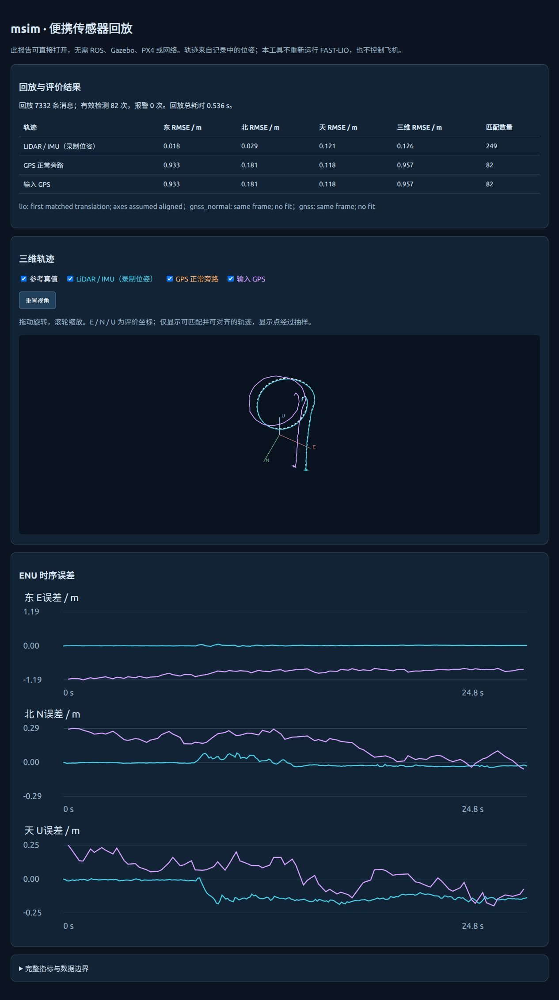

# 便携回放核心：第一阶段

2026-11-26。分支 `codex/portable-replay-core`。

后续已增加统一实时仿真入口与 Bullet 物理试验，默认保留原有完整后端，见 [实时物理后端与验收](PHYSICS.md)。下文描述第一阶段的独立回放能力，FAST-LIO 位姿仍来自录制数据。

本阶段将一条可运行的数据回放、检测和评价链路从 ROS/Gazebo 中抽离。核心运行只依赖 Python 3.10+ 和 NumPy；读取原有 ROS1 bag 时增加可选的 `rosbags` 依赖。无需启动 ROS master、Gazebo、PX4，也无需安装 SciPy、PCL、RViz 或绘图库。

## 已实现与边界

| 能力 | 本阶段状态 |
| --- | --- |
| 独立 Python 包与命令入口 | `python -m msim` 或安装后的 `msim` |
| 数据格式 | JSONL 消息索引、逐帧 NPZ 点云载荷、完整性状态清单 |
| 时间 | 整数纳秒，分别保留采样和到达时间，按到达时间回放 |
| 算法 | 复用现有平面 IMU/GPS 新息检测器；ROS 旧接口改为兼容包装 |
| 评价 | 独立真值匹配、ENU/三维 RMSE、最大及末端误差、匹配与缺失计数 |
| 结果展示 | 单文件 HTML、可旋转三维轨迹、ENU 误差图、图层切换；无 CDN 或外部资源 |
| 原有数据导入 | 可选 `rosbags` 读取当前 msim ROS1 录包，无需 ROS 运行环境 |
| 跨平台测试 | 已加入 Windows、macOS、Linux 与 Python 3.10/3.12 CI 矩阵；当前只在本机 Linux 实测，远程矩阵尚未运行 |
| 动力学、传感器实时生成、PX4 接管 | 本阶段未迁移，继续使用原有完整仿真入口 |
| FAST-LIO2 解算 | 本阶段不重新执行；回放录包中的已解算位姿用于评价 |
| 现有网页三维工作台 | 保留原入口；本阶段另提供可离线打开的结果报告，没有将实时 ROS 服务整体替换 |

## 安装

在仓库根目录，用目标 Python 环境执行：

```bash
python -m pip install .
```

需要导入现有 ROS1 录包时：

```bash
python -m pip install ".[bag]"
```

可先用 `python -m venv .venv` 建立独立环境，再使用该环境的 Python；Windows 与 Linux/macOS 的环境启动路径不同，但下面的模块命令相同。核心包位于 `msim/`，不会导入其他 ROS 适配器。

## 最小示例

```bash
python -m msim demo --output build/portable-demo
python -m msim inspect --input build/portable-demo
python -m msim replay --input build/portable-demo --output build/portable-result
```

直接打开 `build/portable-result/report.html` 查看三维轨迹和 ENU 图。`demo` 是确定性的 IMU/GPS 与预计算位姿测试数据，不是新物理仿真器，不包含 FAST-LIO 实时解算或实际 LiDAR 扫描。默认在中段加入位置阶跃和拖移；`--no-attack` 可生成正常对照，`--seed` 控制随机序列。

`--rate 0` 为尽快回放，`--rate 1` 按记录到达时间运行，`--rate 2` 为二倍速。报告的 `processing_wall_s` 包含文件读取、可选点云校验和限速等待，不是 FAST-LIO 或单次检测的耗时基准。当前提供时钟 API 和回放速率，尚未提供交互式暂停/单步控制台。

输入、转换和结果目录必须不存在，工具拒绝覆盖已有结果。中途失败的转换记录保留 `complete=false`，读取器会拒绝把它当作完整记录。`Ctrl+C` 可中止回放，输入数据不会被修改。

## 导入已有机场录包

```bash
python -m msim import-bag \
  --input /media/wzb/Elements/msim/runs/uav-px4-20261125-153145 \
  --output build/portable-ksql --duration-s 25 --include-clouds

python -m msim replay \
  --input build/portable-ksql --output build/portable-ksql-result \
  --align-lio-translation --assume-aligned-axes --verify-clouds
```

`--input` 也可直接指向 `sensors.bag`。省略 `--duration-s` 导入全部可用时间；默认不导入体积较大的原始点云，`--include-clouds` 才逐帧保存。省略 `--verify-clouds` 时回放点云消息元信息，不逐帧解压载荷，不会假装正在执行 LiDAR 定位。

当前适配器只针对本平台的 ROS1 话题与语义，不是任意录包的通用坐标转换器：

| 话题 | 核心消息与坐标 |
| --- | --- |
| `/imu/data` | `imu`，机体 FLU，姿态按本平台定义为机体到 ENU |
| `/msim/spoofed_gnss_odom` | `gnss`，最终输入 GPS，ENU，天线参考点 |
| `/msim/normal_gnss_odom` | `gnss_normal`，同次飞行的正常旁路，不参与检测器更新 |
| `/ground_truth/state` | `truth`，ENU，机体参考点，仅评价使用 |
| `/Odometry`、`/loose_odom` | `lio`、`loose`，保留原始坐标系与录制位姿 |
| `/velodyne_points` | 可选原始点云，保留所有标量数值字段，包括已有 ring/time，不合成时间 |

当前 Mid-360 的 Livox CustomMsg 及注册点云话题尚未加入此转换器。使用其他设备或话题时需增加显式映射，不能将任意坐标系直接改名为 ENU。

GPS 评价默认使用本平台天线杆臂 `[0.05,0,0.04]` m，将参考真值从机体转换到天线位置；自定义安装使用 `--antenna-offset X Y Z`。该修正只进入评价，检测器不读取真值。

### 坐标对齐

默认仅评价相同坐标系的轨迹。LIO 的 `camera_init` 与真值 ENU 不同，因此默认跳过并报告原因。

- `--align-lio-translation`：仅在评价时按首个匹配位姿做平移对齐；不拟合旋转或尺度，也不改变算法输入。
- `--assume-aligned-axes`：显式确认不同坐标系的轴向一致，必须配合前一参数。适用于已核对起飞朝向的当前 KSQL 数据；它不能修复真实的航向差。
- 未确认轴向时，保留跳过结果，不输出貌似精确的跨坐标系 RMSE。

评价匹配默认容差 50 ms，采用有界缓冲内的最近采样时间，同距优先过去样本。检测独立使用 GPS 采样时刻之前、50 ms 内的 IMU，不使用未来 IMU。无姿态、错误坐标、缺少可用 IMU 或时间倒退都会计数；不通过改写时间戳掩盖问题。

## 数据格式

```text
portable-recording/
├── manifest.json        # 版本、来源、计数、complete 状态与评价元信息
├── events.jsonl         # 按 arrival_ns 排序，流式读取
└── clouds/              # 仅导入点云时存在
    └── 00000001.npz
```

```json
{"schema_version":1,"stamp_ns":1000000000,"arrival_ns":1200000000,"kind":"gnss","stream":"gnss","frame":"enu","data":{"position_m":[1,2,3],"point":"antenna"}}
```

`stamp_ns` 是采样时间，`arrival_ns` 是消息可用时间。本例保留 200 ms 延迟。允许 ROS 消息交付顺序导致的短时“采样时间晚于已收到时钟”情况，但不会将消息采样时间覆盖为回放时间。

- 位移/速度/加速度/角速度采用 SI 单位，四元数顺序为 XYZW。
- `pose` 必须区分 `body` 与 `antenna` 参考点。
- 原始点云逐点时间字段保持原始名称、单位、数值和数据类型；`PointCloud2.time` 的单位应由对应源话题定义解释，不能假定所有设备一致。
- 点云路径必须是记录内部的相对路径，读取时禁用 pickle；当前格式不是 MCAP，后续可在相同核心消息结构上增加 MCAP 适配。
- 数据和图表缓存有界；当前不是全局点云建图器，也不替代超大地图的分块管理。

## 输出

| 文件 | 内容 |
| --- | --- |
| `detector.jsonl` | 每次有效检测的采样/到达时间、IMU 年龄、新息及报警状态 |
| `position-errors.csv` | 可匹配轨迹的 ENU 误差和对应参考位置 |
| `summary.json` | 消息数量、匹配方法、误差指标、跳过原因及执行范围 |
| `report.html` | 不联网的可交互三维轨迹和 ENU 图表 |

只有 demo 中明确给定的攻击标签才用于统计攻击期间报警比例和正常期间误报比例，且只在检测之后用于评价。实际导入录包默认标签未知，不把没有标签的数据当作“无攻击”，也不把报警比例当作已校准检测概率。

## 本轮验证

- 独立 `build/portable-env` 环境只安装核心包与可选 bag 依赖，运行时没有导入 `rospy`、`rosbag`、`rclpy`、SciPy 或绘图库。
- 实际机场源录包前 25 s：7,332 条消息，4,166 条 IMU、2,500 条真值、250 条 LIO、83 条最终 GPS、83 条正常 GPS、250 帧原始点云。
- 点云载荷逐帧校验通过；LIO 有 249 个真值匹配，首帧平移对齐后的 ENU RMSE 为约 `[0.018,0.029,0.121]` m；82 次有效检测、0 次报警、1 次因缺少过去 IMU 跳过。这里只验证回放和适配，不宣称新的检测性能。
- 原 95 项回归测试通过；新增 13 项便携测试通过，覆盖时间、坐标、杆臂、点云组织/字节序、真值隔离和原生 ROS1 序列化转换。跨系统 CI 结果需实际推送运行后才能确认。



## 后续扩展

先保持旧 Gazebo/PX4 入口用于对照，再依次增加：独立传感器/控制接口、轻量物理后端、FAST-LIO 核心适配、MCAP 记录及子地图流式加载。当前不宣称已经完成整个仿真与飞控链路的原生跨平台迁移。

参考：[Rosbags 独立于 ROS 的读取接口](https://ternaris.gitlab.io/rosbags/)、[AnyReader 使用方法](https://ternaris.gitlab.io/rosbags/topics/highlevel.html)。

本轮小型验证记录：[replay-validation-20261126.json](data/replay-validation-20261126.json)。独立 wheel 安装后使用 `python -I` 再次回放成功，确认运行的是已安装包而非工作目录导入。
