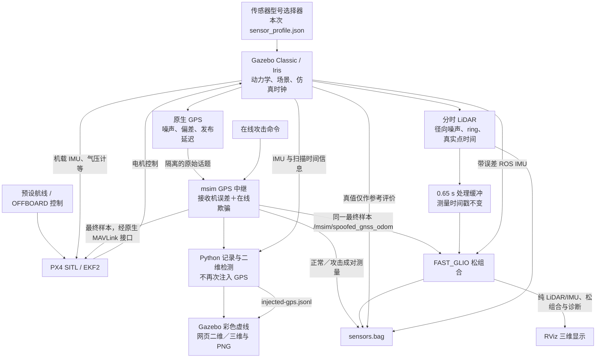
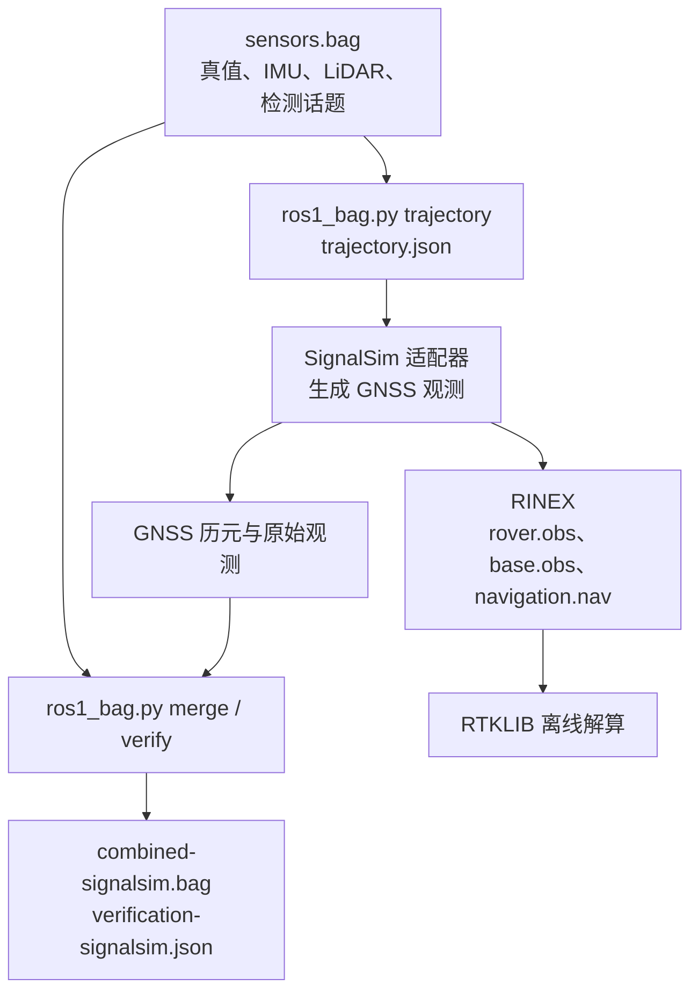

# PX4 航线欺骗实验：当前架构

2026-11-22 更新。当前采用 Gazebo Classic、PX4 SITL、原生带噪 GPS 中继及分时 LiDAR；SignalSim、RINEX 和 RTKLIB 仍位于采集后的离线链路。参数型号与运行命令见 [传感器快速切换](SENSOR_SWITCHING.md)。旧 PPTX 架构图尚未同步本次更新。

## 实时闭环与监看



原生 GPS 插件保持安装，通过 `msim_gps_raw` 隔离原始 Gazebo Transport 话题。中继保留其随机误差与发布时间，并基于采样仿真时间应用攻击；只将最终样本发布到 MAVLink 接口订阅的 `gps0`，防止原始与攻击 GPS 双源交替。ROS 的最终位置与 PX4 来自同一次测量；经纬度在 MAVLink 中有整数化误差。

正常带噪 GPS、受攻击 GPS、采样／发布时间与注入偏移分别记录。正常测量是同一真实飞行上的旁路数据，不是重新飞行的无欺骗组。检测器不读取正常旁路值来作真值判断；仅使用受攻击水平 GPS 与带误差 IMU。报警只显示与记录，不接管飞控。

## LiDAR 时间与处理缓冲

默认 16 线、10 Hz，可切换 32／64 线均匀参数模型，以及使用官方扫描方向序列的 Mid-360 模型。独立 C++ 插件在不同物理时刻分批求交，输出 `/velodyne_points`，字段包含 XYZ、intensity、ring、time。Mid-360 另发布原生 `/livox/lidar`，缓冲后通过 `/msim/livox_lidar_for_fusion` 进入 FAST-LIO Livox 前端。2 ms 步长下帧内时间跨度约 98 ms；时间表示真实求交批次，不是给快照后补一圈时间。测距径向噪声标准差 0.02 m、量化 0.001 m。另有快照模式用于对照。

在线估计器为了等待原生延迟 GPS 的相邻样本，默认延后 0.65 s 处理 LiDAR，原始帧时间与逐点时间保持不变，IMU 在估计器内缓冲。显示的是有明确处理延迟的实时估计。二维检测的 LiDAR 配对仍检查 GPS 采样时刻之前的扫描，年龄阈值 200 ms；这一状态不等同于 LIO 算法内部的全部同步质量。

白色是真值，蓝色为实际 GPS 测量（包含高度误差），绿色为二维检测器估计（高度借用真值），黄色为航线，紫色为攻击偏移示意。旧版本所有标记共享真值高度的限制已对 GPS 标记解除。网页与 Gazebo 都使用最终 GPS 高度。

## 采集后的离线链路



这条链路在飞行结束后运行。**SignalSim 观测目前没有实时送入 PX4**；PX4 在线接收的是保留原生噪声与延迟，并叠加接收机误差和可控偏移后的 GPS 样本。因此 `combined-signalsim.bag` 中的 GNSS 观测和在线欺骗输入应分别解释。

## 运行入口与结果

终端一启动自动跟随最新实验的页面：

```bash
cd /home/wzb/msim
/usr/bin/python3 tools/spoof-live-dashboard.py --follow-latest /home/wzb/msim/runs
```

终端二启动“预设航线中途受骗”的演示：

```bash
cd /home/wzb/msim
./tools/px4-uav-capture.sh --duration-s 60 --gazebo-viz \
  --flight-pattern route --spoof-start-s 20 --spoof-east-rate-mps 0.18
```

若要同时运行 FAST_GLIO 松组合并把 Gazebo、RViz 左右排列，将 `--gazebo-viz` 改为 `--fastglio-live`。后者会自动启用在线 GPS 注入和 Gazebo 窗口，RViz 显示纯 LiDAR/IMU、松组合及输入 GPS 三条轨迹。运行结束生成 `fastglio-live-3d.png`。

打开 [本机监看页](http://127.0.0.1:8765/)；仿真期间 Gazebo 显示无人机和轨迹，采集到时 Gazebo 自动关闭。每次运行自动建立新的 `runs/uav-px4-时间戳/` 目录。主要文件：

| 文件 | 用途 |
| --- | --- |
| `route_plan.json`、`controller.log` | 本次航点快照与 OFFBOARD 指令日志 |
| `injected-gps.jsonl`、`injector.log` | 逐历元真值、注入偏移、假 GPS、检测结果 |
| `gazebo-viz.log` | Gazebo 可视化标记状态 |
| `fastglio-live-report.json`、`fastglio-live-3d.png` | 实时松组合验收与可导出效果图（使用 `--fastglio-live`） |
| `sensors.bag`、`trajectory.json` | 原始传感器与真值轨迹 |
| `px4-flight-report.json`、PX4 ULog | 解锁、OFFBOARD、GPS 接收及注入匹配验证 |
| `signalsim/`、`combined-signalsim.bag`、`verification-signalsim.json` | 离线 GNSS 观测与同步质量检查 |

当前检测器是二维位置／速度 Kalman 创新原型，**不是完整的 15 状态 ES-EKF**。慢速、连续的拖移可能使真实飞机明显偏航却不触发报警；已有航线演示出现过这种漏检。实现与参数说明见 [PX4 接入说明](README.md)。
