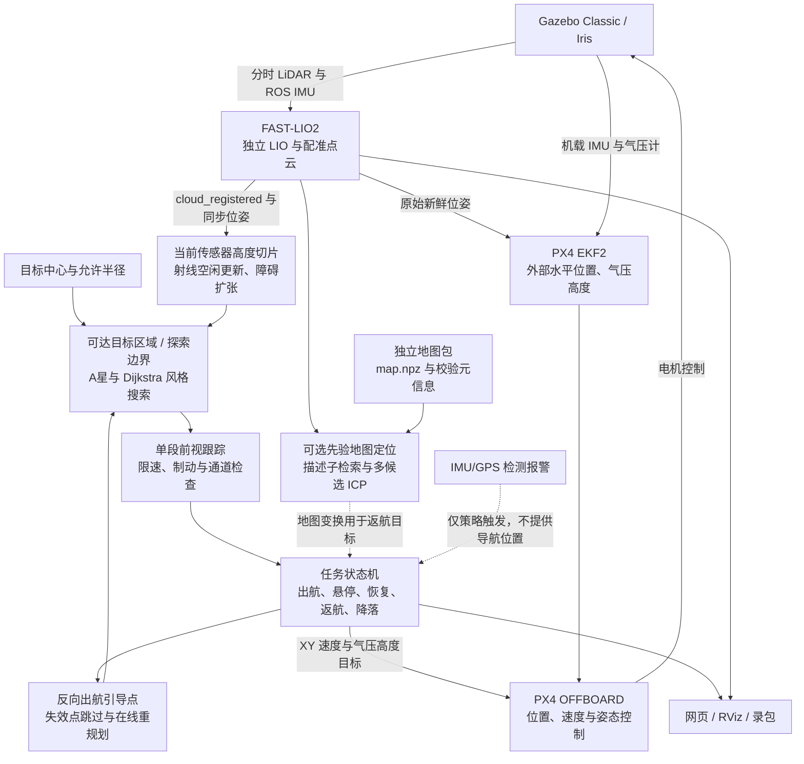
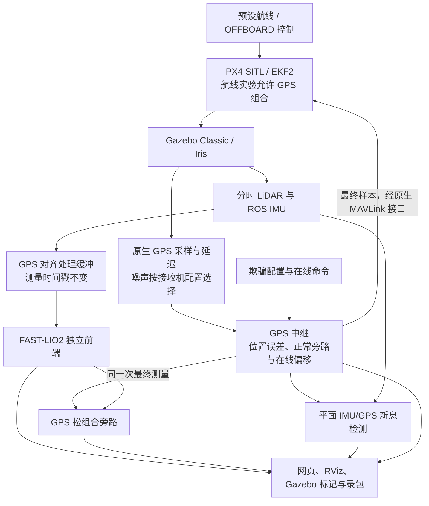
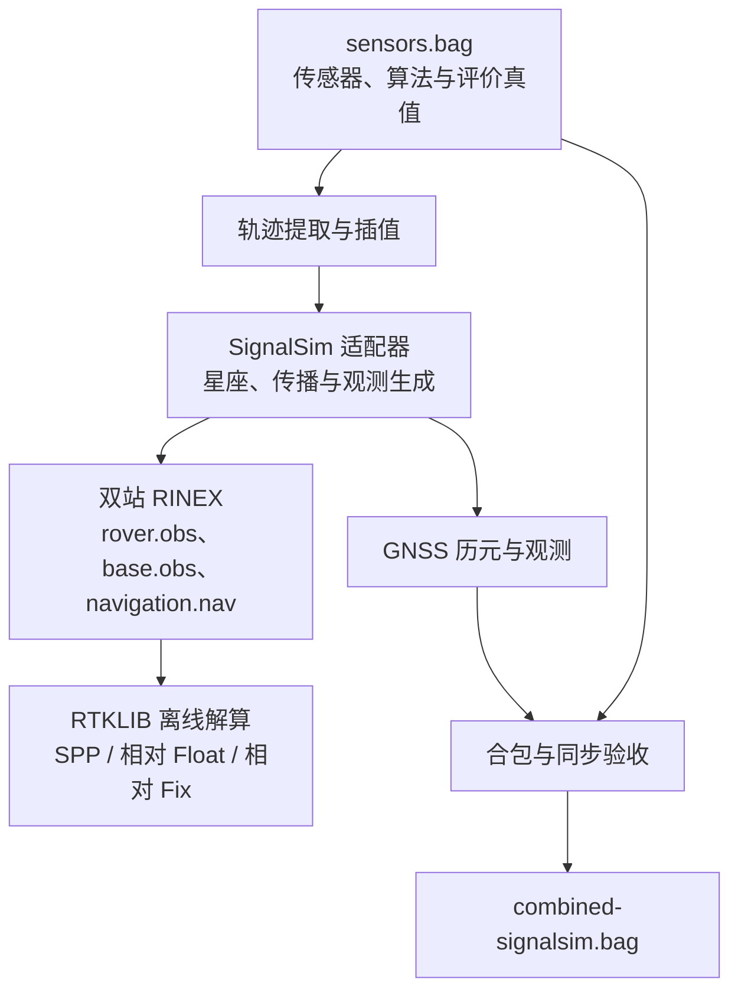

# msim 当前架构与运行模式

2026-11-25 更新。总览与启动示例见[仓库 README](../../README.md)。本页区分 GPS 航线实验、自主探索返航和离线 GNSS 观测链路；模式通过同一个采集脚本选择。

## 系统分层

| 层级 | 实现与职责 |
| --- | --- |
| 场景与物理 | Gazebo Classic、Iris、PX4 仿真接口；城市走廊、复杂街区、工业场地与 KSQL 机场 |
| 传感器生成 | 机载 IMU/气压计、ROS 带误差 IMU、分时射线 LiDAR、GPS 原始测量与中继 |
| 定位与地图 | FAST-LIO2、可选 GPS 松组合旁路、点云体素保存、可选先验地图匹配 |
| 规划与任务 | 高度切片栅格、边界探索、A*、跟踪、恢复、返航与降落状态机 |
| 控制闭环 | 单个 MAVLink 控制进程、PX4 EKF2、原生位置/速度/姿态控制器 |
| 展示与记录 | 网页 Three.js、RViz、Gazebo 标记、ROS bag、JSON/JSONL 与 PX4 ULog |
| 离线评价 | 真值误差、定位源与落地检查、碰撞网格采样、SignalSim 与 RTKLIB |

## 1. 目标自主探索与返航闭环

入口：`px4-uav-capture.sh --goal-enu E N U`；加入 `--web` 使用网页。`--goal-radius-m` 指定允许区域，`--localization-map` 可选择先验地图。旧 `--autonomy` 无目标参数时运行短距出航/返航基线，未启用本节的目标探索规划。

### 定位与控制边界

- `EKF2_GPS_CTRL=0`、`EKF2_EV_CTRL=1`、`EKF2_HGT_REF=0`：本模式从起飞前使用 LIO 水平位置和气压高度，GPS 仍记录与显示；检测报警可触发返航。
- `px4_autonomy.py` 同时负责外部位姿与 OFFBOARD 指令，避免多个控制进程争用 MAVLink。坐标转换依据初始 PX4 与 LIO 姿态建立；当前 KSQL 目标水平坐标按 ENU 约定使用，尚未标定为精确大地坐标。
- `fusion-delay-s` 在自主模式设为 0，GPS 松组合关闭；不会为了等待延迟 GPS 而推迟反馈 LIO。原始 LIO 时间戳保留，过期位置不改写成新测量。
- 重定位结果用于地图到里程计坐标转换和返航目标，不直接把地图匹配跳变作为飞机运动反馈。
- 真值不输入 LIO、重定位或在线规划。飞行结束后才用真值及独立场景网格核验。

### 规划、跟踪与恢复

栅格分辨率 1 m，正常障碍扩张 2 m，并考虑栅格离散范围。巡航地图在到达高度后开始构建，射线只清除实际回波之前、当前同步传感器高度上下 2 m 内的空间。没有回波的方向保持未知，已有障碍保守累计；尚未建模动态障碍移除。

目标已知可达时使用 A*，否则搜索已观测可达区域，在目标距离、路径长度、未知邻居和重复访问惩罚之间选择探索边界。目标允许区域内只有已观测、位于障碍安全区之外的候选位置才能作为到达位置。

控制器在单个路径段内最多前视 3 m，检查扩张栅格、当前点云及制动方向，限制速度和指令加速度。进入扩张安全边界后，仅尝试已观测空闲区域内的单调增距退回，最多搜索 6 m，速度上限 0.5 m/s，并保留 0.8 m 的障碍栅格箱体最小间距。实际占据、未知区域或不可验证退路不会被强制放行。

返航使用反向出航点作为引导，再用当前地图规划。安全直线走廊中可合并密集引导点；中间引导点失效时跳过并重新规划，起飞点保留为最终目标。到达判定分开检查水平距离和气压高度，避免 LIO 天向漂移阻止返航完成。降落时停止巡航规划，网页展示最终完成或失败原因。

该实现为固定气压高度下的水平导航；未加入自主升高越障、完整三维轨迹优化、EGO-Planner 或完整 Scan Context++。先验地图重定位借鉴环形描述子检索，采用点到点 ICP、SVD、多候选歧义检查和两次一致确认；不代表已验证任意六自由度搬移或 LIO 重启恢复。

[目标任务参数、完整实测及限制](GOAL_EXPLORATION.md) · [先验地图制作与短距返航](AUTONOMOUS_RETURN.md)。

## 2. GPS 航线欺骗与松组合实验

入口：`--flight-pattern route --spoof-start-s ... --spoof-east-rate-mps ...`；使用 `--fastglio-live` 或 `--web` 可同时运行定位与显示。

原始 Gazebo GPS 话题隔离为 `msim_gps_raw`。中继只向 MAVLink 订阅的 `gps0` 发布最终样本，防止原始与攻击 GPS 交替进入飞控；ROS GPS 与 PX4 来源一致，经纬度整数编码会有量化差异。

默认 `f9p-dgnss-ucr` 使用公开 ZED-F9P 码差分 DGNSS 实验的白噪声与一阶高斯—马尔可夫位置误差参数，报告方差与生成参数统一。保留原生采样节奏和延迟，但关闭原生位置噪声以避免重复叠加，也关闭未标定遮挡放大。`native` 与历史 `standalone` 等模式按配置保留原生误差；`standalone` 的天空遮挡公式明确标为未标定经验模型。[接收机参数与出处](GNSS_RECEIVER_MODEL_20261123.md)。

正常与受攻击测量是同一次真实飞行上的成对数据，不是分别飞行的有欺骗/无欺骗组。检测器仅使用受攻击水平 GPS 和带误差 IMU，不读取正常旁路值作真值判断。检测使用平面位置/速度 Kalman 预测、新息卡方检验、滑动窗口与短时独立惯性预测；慢速拖移仍可能漏检，窗口统计量尚未完整标定。

普通航线模式的报警仅显示和记录，不自动接管飞控；自主模式的报警返航属于另一套显式策略。GPS 松组合采用位置量测的 EKF 风格更新与平滑修正，当前 `feedback_to_lio=false`、`map_use_loose=false`，保留独立 LIO 与地图分支。

## 3. LiDAR 时间、误差和数据对齐

默认分时扫描插件在不同物理时刻分批射线求交，输出 `/velodyne_points` 的 XYZ、intensity、ring、time；Mid-360 使用官方方向序列并另发 `/livox/lidar`，自动选 Livox 前端。型号均为配置驱动的几何传感器模型。2 ms 物理步长下，一帧点时间跨度约 98 ms；默认径向噪声 0.02 m、量化 0.001 m，可选择快照模式对照。

GPS 组合实验默认延后 0.65 s 处理 LiDAR，等待原生延迟 GPS 的相邻样本；帧时间和逐点时间不改变。自主控制关闭该处理延迟。逐历元 LiDAR/GPS 同步日志另检查 GPS 采样时刻之前的扫描，年龄阈值 200 ms；它不能替代算法内部完整的同步检查。

ROS IMU 加入白噪声、上电偏差及一阶高斯—马尔可夫慢变项；PX4 的机载 IMU/气压计与 ROS 供 LIO 使用的测量链路应分别解释。[传感器切换与配置](SENSOR_SWITCHING.md)。

## 4. 网页、日志与独立验收

网页使用 Three.js/WebGL，分别显示算法 `camera_init` 点云坐标与 Gazebo ENU 场景坐标；两者不直接混画。点云体素累积保存完整 `map.pcd`，浏览器按显示预算抽样。导航状态、目标区域、规划线、返航线、LIO 数据年龄和暂停原因由状态接口提供。

“运行日志”每 2 秒刷新，只读取本轮固定名单文件的末尾 64 KB，可下载片段。状态超过 3 秒未更新会显示过期；已完成记录展示为预览并禁用飞行操作。网页修改场景/目标只生成下次启动的命令，不会热切换正在飞行的场景或目标。

| 输出 | 验证内容 |
| --- | --- |
| `navigation-report.json` | 控制器阶段、目标到达、返航完成及失败原因 |
| `autonomy-verification.json` | 真值目标误差、落点误差、PX4 空中定位源和落地上锁 |
| `mesh-clearance-verification.json` | 独立读取 KSQL 网格的巡航采样间距，不是连续扫掠体积证明 |
| `fastglio-live-lio-error.json` | 首帧平移对齐后的独立 LIO ENU 误差 |
| `controller.log`、`fastglio-live.log`、PX4 ULog | 控制、算法、飞控原始诊断依据 |

最新完整机场任务的目标为 E=100、N=300、U=12 m，允许半径 5 m。真实水平到达误差 4.794 m，落点误差 0.443 m；482 条空中 EKF 记录均使用外部水平定位与气压高度，未组合 GNSS。[完整结果与小型报告](GOAL_EXPLORATION.md#本轮完整回归结果)。该次结果不代表任意目标的统计成功率。

## 5. 采集后的离线 GNSS 链路

SignalSim 观测当前没有实时送入 PX4。城市传播与反射参数尚未按真实材料和接收机标定，仿真中的高 FIX 率不能直接解释为真实城市精度。[离线集成与复现](../gnss/SIGNALSIM-FASTGLIO.md)。

## 核心代码入口

| 文件 | 职责 |
| --- | --- |
| [`tools/px4-uav-capture.sh`](../../tools/px4-uav-capture.sh) | 模式选择、依赖环境、采集与后处理；启动私有脚本副本避免运行中编辑干扰 |
| [`exploration_planner.py`](../../adapters/ros1_noetic/fast_glio_uav/exploration_planner.py) | 栅格、搜索、跟踪通道、退回和返航引导 |
| [`px4_autonomy.py`](../../adapters/ros1_noetic/fast_glio_uav/px4_autonomy.py) | 外部定位、MAVLink 控制与任务状态机 |
| [`autonomy_core.py`](../../adapters/ros1_noetic/fast_glio_uav/autonomy_core.py) | 描述子、ICP、重定位确认和几何工具 |
| [`px4_live_loose.launch`](../../adapters/ros1_noetic/fast_glio_uav/px4_live_loose.launch) | FAST-LIO2 与可选松组合配置 |
| [`web-sim-console.py`](../../tools/web-sim-console.py) | 网页状态、点云、场景资源与只读日志接口 |

旧 PPTX 架构文件与历史实验报告保留当时版本，本页和仓库 README 为当前实现说明。
