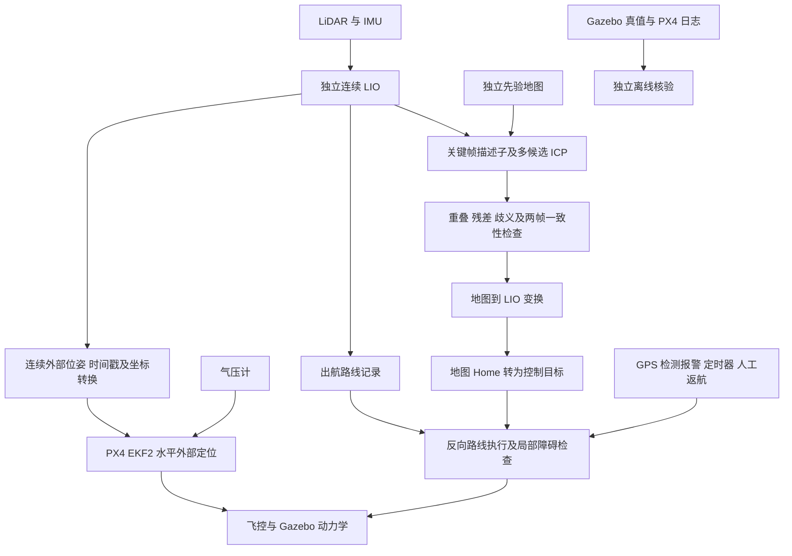
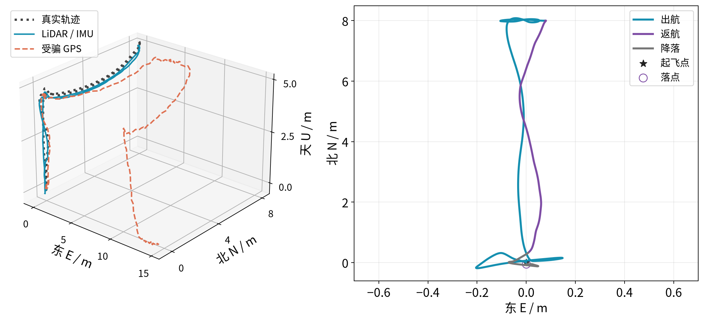

# 无人机重定位与自主返航运行说明

指定远距离目标、实时探索和规划的新模式见 [KSQL 目标点自主探索与返航](GOAL_EXPLORATION.md)。本文主要说明短距离返航与先验地图重定位基线。

平台新增显式选择的 `--autonomy` 仿真实验模式：独立 LiDAR/IMU 定位反馈 PX4，自动起飞和短距离出航，再沿记录路线返回起飞区域并降落。可以加载提前采集的先验地图进行重定位。默认手动采集及 GPS 松组合模式保持原有行为。

已完成城市走廊场景的无欺骗、有欺骗闭环飞行，以及错误地图禁止起飞测试。当前版本从起飞前就排除 GPS 定位，飞控使用 **LIO 水平位置和气压计高度**；尚未验证飞行途中由受骗 GPS 导航切换到 LIO 的接管过程。

## 快速运行

先结束已有的 Gazebo/PX4 采集任务。以下命令会自动解锁起飞，无须点击网页起飞按钮：

```bash
cd /home/wzb/msim
./tools/px4-uav-capture.sh --autonomy --web --scene simple \
  --teleop-height-m 5 --autonomy-distance-m 8 --return-after-s 40
```

浏览器打开 `http://127.0.0.1:8766/`。右侧显示自主导航状态、重定位状态、外部定位帧数和“立即返航”按钮；点云视图中浅绿色线表示剩余返航路线。网页可以生成下次启动的自主模式命令。该命令默认不加载先验地图，运行的是连续 LIO 加原路返航基线。

希望同时显示 Gazebo 和 RViz 时，去掉 `--web`；希望后台运行时使用 `--headless`。RViz 配置增加 `/msim/return_path` 浅绿色返航路线。测试结束后保存 bag、地图、控制日志和自动核验报告。已完成结果可单独预览：

```bash
/usr/bin/python3 tools/web-sim-console.py \
  --run /media/wzb/Elements/msim/runs/uav-px4-20261125-095326 --port 8768
```

完成后的预览禁用飞行控制。实时网页随采集进程退出；需要回看时使用上面的独立预览命令。

## 创建并使用先验地图

先运行一次无先验地图的采集，完成后从其 bag 建立地图包。建图仅使用 `/Odometry` 和 `/cloud_registered`，查询飞行使用另一次独立采集：

```bash
source /home/wzb/FAST_GLIO/devel/setup.bash
python tools/build-relocalization-map.py \
  --run /media/wzb/Elements/msim/runs/uav-px4-20261125-094311 \
  --output /tmp/msim-prior-map
```

输出目录必须尚不存在，工具不会覆盖已有地图。地图包包括 `map.npz` 点云与索引，以及 `map.json` 场景、地图起飞点、来源和校验值。上例来源包含 27 个关键帧、25,182 个地图点；实际复用的地图也保存在来源目录的 `relocalization-map/` 下。

```bash
./tools/px4-uav-capture.sh --autonomy --web --scene simple \
  --teleop-height-m 5 --autonomy-distance-m 8 \
  --return-after-s 40 --autonomy-timeout-s 130 \
  --localization-map /tmp/msim-prior-map \
  --spoof-start-s 25 --spoof-east-rate-mps 0.3
```

这是位置域 GPS 欺骗实验。GPS 的正常和受骗测量仍发布、记录并显示，但不进入此模式的飞控定位。注入时间以仿真时间为准；`--return-after-s` 从解锁后开始计时。GPS 检测器在出航阶段持续报警超过 2 秒，也可提前触发返航；本次实测返航由定时条件触发，未验证报警触发分支。

地图必须覆盖起飞区域及查询航线。场景名称不一致或校验失败会拒绝启动。几何匹配不成立时禁止起飞。场景名称和哈希检查不能替代地图几何验证，也不能保证地图仍符合变化后的环境。

## 实现架构



| 模块 | 当前实现 |
| --- | --- |
| 地图制作 | 0.5 m 体素，1.5 m 间隔关键帧，地图最多 120,000 点 |
| 地点检索 | 12 环 × 36 扇区的高度跨度描述子，检索前 6 个候选，各尝试两个航向初值 |
| 几何配准 | 分阶段点到点 ICP，匹配距离依次为 3、1、0.5 m |
| 接受条件 | 重叠率 > 0.55、有效点残差 RMSE < 0.30 m；得分接近且位置相距 > 2 m 的候选视为歧义 |
| 连续确认 | 至少两次一致配准；地图修正平移差 < 0.6 m、旋转差 < 0.12 rad |
| 飞控接入 | MAVLink `VISION_POSITION_ESTIMATE`，只发送新鲜的原始 LIO；响应 PX4 时间同步请求 |
| 飞控配置 | `EKF2_GPS_CTRL=0`、`EKF2_EV_CTRL=1`、`EKF2_HGT_REF=0`；参数以 PX4 INT32 字节编码发送并核对回执 |
| 坐标处理 | 按初始 PX4 姿态与 LIO 姿态建立转换；高度基准切换稳定后重新锚定地面控制高度 |
| 目标执行 | 每次目标前视最大 1.2 m；出航每约 0.65 m 记录路线；返航到 Home 附近后 LAND |
| 异常处理 | LIO 超时、飞行范围越界和任务超时请求降落；定位失配或近端障碍先暂停，持续 15 秒则降落 |

描述子借鉴 Scan Context 的环形地点检索思路，但这是独立实现的工程基线，未接入 Scan Context++、TEASER、GICP 或 EGO-Planner。地图修正仅用于转换返航目标，不把地图配准跳变直接反馈为飞机运动。外部位姿使用工程设置的 0.1 m 标准差下限，尚未经过完整性校准。

状态主线为 `等待 LIO → 初始化 → 解锁 → 起飞 → 出航 → 返航 → 降落 → 完成`。先验地图 35 秒仍未确认时不解锁，输出 `prior_map_not_confirmed`。障碍检查只查询当前点云与近端线段的距离，少于 100 点或点云过期也暂停；这不等同于未知空间安全验证或三维避障规划。

## 参数与输出

| 参数 | 默认及范围 |
| --- | --- |
| `--autonomy` | 显式启用自动起飞及返航；自动启用 LIO 建图记录 |
| `--localization-map` | 可选先验地图目录；未提供则不执行地图重定位 |
| `--teleop-height-m` | 5 m；范围 0.5～30 m；本次验证 5 m |
| `--autonomy-distance-m` | 8 m；范围 2～30 m |
| `--return-after-s` | 解锁后 30 s；范围 15～120 s；推荐本次复现用 40 s |
| `--autonomy-timeout-s` | 150 s；至少比返航时间多 20 s，最多 300 s |
| `--fusion-delay-s` | 自主模式固定为 0，避免为 GNSS 插值等待而延迟反馈 LIO |

| 文件或话题 | 用途 |
| --- | --- |
| `controller.log`、`navigation-events.jsonl` | 控制器和状态切换日志 |
| `external-navigation-config.json`、`control-origin.json` | PX4 外部定位配置、转换和稳定后的高度锚点 |
| `navigation-status.json`、`/msim/navigation/status` | 实时导航与重定位质量 |
| `/msim/localized_odom` | `prior_map` 下经过地图修正的位置和姿态 |
| `/msim/return_path` | `camera_init` 下的返航路线，供 RViz 显示 |
| `navigation-report.json` | 控制器任务结论 |
| `autonomy-verification.json` | 真值落点、实际爬升/出航、ULog 空中定位源及降落状态的独立核验 |
| `capture-session.json` | `mode=autonomy` 和结束原因 |
| `fastglio-live-lio-error.json` | LIO 相对真值误差，首帧平移对齐 |

控制器不订阅真值；真值只用于仿真传感器生成、现有监看显示及独立评估。GPS 报警决策使用测量与 IMU，不使用监看消息中附带的真值坐标。

## 实际测试结果

以下为 2026 年 11 月 25 日城市走廊、VLP-16、默认 IMU/GPS 模型的单次运行结果，不是多随机种子的统计成功率。

| 采集目录尾号 | 条件 | 最大出航 / 爬升 m | 真值落点水平误差 m | 核验 |
| --- | --- | --- | --- | --- |
| `094311` | 无先验地图、无欺骗 | 6.05 / 5.06 | 0.282 | 返航及降落通过 |
| `094606` | 独立先验地图、GPS 东向渐进欺骗 | 8.23 / 5.11 | 0.135 | 地图确认、返航及降落通过 |
| `095326` | 最终版本复测、先验地图及欺骗 | 8.08 / 5.14 | 0.053 | 自动核验 `pass_all=true` |
| `095213` | 同场景但几何不匹配的地图 | 约 0 / 0 | 不适用 | 未解锁；定位拒绝符合预期，命令退出码 1 |

最终复测路径为 `/media/wzb/Elements/msim/runs/uav-px4-20261125-095326`。GPS 东向最大注入偏移为 14.3994 m，涵盖整个采集时段；真值落点误差取最后 0.5 秒机体位置均值与首个真值位置的水平距离。空中 63 条 EKF 状态记录均启用外部水平位置和气压计高度，均未启用 GNSS 位置、高度或速度。该场景下 LIO 三维 RMSE 为 0.167 m。

无欺骗基线返航计时设为 28 秒，因此实际出航约 6 米；另外两次设为 40 秒。这些结果验证链路是否运行，不能据此比较先验地图是否显著提高返航精度。



图左是首帧平移对齐后的 LIO、真值及受骗 GPS；图右按任务阶段显示真实运动。右图东、北轴显示范围不同，用于放大观察横向差异。

独立重算报告与展示图：

```bash
source /home/wzb/FAST_GLIO/devel/setup.bash
python tools/evaluate-autonomy.py --run /media/wzb/Elements/msim/runs/uav-px4-20261125-095326
python tools/plot-autonomy-result.py \
  --run /media/wzb/Elements/msim/runs/uav-px4-20261125-095326 \
  --output /tmp/autonomous-return.png
```

本节短距版本通过 70 项 Python 回归测试、网页按键和场景命令 Node 测试、Python/JavaScript/Bash 语法检查。完成记录的实际 HTTP 接口核验返回 `state=landed`、`armed=false`，并禁用飞行控制。后续目标任务扩展已完成浏览器视觉验收，当前测试与结果见 [KSQL 目标任务说明](GOAL_EXPLORATION.md)。

## 后续研究边界

当前实测仅覆盖短距离城市走廊。复杂街区、工业场地及 KSQL 可以选择相应场景，但需要重新采集地图、核对起飞区域和高度，不能把本次结果外推到公里级返航。重定位查询保持连续 LIO，主要考虑航向候选；尚未验证 LIO 重启、任意六自由度搬移、地图结构变化和大范围重复建筑。

下一阶段可先补充重复结构下的误接受测试、飞行中 GNSS 异常接管和局部重规划，再与成熟重定位方法做同条件对照。论文选型和参考资料见 [重定位与自主返航技术路线](RELOCALIZATION_RETURN_HOME_RESEARCH.md)。
