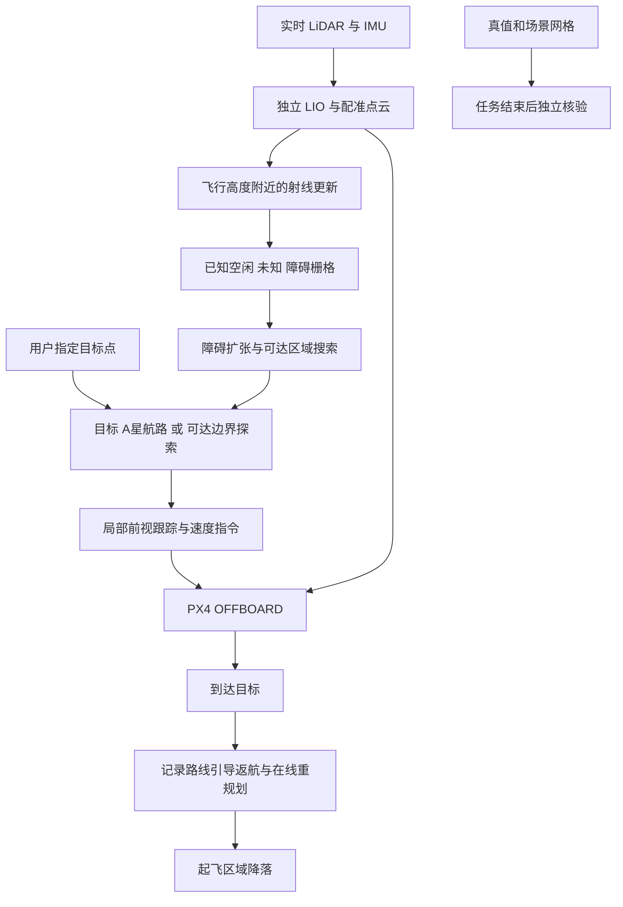
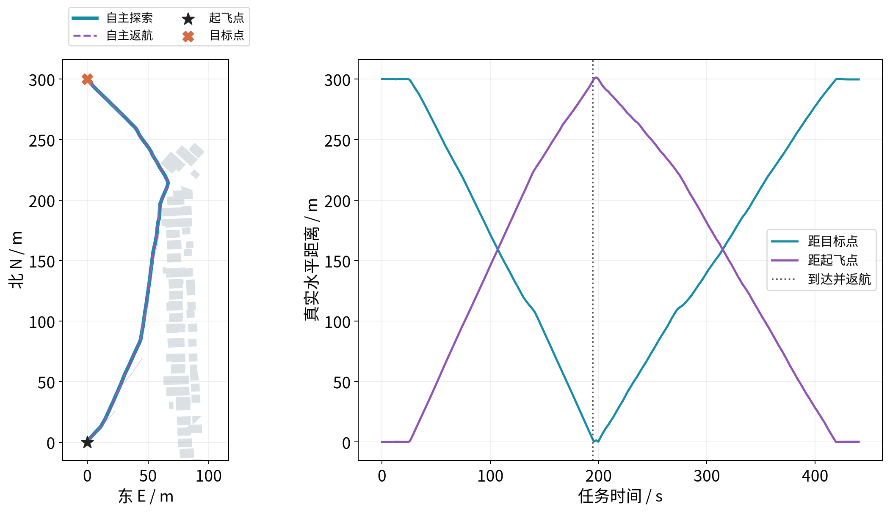
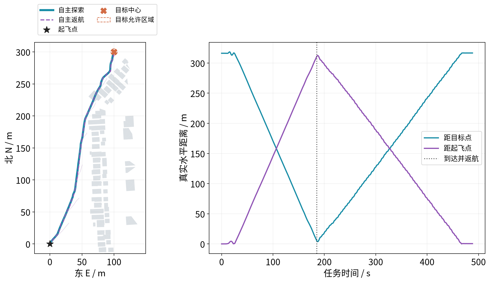
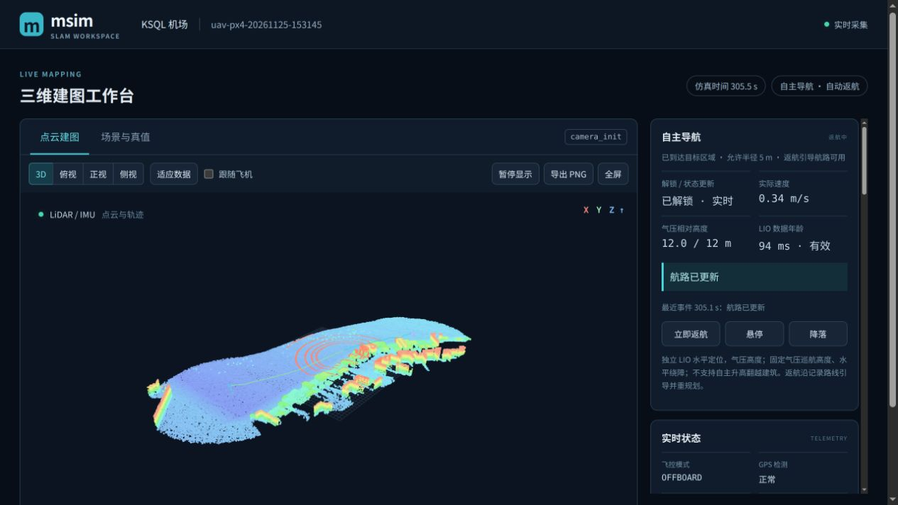
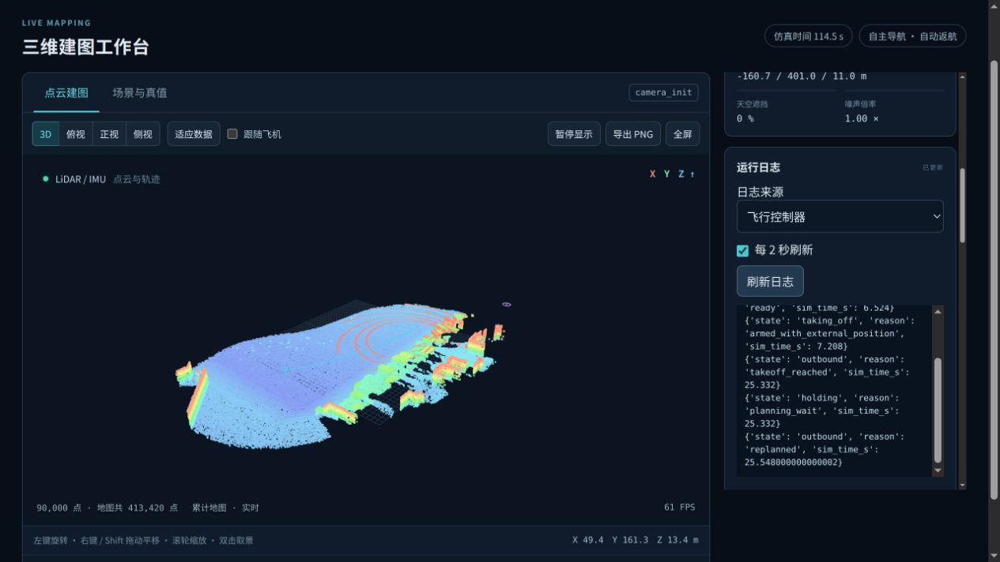
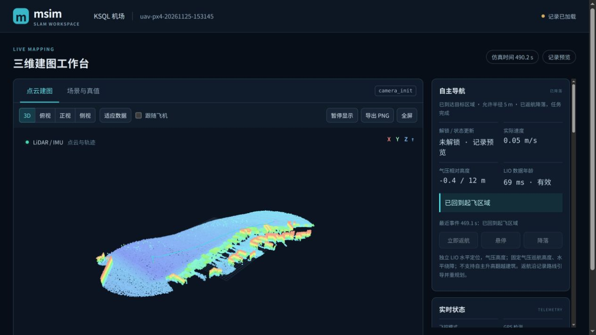

# KSQL 目标点自主探索与返航

目标任务允许只指定一个目标点：飞机自动起飞，通过实时 LiDAR 建立已观测的通行区域，选择探索方向和航路，到达目标后自主返航并降落。目标任务不读取 `ksql_airport.route.json`，也不读取 Gazebo 场景网格或真值来规划。

当前实现为固定巡航高度下的水平导航。目标尚未被观测时，飞机前往可达区域朝向目标的边界，继续扫描后重新规划；路径已被观测时使用 A*。高度方向暂不搜索，因此不能依靠自动爬升越过堵死的通道。

## 运行 KSQL 300 米任务

先结束已有 Gazebo/PX4 采集，再执行：

```bash
cd /home/wzb/msim
./tools/px4-uav-capture.sh --web --scene ksql_airport \
  --goal-enu 0 300 12 --mission-speed-mps 2 \
  --autonomy-timeout-s 900 --lidar-model vlp16 --point-filter-num 2
```

浏览器打开 `http://127.0.0.1:8766/`。命令会自动解锁、起飞并执行任务，不需要人工控制方向。`0 300 12` 表示相对起飞点向东 0 米、向北 300 米、巡航高度 12 米。目标坐标属于起飞点锚定的 LIO 水平坐标；当前 KSQL 固定起飞朝向按 ENU 约定使用，尚未标定为精确的大地坐标。它不是 Gazebo 绝对位置 `E=0,N=300`。

网页需要通过上述 HTTP 服务访问。直接以 `file://` 打开 `web/sim-console/index.html` 时，页面没有对应的数据服务。

网页“切换场景”中选择“目标点自主探索并返航”，输入目标东、北、高度、允许半径和速度，即可复制命令或下载启动脚本。输入用于下次启动，不会更改正在飞行的任务。点云视图的紫色航路为实时规划，浅绿色为记录的返航引导路线，紫色球标记目标中心，紫色圆圈为允许到达的水平区域；“立即返航”和降落按钮仍可中止出航。

去掉 `--web` 可同时运行 Gazebo 和 RViz；加入 `--headless` 可后台采集。RViz 的 `/msim/planned_path` 显示实时规划航路。

## 参数

| 参数 | 默认与含义 |
| --- | --- |
| `--goal-enu E N U` | 启用目标任务；水平距离 5～1000 m，U 为 3～30 m |
| `--mission-speed-mps` | 默认 2 m/s，范围 0.3～3 m/s；XY 速度指令限制，方向改变时约束指令加速度 |
| `--goal-radius-m` | 默认 2 m；可选 0.5～30 m，且小于目标水平距离的一半。范围内安全位置视为到达；另检查气压高度差小于 1.5 m |
| `--autonomy-timeout-s` | 目标任务默认 900 s，最多 3600 s；出航占用 60% 时间仍未到达时，提前返航并标记任务失败 |
| `--return-after-s` | 仅用于旧短距离演示，不作为目标任务的定时返航触发条件 |
| `--localization-map` | 可选；地图应覆盖整个任务区域，否则定位失配会中止任务 |

U 决定本轮固定巡航高度，并覆盖另行传入的 `--teleop-height-m`。飞控使用独立 LIO 水平位置和气压计高度，GPS 从起飞前即排除；GPS 仍正常记录与显示。当前模式尚未验证从受骗 GNSS 导航向该模式的飞行中切换。

## 在线导航过程



规划栅格分辨率为 1 m，障碍扩张距离为 2 m，并考虑栅格离散范围。射线只清除实际回波到达之前、位于当前同步 LIO 传感器高度上下 2 m 区间内的空间；没有回波的方向仍保持未知。点云每约 0.5 秒更新一次，单次射线插入限制为 60 m，局部探索搜索范围约 45 m。超过局部范围的目标通过移动、观测和重规划逐步接近。

A* 不穿越未知栅格，斜向移动也检查相邻角落。探索边界按目标距离、路径长度、信息边界及重复访问次数选择。目标跟踪在单个路径段上使用最多 3 m 前视，逐段过拐角，禁止跨多个段切角；每次控制还检查同一障碍扩张栅格、制动方向和当前点云 2 m 间距。目标尚不可通行时，不保证一定到达：规划长期无解会返航或中止，任务报告不会把“安全结束但未到目标”计为完成。

返航阶段将记录的出航点反向用作引导，再用累计观测的空闲栅格规划到下一个引导点。因此返航仍检查通行条件；它不是无检查地倒放位置。当前障碍以静态累计方式保存，对动态障碍的移除和清除尚未建模。

## 时序与失联处理

`/clock` 与 LIO 是独立 ROS 消息流，控制器收到它们的顺序可能不同。实际试飞曾出现位姿时间戳比本地已收到的 `/clock` 新 36 ms，被旧的单帧判断误认为失联而降落。修复后先读取位姿快照，再读取时钟，并允许最多 150 ms 的有界交付偏差；超过 0.5 秒的旧位姿仍不发送为新测量。

瞬时位姿不可用时先发送零水平速度维持 OFFBOARD 指令流；持续不可用超过 0.5 秒则请求 LAND。原始 LIO 时间戳始终保留，没有通过改写时间戳掩盖数据延迟。其他异常包括规划容量耗尽、地图失配、航程和高度越界及总任务超时。

## 输出和独立验收

| 输出 | 内容 |
| --- | --- |
| `navigation-status.json` | 导航阶段、目标、规划航路、已知空闲/障碍数量、规划耗时、LIO 数据年龄 |
| `/msim/planned_path` | LIO 坐标系实时规划路径 |
| `navigation-events.jsonl` | 起飞、探索、暂停、重规划、返航、降落事件 |
| `navigation-report.json` | 目标是否到达及返航任务是否完成 |
| `autonomy-verification.json` | 真值目标误差、真实落点误差、ULog 定位源与降落状态 |
| `mesh-clearance-verification.json` | 轨迹与独立读取的 KSQL 碰撞网格之间的采样间距 |
| `goal-mission-result.png` | 机场建筑投影、实际出航/返航轨迹、距离时序图 |

独立验收预先设置目标到达误差不超过 5 m、最终落点水平误差不超过 3 m；到达判定来自控制器的 LIO，验收误差则来自离线真值，两者分别记录。网格检查每 0.2 秒采样一次巡航阶段的机体中心，计算到三角面的距离，要求大于 0.6 m；结果以 3 m 截断的距离下界报告，不是连续扫掠体积的无碰撞证明。

```bash
source /home/wzb/FAST_GLIO/devel/setup.bash
python tools/evaluate-autonomy.py --run 采集目录
python tools/evaluate-mesh-clearance.py --run 采集目录
python tools/plot-goal-mission.py --run 采集目录
```

报告或图片也可用 `--output` 保存到其他目录，读取原始数据时不需要重跑飞行。

## KSQL 300 米闭环实测

2026 年 11 月 25 日使用 VLP-16、默认 IMU、无先验地图，执行本页的 `--goal-enu 0 300 12 --mission-speed-mps 2 --autonomy-timeout-s 900`。采集目录为 `/media/wzb/Elements/msim/runs/uav-px4-20261125-110517`。这是一轮完整闭环验证，不代表多随机种子的统计成功率。

| 项目 | 实际结果 |
| --- | --- |
| 自动到达并返航降落 | 完成，无人工方向控制 |
| 最大真实水平离家距离 | 301.265 m |
| 目标到达事件时的真实三维误差 | 2.220 m |
| 整段轨迹到目标的最小三维距离 | 0.385 m；与事件时误差分别报告 |
| 最终落点真实水平误差 | 0.256 m |
| 最大真实爬升 | 12.233 m |
| 传感器有效采集时长 | 约 439 s |
| 空中 PX4 EKF 记录 | 434 条；全部启用外部水平位置和气压计高度，全部未启用 GNSS 位置、高度或速度 |
| 机场网格间距采样 | 1,914 点；中心距离下界不小于 3 m，0.6 m 内采样点为 0 |
| 独立任务核验 | `pass_all=true` |

出航先探索东侧可达区域，再接近北侧目标。返航使用累计观测的地图与反向出航引导点，重新规划到起飞区域。图中灰色建筑只用于离线展示，未输入在线规划器。



核验文件：[任务与定位源核验](data/ksql-goal-autonomy-verification-20261125.json)、[网格间距核验](data/ksql-goal-mesh-clearance-20261125.json)、[导航任务记录](data/ksql-goal-navigation-report-20261125.json)。本次补充报告与图片保存在仓库 `docs/px4/`，原始 bag 和 PX4 日志仍在外置硬盘。任务预览可启动为：

```bash
/usr/bin/python3 tools/web-sim-console.py \
  --run /media/wzb/Elements/msim/runs/uav-px4-20261125-110517 --port 8769
```

网页已实际验证地图加载、已到达与已降落状态、目标数值修改后启动命令同步更新，以及完成记录禁用飞行控制。预览时显示约 71.8 万个保存地图点，浏览器按预算抽样显示 9 万点。

上述首轮版本通过 83 项 Python 测试，以及网页按键、场景命令和相关语法检查。回归测试包含射线未知区域处理、绕障 A*、300 米未知地图墙体绕行、三角面距离计算，以及长任务启动脚本不可变副本。

## 运行脚本修复

完整飞行与任务核验结束后，原启动进程曾在末尾报引号错误。当前文件本身通过语法检查；原因是在长任务运行期间修改了同一脚本，Bash 流式读取后续文本时使用了旧位置。现在每次启动先创建私有固定副本，任务执行期间仓库脚本的编辑不会改变正在运行的指令；结束后清理副本。该修复已用运行中改写源文件的回归测试验证，不需要改动已采集的数据。

连续未知空间探索、重复访问惩罚和 A* 属于工程基线，不构成已证明的论文创新。三维高度规划、动态障碍预测、完整性风险约束和飞行中定位接管仍是后续扩展方向。


## 目标允许区域、受阻恢复与网页日志（2026-11-25）

例如中心 E=100、N=300、U=12，允许半径 5 m：

```bash
./tools/px4-uav-capture.sh --web --scene ksql_airport \
  --goal-enu 100 300 12 --goal-radius-m 5 --mission-speed-mps 2 \
  --autonomy-timeout-s 900 --lidar-model vlp16 --point-filter-num 2
```

允许区域是水平圆盘。规划器只选择圆盘内已观测为空闲且位于障碍安全区之外的栅格；中心被建筑占据时，不再强求到中心。如果整个区域都不安全或未观测，不宣称到达，继续探索或按超时流程中止。区域由实时传感器验证，不读取场景真值提前宣称安全。网页输入只改变下次启动命令，不会在飞行中修改目标。

修复了原控制器跨路径段前视可能切角、规划 2 m 扩张而近端只检查 0.65 m 的不一致。进入扩张安全区时，仅可在已观测空闲空间内寻找最多 6 m 的退路，沿途障碍距离不得下降，障碍栅格箱体距离至少 0.8 m，速度限制 0.5 m/s；实际占据、未知区域和不满足间距的位置不会被强制放行。退出后恢复正常 2 m 安全区规划。没有可验证退路时保持悬停并按超时流程中止，不能保证所有位置都能脱困。

巡航地图在起飞到高度后才开始构建，避免将起飞地面作为巡航障碍永久累积。巡航切片跟随同步 LIO 高度，已有障碍仍保守累计；尚未实现完整三维体素规划或高度漂移校正。到达目标、返航引导点和起飞区域时，水平误差与气压高度分别判断，避免 LIO 天向漂移使飞机一直等不到“到达”。

网页侧栏顶部的“自主导航”显示解锁状态、飞控模式、实测速度、气压相对高度/巡航高度、LIO 数据年龄、目标中心水平距离、允许半径和规划/暂停原因。状态文件超过 3 秒未更新时明确显示过期；记录预览不会冒充实时状态。

“运行日志”可选导航事件、PX4 消息、控制器、FAST_GLIO、仿真启动和录包日志，每 2 秒刷新，单次最多读取末尾 64 KB，可下载当前片段。只允许读取本轮固定名单的日志，不接受任意路径。完整原文件位于页面显示的采集目录：

| 文件 | 用途 |
| --- | --- |
| `navigation-events.jsonl` | 自动起飞、出航、悬停、重规划、返航、降落原因 |
| `px4-events.jsonl` | 控制器接收到的 PX4 STATUSTEXT 消息及严重度 |
| `controller.log` | 控制器标准输出及异常堆栈 |
| `fastglio-live.log` | 定位与建图算法日志 |
| `ros-home/log/**/*.ulg` | 完整飞控二进制日志；退出归档后可用 Flight Review 等工具分析 |

目标区域的独立验收同时报告真实水平/垂直误差，水平容差为设置半径加 3 m 的定位评估余量，垂直容差 3 m；这些是仿真验收阈值，不等于控制器允许穿越障碍。ULog 缺失会报告“无法确认”，不再将没有日志直接解释为飞控实际未使用指定定位源。

返航的密集引导点只在已验证直线走廊中提前合并，并保持当前引导点稳定，避免逐点停车。后续地图更新若将旧的中间引导点判为障碍或未知，会跳过失效引导点并对后续点重新规划；起飞点本身不会被丢弃。这不意味着直接穿越旧点所在障碍。


## 本轮完整回归结果

运行目录 `/media/wzb/Elements/msim/runs/uav-px4-20261125-153145`，目标 E=100、N=300、U=12 m，半径 5 m，无先验地图、无欺骗。控制器于仿真 188.036 s 到达目标允许区域，约 490 s 完成返航降落、上锁；采集有效时长 487 s。`completed=true`，失败列表为空，独立验收 `pass_all=true`。

| 项目 | 结果 |
| --- | --- |
| 到达事件的真实水平误差 | 4.794 m，位于设定的 5 m 区域内 |
| 到达事件的真实垂直误差 | 0.035 m |
| 最终落点距起飞点的真实水平误差 | 0.443 m |
| 最大真实水平离家距离 | 312.437 m |
| 最大真实爬升 | 12.541 m |
| 空中 PX4 EKF 记录 | 482 条，全部使用外部水平定位与气压高度，全部未组合 GNSS |
| 独立碰撞网格采样 | 2,149 点，机体中心间距下界不小于 3 m（报告上限），0.6 m 内采样为 0 |
| 软件回归 | 95 项 Python 测试、网页按键与命令生成测试通过；语法和差异空白检查通过 |

该次验证完成了相同目标的往返，不代表任意场景、目标及随机种子都能完成。网格距离为离线采样核验，不是连续无碰撞证明。新的目标中心被占据、安全区退回、转角跟踪、失效引导点和小于栅格的目标半径均有单独回归测试；本次实际机场目标中心位于开放空间，未将“中心在建筑内部”的单元场景冒充机场实测。

报告：[独立验收](data/goal-region-autonomy-verification-20261125.json)、[导航记录](data/goal-region-navigation-report-20261125.json)、[网格间距](data/goal-region-mesh-clearance-20261125.json)。







结果预览与日志入口（不连接飞控）：

```bash
/usr/bin/python3 /home/wzb/msim/tools/web-sim-console.py \
  --run /media/wzb/Elements/msim/runs/uav-px4-20261125-153145 --port 8770
```

降落阶段停止更新巡航地图；网页在任务结束后显示完成/失败结果，不再把落地附近的地面障碍提示作为正在执行的避障状态。


