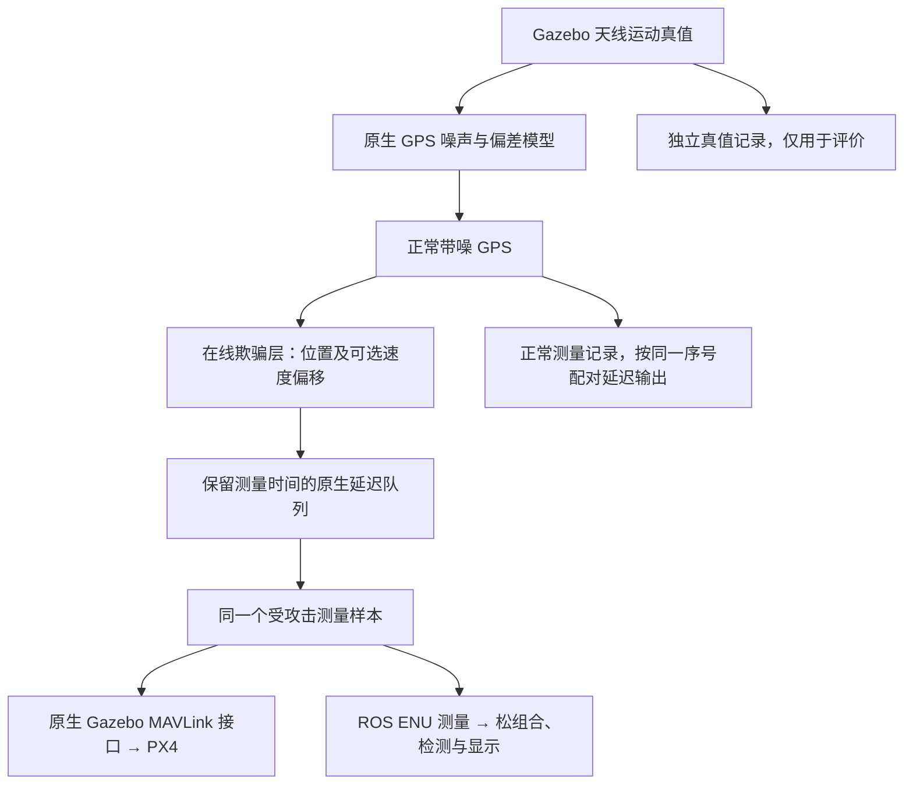

# 原生 GPS 在线欺骗接入与 LiDAR 选型设计（2026-11-19）

历史基线／设计记录：后续实施结果及当前运行入口见 [传感器优化与快速切换](SENSOR_SWITCHING.md)。

状态：方案设计与现有数据核查，尚未切换运行链路、安装候选雷达插件或重新采集。

## 1. GPS 推荐方案

保留 PX4 Gazebo Classic GPS 的几何、原生噪声、偏差演化和发布延迟。在 msim 中维护基于原生 GPS 插件源码的独立插件，在带噪测量生成后、进入延迟队列前加入可控欺骗。保留上游来源、许可证及基线版本，独立命名编译，不覆盖依赖目录中的原生库。

### 数据与时间约定

- 正常位置 `p_normal(t) = p_antenna(t) + b_native(t) + n_native(t)`；受攻击位置 `p_attack(t) = p_normal(t) + s(t)`。不重新用真值构造攻击输出，也不重新抽一次噪声。
- 默认兼容当前攻击：开始时刻后 ENU 位置线性漂移。增加“位置与速度一致”模式：`v_attack = v_normal + ds/dt`；同时保留“只改位置”的对照模式，清楚记录二者。
- 位置在局部 ENU 定义攻击，再用确定的地理转换写回经纬高；速度变换显式处理 ENU/NED，禁止将东向偏移写到北向或反转天向符号。
- 带噪位置和速度以原生消息为输入；需要速度一致时，从最终三轴速度重算速度标量和航向，防止字段互相矛盾。
- 攻击时间使用样本的 Gazebo 仿真采样时刻；发布延迟使用仿真时间。记录 `sample_time`、`publish_time`、序号、正常值、攻击值及攻击偏移，避免按到达墙钟时间触发。
- 当前原生插件声明延迟 120 ms，其队列和离散发布可能影响实际消息年龄。以实测 `publish_time - sample_time` 验收，不将常数直接视为每条消息精确延迟。
- 给 PX4 与 ROS 的数据来自同一个最终样本；转换与 MAVLink 经纬度整数化允许量化差异。原始正常 GPS 只用于旁路记录，不同时送到 PX4。
- 恢复 `gps0` 及其关节，明确天线安装杆臂与姿态；停止旧 `px4_online_gnss.py` 的 HIL_GPS 发送，恢复并检查原生 SITL GPS 配置，确保每个历元只有一个有效 GPS 数据源。

### 实现边界

推荐新增 `libmsim_gazebo_gps_plugin.so`，基于当前本地 `gazebo_gps_plugin.cpp` 实现，保留原生发布话题命名，使现有 `GazeboMavlinkInterface::GpsCallback` 继续处理消息。在线命令只更新线程安全的攻击参数快照，由仿真更新回调应用；ROS 记录与发布放在输出环节，确保使用经过原生延迟的同一个样本。正常与攻击消息应成对入队，避免延迟后取错参考样本。

备用方案是原生插件输出到独立原始 Gazebo Transport 话题，再由中继发布受攻击话题。这能保持原生插件二进制不变，但必须明确改写话题路由，避免原始 GPS 被 MAVLink 自动订阅，同时管理中继到达时间和采样时间。对当前项目，独立扩展 GPS 插件的链路更直接。

### 噪声与协方差

先提供 `native_legacy` 配置，保持上游噪声和偏差更新公式，建立可比较基线。原生实现中的噪声密度、随机驱动、物理步长与输出误差的关系必须实测，不能直接把配置数字当作最终位置标准差。

当前原生代码将 `eph/epv` 固定为 1.0，不能保证反映实际噪声。ROS 方差、MAVLink 水平/垂直精度字段也不是完全相同的统计量，不应简单互相复制。应由明确误差模型或静止/动态标定数据确定其含义、参数及映射，并在报告中说明。正常误差不确定性与欺骗偏移分开记录；攻击时是否伪报精度作为独立选项。

暴露固定种子和参数快照；同一输入、步长、种子应可复现。若以后修正上游偏差离散公式，单独命名 `calibrated` 配置，不静默改变 `native_legacy`。

### 验收

1. 欺骗关闭时，输出与原生正常样本一致；静止位置存在与模型相符的随机误差，记录样本均值、方差和自相关。
2. 欺骗打开时，同序号 `攻击位置 − 正常位置` 与命令偏移一致；在同一个样本上验证，不能靠两次独立飞行相减。
3. PX4 接收位置与 ROS 位置经坐标转换后在量化容差内一致，无双源交替跳变。
4. 暂停、慢速运行和恢复不改变仿真时刻定义；实际消息年龄可追溯。
5. 分别测试位置攻击、位置速度一致攻击及停止策略。记录停止时是保持偏移、平滑撤回还是突变归零，默认不静默跳回。

## 2. 当前 FAST-LIO 是否按错误的 100 ms 做去畸变

当前 Velodyne 适配器给所有点 `time=1e-6 s`。`preprocess.cpp` 发现末点时间大于零，将 `given_offset_time` 设为 true，因此不使用按方位角推算一圈时间的分支。`timestamp_unit=0` 将秒转换成内部毫秒表示；随后 `sync_packages()` 的平均扫描时长从 0 开始，依据点时间得到约 1 微秒的帧时长。

核对已有有欺骗实验：

| 数据 | /Odometry 数量 | 输出时间戳减最近原始点云时间戳 |
| --- | ---: | ---: |
| 在线 `scene-comparison-20261116-01/simple/spoofed/sensors.bag` | 616 | 全部 1000 ns，即 1 微秒 |
| 离线 `lio-spoof-algorithms-20261118/spoofed/comparisons/fast-lio-velodyne/algorithm.bag` | 613 | 全部 1000 ns，即 1 微秒 |

因此没有证据表明这两次 FAST-LIO 将快照当成 100 ms 旋转扫描去补偿。算法仍进入去畸变函数，但不代表施加了 100 ms 的帧内运动变换；帧间约 100 ms 的 IMU 状态传播仍然必要。

此检查只排除了“明显虚构 0～100 ms 点时间”的情形，不证明 IMU 插值、坐标转换、初始化及所有去畸变实现都正确。严谨的下一步是在同一录包上保留相同 IMU 状态传播，仅旁路逐点去畸变，导出补偿前后每点位移分布及两种轨迹。其他算法需各自检查，不将 FAST-LIO 的结论推广到 LIGO/LIO-SAM。

现有大误差的原因尚未确认，不能据此归因于缺少旋转扫描模型。缺少帧内运动畸变通常会简化输入，但算法实现与这种输入的具体交互仍需受控实验判断。

## 3. 当前 Gazebo Classic / ROS Noetic 可选 LiDAR

| 候选 | 能提供什么 | 接入与限制 |
| --- | --- | --- |
| Velodyne VLP-16、HDL-32E | 成型模型、PointCloud2、ring、噪声、CPU/GPU 选项 | 和现有 16 线基线容易对照；不据模型名称推断真实逐点时序，仍需审计插件 |
| Ouster OS1-64 等 | 更多线束，可测试稠密点云与垂直几何覆盖 | 社区模型需编译并适配；增加点数不自动解决时间、外参或退化问题 |
| Livox Avia、Mid-40、Mid-70、Horizon、Mid-360 | CSV 非重复扫描模式及相应模型 | 官方插件文档主要针对 Melodic/Gazebo 9；当前版本需要适配验证 |
| Mid-360 Noetic/Gazebo 11 社区插件 | 声明支持当前软件版本，支持 XYZ、带时间字段及 Livox CustomMsg | 候选优先级高，但尚未安装验证；自定义消息包名也要与 FAST-LIO 的订阅类型匹配 |
| RPLIDAR / Hokuyo 类型 2D 扫描器 | 平面扫描，可用于导航或传感器对照 | 不宜直接替换本轮面向 3D 点云的 LiDAR/IMU 组合 |
| PX4 单束 lidar / foggy_lidar | 测距、高度及特定雾模型实验 | 不等于三维建图雷达，不可因名称有 lidar 就作为 LIO 点云源 |

GPU ray 是计算后端选项，不是一种硬件雷达，也不自动增加帧内扫描时间。

尤其注意：所核对的 Mid-360 社区插件在 `OnNewLaserScans()` 中先初始化整批射线，再一次调用 `rayShape->Update()`，随后发布消息。它支持扫描模式和时间字段，但从这一更新路径不能将其直接视为按每点采样时刻运动求交的完整仿真。README 所称修正点云 distortion，也不能直接等同于实现了物理运动畸变。

建议先完成原生 GPS 噪声链路，再以当前快照作为明确标注的控制组；新增 Mid-360 扫描模式作为第二种几何输入。若目标是验证运动补偿，另外实现并验收跨仿真时间分批求交的扫描模式，不能仅更换模型名。

## 依据

- 本地 PX4：`gazebo_gps_plugin.cpp`、`gazebo_gps_plugin.h`、`gazebo_mavlink_interface.cpp`；模型生成 `prepare_px4_assets.py`。
- 本地 FAST-LIO：`/home/wzb/FAST_GLIO/FAST_LIO/src/preprocess.cpp`、`laserMapping.cpp`、`IMU_Processing.hpp`。
- [Velodyne 模型与插件](https://github.com/lmark1/velodyne_simulator)
- [Velodyne / Ouster 模型](https://github.com/ntnu-arl/lidar_simulator)
- [Livox 官方仿真插件](https://github.com/Livox-SDK/livox_laser_simulation)
- [Mid-360 Noetic/Gazebo 11 插件](https://github.com/fratopa/Mid360_simulation_plugin)
- [Mid-360 插件批量射线更新源码](https://github.com/fratopa/Mid360_simulation_plugin/blob/main/livox_laser_simulation/src/livox_points_plugin.cpp)
