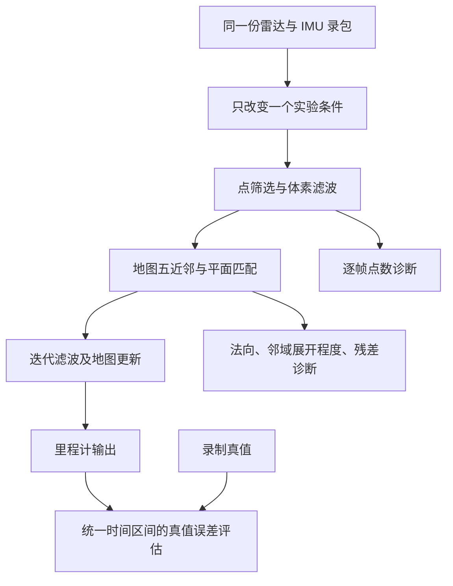

# FAST-LIO 抽稀收益的受控诊断（2026-11-16）

已完成 12 种条件的受控回放，另做 2 次只增加邻域日志的重复验证，共 14 次有效回放。可以确认：原录包上半采样的改善可复现，而且不是偶数点碰巧有利、回放算不过来丢帧、或简单减小雷达权重能够解释的。收益与抽稀改变的体素代表点、匹配集合和后续地图有关；目前证据仍不足以把全部收益归结为一个唯一根因。先前“减少重复墙面点，让地面约束占比提高”的解释在这次数据中没有得到支持。

这次研究针对原来出现 4.392→1.260 m 改善的旧录包：16 线、每圈 800 个水平采样、10 Hz 雷达。它不是最新 1800 个水平采样、带独立零偏模型的 60 秒有／无欺骗实验；结论不能直接视为新配置已经验证的收益。

## 具体如何检查

1. **固定输入和比较方法。**所有组使用同一份 `annotated-sensors.bag`；其中原始 XYZ、强度、IMU、真值相同，雷达点线号由仿真角度恢复，逐点时间统一为 1 µs，表示瞬时扫描。没有 GNSS 输入或真值反馈到算法。统一选取仿真时间 5.58–34.38 s，与 50 ms 内最近真值配对；每组均有 288 对位置。只按首对位置做平移对齐，没有旋转或尺度拟合。
2. **制作独立诊断版本。**复制 FAST-LIO 的 `laserMapping.cpp` 和 `preprocess.cpp` 到本次运行目录构建，保留原工作区源码与安装二进制。逐帧记录体素前点数、体素后点数、有效匹配点数、地图点数、平面法向分布、位置法向矩阵、点面残差、IMU 偏置估计和解算耗时。每组保存参数快照、采样参数、录包、逐帧 CSV 和误差汇总。
3. **先验证日志没有改变结果。**全点组和偶数半采样组在半速回放时，与原来 1 倍速回放的 312 个共同位置时间戳逐一比较，最大位置差均为 0。额外增加五近邻质量日志后，再与不含该日志的两个基准比较，最大位置差仍为 0。故这次旧录包的抽稀收益不能归因于日志干扰或正常回放速度下漏掉整帧。
4. **分开改变具体条件。**测试偶数点、奇数点、固定种子随机半采样、三分之一和四分之一采样，检查收益是否依赖特定点序；单独改变雷达测量方差，检查是否只是降低雷达权重；检查五近邻形状并增加邻域筛选，检查不稳定平面；最后分别修改扫描体素或地图体素，检查空间表示与地图匹配的影响。
5. **独立分析原始点云。**在算法位姿和地图介入之前，统计采样保留的雷达线比例、0.5 m 体素覆盖及体素中心偏移，避免把后续地图变化误说成原始输入的变化。



## 受控结果

下表单位均为米。雷达测量方差修改的是算法的 `mapping/lidar_meas_cov`，没有修改实际 IMU 或点云噪声。基础值为 0.001，扫描体素和地图体素基础值均为 0.5 m。

| 实验 | 东 RMSE | 北 RMSE | 天 RMSE | 三维 RMSE |
|---|---:|---:|---:|---:|
| 全部点，原配置 | 0.323 | 4.101 | 1.539 | 4.392 |
| 每两点取一：偶数点 | 0.150 | 1.200 | 0.354 | 1.260 |
| 每两点取一：奇数点 | 0.181 | 1.050 | 0.707 | 1.279 |
| 固定种子的随机半采样 | 0.437 | 0.957 | 1.025 | 1.469 |
| 每三点取一 | 0.116 | 1.338 | 0.248 | 1.365 |
| 每四点取一 | 0.128 | 1.105 | 0.568 | 1.249 |
| 全部点，雷达测量方差 ×2 | 0.596 | 2.882 | 2.468 | 3.841 |
| 半采样，雷达测量方差 ÷2 | 0.186 | 1.107 | 0.716 | 1.332 |
| 全部点，邻域展开门限 0.01 | 0.693 | 3.089 | 2.758 | 4.198 |
| 全部点，邻域展开门限 0.05 | 0.190 | 3.150 | 2.000 | 3.736 |
| 全部点，仅地图体素改为 1 m | 0.357 | 2.217 | 2.050 | 3.041 |
| 全部点，仅扫描体素改为 1 m | 3.382 | 3.013 | 1.826 | 4.883 |


## 能确认的发现

### 点数减半，优化点数并没有减半；代表位置也变了

在公共时间区间，全点组每帧平均约 12,448 个输入点，经过体素滤波后约 4,863 个，最终约 2,749 个有效匹配。偶数半采样组分别约为 6,224、3,378、1,678。原始点数减少约 50%，体素点数只减少约 31%，有效匹配数减少约 39%。因此，把抽稀看成给原来的优化残差简单乘一个固定权重并不准确。

独立的原始点云统计显示：偶数半采样平均保留原来约 69.4% 的 0.5 m 体素；在保留的体素中，代表点中心相对全点结果平均移动约 4.24 cm，各帧中心位移的 95 分位平均约 16.2 cm。这是**前处理代表点的位置变化**，不是声称传感器本身增加了这个量级的测距误差。

16 条雷达线的采样占比基本保持，全点与偶数半采样的单线占比最大差约 0.0183 个百分点，没有出现丢掉一半雷达线的情况。

### “抽稀后几何更均衡／地面占比更高”没有得到支持

最终有效匹配中，以垂直方向为主的平面法向占比，全点组平均约 31.8%，半采样组反而约 17.1%。这些是**拟合平面的法向分类**，不能直接当作真实地面点比例。

位置法向矩阵 `G = Σ n_i n_i^T` 的条件数中位数，全点约 2.72，半采样约 5.28；没有出现抽稀后该指标更好的结果。`G` 只描述当前匹配集合的局部位置几何，不包含完整的姿态耦合，也不保证拟合地图本身正确，所以不能单靠这个数给整体可观测性下结论。

### 近共线五近邻确实存在，但还不能认定为唯一根因

对每个最终接受的匹配，取地图五近邻的中心化协方差，令特征值从小到大为 `λ1 ≤ λ2 ≤ λ3`。若 `λ2/λ3 < 0.01`，就把该邻域标记为接近一条线：它缺少稳定确定平面所需的二维展开。

在公共区间逐帧统计后，全点组平均约 23.0% 的有效匹配符合这一标记，半采样约 13.0%。在法向以垂直方向为主的有效匹配中，相应比例约为 39.7% 和 24.4%。说明抽稀后的匹配邻域质量发生了可测变化。

但把这种几何条件作为门限，直接筛除全点云中的窄邻域，三维误差仅降为 4.198 m（门限 0.01）或 3.736 m（门限 0.05），没有复现半采样的 1.260 m。因此，近共线邻域是值得处理的风险，**本次干预尚不能证明它解释了全部收益**。该门限只在独立实验二进制中测试，不能据此视为已经完成通用修复。

### 单纯降低权重、降低点数，也不足以复现收益

全部点不变、将测量方差加倍，三维误差为 3.841 m；半采样后将方差减半，误差仍为 1.332 m。它们是近似权重对照，并不让两组信息矩阵完全相同，但已经说明“只因雷达总权重降低”无法充分解释改善。

保留全部原始点、只把扫描体素从 0.5 m 改为 1 m，有效匹配每帧平均仅约 1,390 个，比普通半采样还少，三维误差却为 4.883 m。只把地图体素改为 1 m，误差为 3.041 m。说明**点数、扫描体素代表位置、地图结构和邻近匹配需要一起考虑**；“更少点”“更粗体素”均不是必然更好的规则。

## 当前结论的边界

有直接证据支持的结论是：这份旧录包上，按原始点序抽稀或随机半采样的收益稳定出现；空间代表点与匹配邻域随之显著改变，而不是格式、回放丢帧或单一标量权重的收益。匹配和建图是非线性的，前面某些点位或关联的变化会影响后续地图，再影响下一帧匹配，这是结果对采样敏感的具体处理路径。

尚未被单独证明的是：这些变化中，体素中心、空间覆盖、错误关联和地图误差反馈分别贡献了多少。因此不能把“重复墙面权重过大”或“近共线邻域”写成已经唯一查明的根因。要进一步分离它们，需要固定同一个地图及同一个预测位姿，交叉替换匹配点集与体素代表点，避免地图随各组轨迹一起变化；本报告的动态地图回放没有完成这一更强的反事实控制。


## 数据、代码与复现

- [全部汇总 JSON](../../runs/lio-sampling-diagnosis-20261116/sampling-summary.json)、[结果表 CSV](../../runs/lio-sampling-diagnosis-20261116/sampling-summary.csv)、[ENU 误差时序 CSV](../../runs/lio-sampling-diagnosis-20261116/sampling-error-timeseries.csv)。
- [输入点云统计](../../runs/lio-sampling-diagnosis-20261116/input-profile.json)、[诊断／回放速度验证](../../runs/lio-sampling-diagnosis-20261116/instrumentation-validation.json)、[时间历元检查](../../runs/lio-sampling-diagnosis-20261116/epoch-validation.json)、[输入哈希及实验说明](../../runs/lio-sampling-diagnosis-20261116/experiment-manifest.json)。
- [全点逐帧日志](../../runs/lio-sampling-diagnosis-20261116/full/matching.csv)、[半采样逐帧日志](../../runs/lio-sampling-diagnosis-20261116/stride2-even/matching.csv)、[五近邻质量日志](../../runs/lio-sampling-diagnosis-20261116/full-neighborhood/matching.csv)。各实验目录还有 `parameters.yaml`、`experiment.json`、`algorithm.bag`。
- [诊断版本构建脚本](../../tools/build-lio-sampling-diagnostic.py)、[单次回放脚本](../../tools/run-lio-sampling-case.sh)、[汇总分析脚本](../../tools/analyze-lio-sampling.py)、[输入分布分析脚本](../../tools/profile-lio-sampling-input.py)。

一次三分之一采样回放出现了时间回跳和重复历元，已在 `stride3/INVALID.json` 中标记并排除，重跑后的 `stride3-retry` 用于结果表。14 个有效回放各有 312 个递增且不重复的诊断时间戳，公共统计区间均有 288 个有效匹配。

复现两个主要基准（需要使用新的运行目录名称）：

```bash
cd /home/wzb/msim
python3 tools/build-lio-sampling-diagnostic.py --output runs/新的诊断目录/build
bash tools/run-lio-sampling-case.sh runs/新的诊断目录 \
  runs/uav-px4-fastglio-bias-unfrozen-20261115/comparisons/annotated-sensors.bag full 1 0
bash tools/run-lio-sampling-case.sh runs/新的诊断目录 \
  runs/uav-px4-fastglio-bias-unfrozen-20261115/comparisons/annotated-sensors.bag half 2 0
MPLCONFIGDIR=/tmp/msim-sampling-matplotlib \
  /home/wzb/FAST_GLIO/.pixi/envs/default/bin/python tools/analyze-lio-sampling.py \
  --group runs/新的诊断目录 --start 5.58 --end 34.38
```
