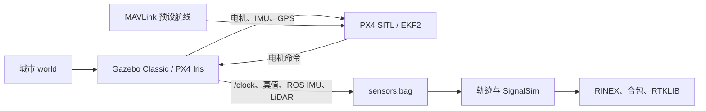

# PX4 SITL 城市无人机接入

这条流程在 FAST_GLIO 的城市 Gazebo Classic 场景中运行 PX4 Iris。PX4 通过 Gazebo 电机、IMU、气压计和所选 GPS 输入闭环飞行；msim 另外记录地面真值、ROS 1 IMU 和 16 线 LiDAR。默认通过 MAVLink OFFBOARD 沿走廊巡航。采集后沿用现有轨迹 → SignalSim → RINEX / ROS 1 bag → RTKLIB 的分析链路。



## 准备

需要 `/home/wzb/FAST_GLIO` 已构建的 Pixi ROS Noetic/Gazebo Classic 环境、C++ 构建工具、可访问 GitHub 和 PyPI 的网络。首次在 msim 目录运行：

```bash
cd /home/wzb/msim
./tools/setup-px4-sitl.sh
```

脚本将 PX4 `v1.16.1` 固定在 `build/deps/PX4-Autopilot`，只初始化 Gazebo Classic、MAVLink 及其代码生成器子模块；构建依赖和产物均在 `build/`。不会修改 FAST_GLIO 的源码。PX4 自带的 Gazebo GPS 是**当前飞控实际使用的 GNSS 输入**。world 和飞控 home 均配置为北纬 30.5312°、东经 114.3601°、海拔 50 m，和 msim 轨迹地理原点一致。

## 采集

```bash
cd /home/wzb/msim
./tools/px4-uav-capture.sh --duration-s 300 --gui
```

默认巡航高度 8 m；起点是城市走廊 `(东 0 m, 北 -20 m)`。巡航脚本通过 MAVLink 的 14540 UDP 端口持续发送 PX4 OFFBOARD 位置目标。若需要用其他 MAVLink 控制器驾驶，可加 `--manual`；采集计时仍从传感器话题就绪后开始。

每次运行目录位于 `/home/wzb/msim/runs/uav-px4-日期时间/`。`launch.log` 是 PX4/Gazebo 日志，`controller.log` 是巡航和解锁日志，`ros-home/log/` 保存 PX4 ULog，`sensors.bag` 是原始 ROS 1 数据，`trajectory.json`、`capture-report.json`、`px4-flight-report.json` 是轨迹和飞行验收结果，`signalsim/` 内是 RINEX 与原始观测，`combined-signalsim.bag` 是合包。自动巡航要求 ULog 证实已解锁、处于 OFFBOARD、爬升至少 3 m、移动至少 5 m、接收到 GPS；失败时先查 `launch.log` 与 `controller.log`。只重做后处理：

```bash
./tools/px4-uav-capture.sh --postprocess-only --run /home/wzb/msim/runs/uav-px4-日期时间 --duration-s 300
```

## 在线 GNSS 注入

使用 PX4 Iris 的单一 GPS 输入模式：采集脚本生成一个不含 Gazebo GPS 插件的 SDF，在线进程从 `/ground_truth/state` 读取位置，以仿真时间 5 Hz 发送 `HIL_GPS`。进程先设置并核对 PX4 的 `MAV_USEHILGPS=1`，再启动航线控制器。东、北偏移可用于检查 PX4 是否消费了注入值：

```bash
cd /home/wzb/msim
./tools/px4-uav-capture.sh --duration-s 300 --online-gnss \
  --gnss-east-bias-m 8 --gnss-north-bias-m 0 --gui
```

每次运行保存 `injected-gps.jsonl`（注入坐标、仿真时间、偏移）、`injector.log` 和 PX4 ULog。自动巡航的 `px4-flight-report.json` 会检查 ULog 的 `sensor_gps` 与注入坐标是否匹配；原始真值仍保存在 `sensors.bag`。指定 `--manual` 时，可自行控制飞行，采集结束后需自行检查注入日志与 ULog。没有 `--online-gnss` 时，仍使用原 Gazebo GPS。

**当前在线源是 Gazebo 真值加固定 ENU 偏移**，卫星数等接收机质量字段为固定模拟值。它验证 GNSS 注入到 PX4 EKF2 的链路，尚未把 SignalSim 的伪距/载波观测实时解算为 PX4 GPS；离线生成的 `combined-signalsim.bag` 和 RINEX 仍与在线注入源分开。固定偏移是可观测性测试，不构成完整欺骗或干扰模型。

## GNSS 欺骗与干扰实验的输入边界

离线回放、RViz 查看和 FAST_GLIO 误差评估见 [FAST_GLIO 回放说明](REPLAY_FASTGLIO.md)。

目前 SignalSim 由录制后的真值离线生成 GNSS 观测。它能用于 RINEX/RTKLIB 和 bag 回放，**尚未进入 PX4 的 EKF2**，所以修改这些离线输出不会影响本次飞行。普通模式下 PX4 使用 Gazebo GPS；`--online-gnss` 模式下使用上面的单一注入源。后续应把 SignalSim 在线观测解算或其他实验信号接到这个源，并核查 PX4 的 `sensor_gps`、`vehicle_local_position`、`vehicle_global_position`、`estimator_status` 和飞行模式，才能评价定位与控制响应。ROS bag 中存在异常 GNSS 话题不能证明 PX4 已接收它。

在线位置注入链路已实现；SignalSim 在线供数、时间相关欺骗轨迹和干扰强度模型仍需实现。

## 本机短测记录

2026-11-05 在 `runs/uav-px4-smoke2-20261105` 完成 40 秒仿真短测：PX4 ULog 证实已解锁并进入 OFFBOARD，最大位移 19.23 m、最大爬升 8.79 m，机载 GPS 记录 42 条；ROS 1 bag 记录 4165 条真值、6941 条 IMU、416 条 LiDAR；SignalSim 生成 200 个 GNSS 历元并成功合包。`verification-signalsim.json` 通过时间质量门禁，GNSS 到最近 IMU 最大 2 ms、到 LiDAR 最大 6 ms。该短测验证接线与采集，不代表已实现在线欺骗注入，也不代表这段短轨迹的 RTK 已通过精度验收。

同日 `runs/uav-px4-online-gnss-smoke-20261105` 以东向固定偏移 8 m 完成 40 秒在线注入短测：PX4 ULog 中 44 条 `sensor_gps` 与注入日志坐标匹配率为 100%，无人机已解锁并进入 OFFBOARD，最大位移 18.28 m；后处理生成 200 个 SignalSim 历元，时间质量门禁通过。此短测验证的是 PX4 在线接收路径，不代表 SignalSim 已在线接入 PX4。
