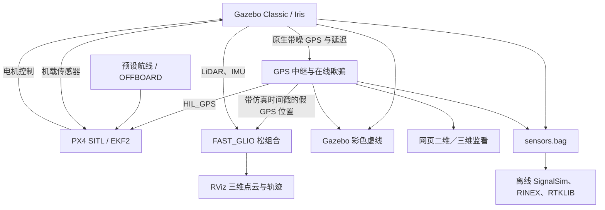

# PX4 SITL 城市无人机接入

这条流程在 FAST_GLIO 的城市 Gazebo Classic 场景中运行 PX4 Iris。PX4 通过 Gazebo 电机、IMU、气压计和所选 GPS 输入闭环飞行；msim 另外记录地面真值、ROS 1 IMU 和 16 线 LiDAR。默认通过 MAVLink OFFBOARD 沿走廊巡航。采集后沿用现有轨迹 → SignalSim → RINEX / ROS 1 bag → RTKLIB 的分析链路。



各进程、话题、文件和在线／离线边界见 [完整架构图](ARCHITECTURE.md)。

2026-11-22 已修正 FAST-LIO 地图边长参数的位置，并重新完成四种雷达各 60 秒在线测试。[最新四雷达 ENU 误差与修正前后对照](LIDAR_COMPARISON_FIXED_20261122.md)包含纯 LiDAR/IMU、GPS 松组合、检查结果及原始数据；问题定位过程见[地图参数诊断](EAST_ERROR_DIAGNOSIS_20261122.md)。

## 复杂场景

2026-11-22 新增 `--scene ksql_airport`：保留约 2.87 km × 2.78 km 的机场周边地形、卫星底图和建筑碰撞网格，选定 1 km × 1 km 测试区域。首次运行 `python3 tools/fetch-ksql-assets.py` 下载固定版本资源；可用 `--scene-profile` 一并切换出生点、地理原点、相对起飞高度与航线。启动命令、修改位置与范围说明见 [场景说明](../../scenes/README.md#ksql-大范围场景2026-11-22)，验证记录见 [KSQL 接入报告](KSQL_INTEGRATION_20261122.md)。

新增 `--scene complex_urban` 与 `--scene industrial_yard`，分别提供错落建筑街区和含 PX4 原生货架、托盘、货箱的工业场地。支持 `--world /绝对路径/文件.world`。启动、模型来源与边界见[场景说明](../../scenes/README.md)，真实采集与误差对照见[复杂场景实验](COMPLEX_SCENES_20261116.md)。新实验可选 `--fastglio-frontend velodyne --point-filter-num 4`；当前默认扫描器直接输出 ring 与分批物理采样时间；旧录包仍保留原先快照含义。`--route-clock sim` 以仿真时间推进航点停留，适合不同运行负载的场景对照。

## 准备

需要 `/home/wzb/FAST_GLIO` 已构建的 Pixi ROS Noetic/Gazebo Classic 环境、C++ 构建工具、可访问 GitHub 和 PyPI 的网络。首次在 msim 目录运行：

```bash
cd /home/wzb/msim
./tools/setup-px4-sitl.sh
```

脚本将 PX4 `v1.16.1` 固定在 `build/deps/PX4-Autopilot`，只初始化 Gazebo Classic、MAVLink 及其代码生成器子模块；构建依赖和产物均在 `build/`。不会修改 FAST_GLIO 的源码。PX4 自带的 Gazebo GPS 是**当前飞控实际使用的 GNSS 输入**。world 和飞控 home 均配置为北纬 30.5312°、东经 114.3601°、海拔 50 m，和 msim 轨迹地理原点一致。

## 传感器误差模型（新采集）

当前型号选择器以 [`sensor_profile.json`](../../adapters/ros1_noetic/msim_sensors/config/sensor_profile.json) 为 IMU 基线，并生成每次运行的完整有效配置；快速换型、GPS 误差与扫描模式见 [传感器切换说明](SENSOR_SWITCHING.md)。历史 IMU 基线在该文件，各参数单位、误差公式和验证记录见[传感器模型说明](SENSOR_MODEL.md)。这是**可复现实验基线**，误差数值尚未用某一台实物标定。每次采集会把所用配置复制为运行目录的 `sensor_profile.json`；修改配置后须重新采集，旧 bag 不会改变。自定义配置可加 `--sensor-profile /绝对路径/配置.json`。

ROS `/imu/data` 由 Gazebo 的 `/imu/ideal` 经过独立噪声模型生成：陀螺仪、加速度计分别使用连续时间白噪声密度、开机零偏及具有相关时间的零偏随机游走。200 Hz 标称频率下，单次样本白噪声标准差按 `密度 / sqrt(实际采样间隔)` 计算；输出协方差也按这个采样间隔填写。姿态四元数用单独的初始误差、白噪声和缓慢漂移模拟一个简化姿态估计器，并保持单位长度；**它仍以 Gazebo 姿态为参考，不等同于完整的九轴 AHRS**。PX4 接收的另一套 `/imu` 则在原生插件中显式设置相近量级的噪声和非零零偏，两套 IMU 的随机样本彼此独立。

LiDAR 默认 16 线、1800 水平采样、10 Hz；可切换 32、64 线参数模型。独立扫描插件在物理时间推进时分批求交，径向测距高斯噪声标准差 0.02 m，距离量化 0.001 m，每点保留采集时间。默认 Velodyne 入口会自动匹配线数；分时帧内跨度约 98 ms。均匀线束只是研究近似，尚无厂商通道标定、多回波和材质反射模型。旧日期下的算法误差数字来自旧传感器配置，不能直接比较。

## 采集

```bash
cd /home/wzb/msim
./tools/px4-uav-capture.sh --duration-s 300 --gui
```

默认巡航高度 8 m；起点是城市走廊 `(东 0 m, 北 -20 m)`。巡航脚本通过 MAVLink 的 14540 UDP 端口持续发送 PX4 OFFBOARD 位置目标。若需要用其他 MAVLink 控制器驾驶，可加 `--manual`；采集计时仍从传感器话题就绪后开始。

每次运行目录位于 `/home/wzb/msim/runs/uav-px4-日期时间/`。`launch.log` 是 PX4/Gazebo 日志，`controller.log` 是巡航和解锁日志，`ros-home/log/` 保存 PX4 ULog，`sensors.bag` 是原始 ROS 1 数据，`trajectory.json`、`capture-report.json`、`px4-flight-report.json` 是轨迹和飞行验收结果，`signalsim/` 内是 RINEX 与原始观测，`combined-signalsim.bag` 是合包。自动巡航要求 ULog 证实已解锁、处于 OFFBOARD、爬升至少 3 m、移动至少 5 m、接收到 GPS；失败时先查 `launch.log` 与 `controller.log`。只重做后处理：

```bash
./tools/px4-uav-capture.sh --postprocess-only --run /home/wzb/msim/runs/uav-px4-日期时间 --duration-s 300
```

## 在线 GNSS 注入

当前默认使用单一 GPS 输入：保留 Iris 原生 GPS 噪声与延迟，将原始话题隔离，经 msim 中继叠加可配置接收机误差和攻击后，送入原生 MAVLink 接口。ROS 松组合读取同一个最终样本。Python 在线进程只记录与检测，不另发 HIL_GPS。

```bash
cd /home/wzb/msim
./tools/px4-uav-capture.sh --duration-s 300 --online-gnss \
  --gnss-east-bias-m 8 --gnss-north-bias-m 0 --gui
```

每次运行保存 `injected-gps.jsonl`（注入坐标、仿真时间、偏移）、`injector.log` 和 PX4 ULog。自动巡航的 `px4-flight-report.json` 会检查 ULog 的 `sensor_gps` 与注入坐标是否匹配；原始真值仍保存在 `sensors.bag`。指定 `--manual` 时，可自行控制飞行，采集结束后需自行检查注入日志与 ULog。当前此链路默认启用，`--online-gnss` 作为兼容选项保留。

**当前在线源是原生带噪 GPS，加可配置接收机误差、固定 ENU 偏移及定时线性漂移**，卫星数等接收机质量字段为固定模拟值。它验证 GNSS 注入到 PX4 EKF2 的链路，尚未把 SignalSim 的伪距/载波观测实时解算为 PX4 GPS；离线生成的 `combined-signalsim.bag` 和 RINEX 仍与在线注入源分开。固定偏移和线性漂移是可控实验输入，不构成完整欺骗或干扰模型。

## GNSS 欺骗与干扰实验的输入边界

离线回放、RViz 查看和 FAST_GLIO 误差评估见 [FAST_GLIO 回放说明](REPLAY_FASTGLIO.md)。

目前 SignalSim 由录制后的真值离线生成 GNSS 观测。它能用于 RINEX/RTKLIB 和 bag 回放，**尚未进入 PX4 的 EKF2**，所以修改这些离线输出不会影响本次飞行。普通模式下 PX4 使用 Gazebo GPS；`--online-gnss` 模式下使用上面的单一注入源。后续应把 SignalSim 在线观测解算或其他实验信号接到这个源，并核查 PX4 的 `sensor_gps`、`vehicle_local_position`、`vehicle_global_position`、`estimator_status` 和飞行模式，才能评价定位与控制响应。ROS bag 中存在异常 GNSS 话题不能证明 PX4 已接收它。

在线位置注入及线性漂移欺骗轨迹已实现；SignalSim 在线供数、更复杂的时间相关欺骗轨迹和干扰强度模型仍需实现。

## 在线欺骗漂移与检测原型

`--online-gnss` 模式可在指定时间后，以给定东／北速度逐渐增加 GNSS 位置偏移。注入进程使用 `/imu/data` 和发送给 PX4 的水平 GNSS 位置运行二维位置／速度 Kalman 预测，计算 GNSS 创新卡方值（二维、显著性水平 0.0001，阈值约 18.42）。另用最长 5 秒的纯惯导位置预测与 GNSS 比较，并计算 10 历元平均创新。任一检测量超阈值时，**仅跳过检测器自身的 GNSS 更新**；假 GPS 仍发给 PX4，报警不接管飞控。

逐历元注入坐标、偏移量、攻击状态和检测结果写入 `injected-gps.jsonl`，并以 JSON 字符串发布到 `/gnss/spoof_detection`，供 Gazebo 实时画紫色欺骗偏移轨迹及检测结果。仿真真值用于生成实验输入、日志与评估，不参与检测器的异常判定。

现有 16 线 LiDAR 的 `/velodyne_points` 也进入在线注入进程。每个 GPS 历元按 Gazebo 仿真时间匹配最近且不晚于该历元的点云；200 ms 内视为同步。日志和实时页面显示 LiDAR 扫描时间差、点数及匹配状态，飞行报告检查起始 1 秒后至少 90% 的历元有效匹配。LiDAR 当前用于时间同步和记录；开启下述 `--fastglio-live` 时还供 FAST_GLIO 定位，但**尚未参与二维欺骗检测器的报警计算**。详情见 [架构图中的时间对齐说明](ARCHITECTURE.md)。

2026-11-15 的 35 秒短测中，起始 1 秒后的 183 个 GPS 历元均匹配到有效 LiDAR 扫描，最大在线时间差 148 ms；PX4 GPS 与注入坐标匹配率为 100%，离线合包质量门禁通过。在线配对只使用已到达的过去扫描；离线同步质量门禁可在完整 bag 中选取前后最近扫描，因此两者的时间差不应直接比较。

### Gazebo 与 FAST_GLIO 实时松组合双窗口

只在后台采集与导出图表，可在 `--fastglio-live` 后加 `--headless`；`--skip-signalsim` 可跳过离线 SignalSim/RINEX 后处理，仍保留原始传感器 bag、FASTGLIO 解算和误差图。若飞行或在线同步检查失败，脚本仍导出图表并以非零退出码结束，检查结果保存在 `px4-flight-report.json`，不能把图片生成视为全部检查通过。

2026-11-16 已使用新传感器配置完成有／无欺骗的两次 60 秒航线实验：同样使用 GPS 松组合，有欺骗组第 20 秒起向东增加 `0.18 m/s` 偏移。[实验报告](../../runs/fastglio-spoof-comparison-20261116-01/charts/REPORT.md)包含三维轨迹、两组 ENU 误差及 CSV/JSON。两组均解锁并进入 OFFBOARD、PX4 注入坐标匹配率 100%、松组合各接受 615 次更新；但较密点云的在线 GPS/LiDAR 配对时间差超过 200 ms，完整同步门禁未通过。比较工具为 `tools/compare-fastglio-spoof-runs.py --clean 无欺骗目录 --spoofed 有欺骗目录 --output 图表目录`。

在图形桌面打开一个终端，运行：

```bash
cd /home/wzb/msim
./tools/px4-uav-capture.sh --duration-s 60 --fastglio-live \
  --flight-pattern route --spoof-start-s 20 --spoof-east-rate-mps 0.18
```

脚本自动把 **Gazebo 放在左侧、RViz 放在右侧**。Gazebo 显示 Iris 飞机、预设航线、真值和假 GPS 虚线；RViz 在 `camera_init` 三维坐标系里显示点云、青色 LiDAR/IMU 轨迹、橙色 FAST_GLIO 松组合轨迹，以及绿色的注入 GPS 对齐轨迹。约 20 秒后开始欺骗漂移，可对比真实飞机、纯惯性/点云估计和受假 GPS 牵引的松组合结果。关闭仿真前可在 RViz 中旋转、缩放视角；若首次出现 ROS 1 生命周期提示，关闭提示框即可继续查看。

该模式把**同一份假 GPS 位置**送给 PX4 的 `HIL_GPS` 与 FAST_GLIO 的 `/msim/spoofed_gnss_odom`；位置话题使用 Gazebo 仿真时间戳，LiDAR 和 IMU 也使用 `/clock`。FAST_GLIO 发布 `/Odometry`、`/path`（纯 LiDAR/IMU）、`/loose_odom`、`/loose_path`（松组合）和 `/rtk_path`（对齐的输入 GPS，名称由算法源码沿用）。这里的输入是**合成位置解**，不是在线 RTKLIB 或 SignalSim 原始观测。当前 Gazebo 点云只有 `x/y/z/intensity`，没有每个点的采样时间；FAST_GLIO 使用 MARSIM 的瞬时扫描分支，因此不做逐点运动补偿。为使受骗轨迹在演示中持续可见，此专用 launch 放宽了 GNSS 残差门限；其接受更新数不能当作欺骗检测性能。FAST_GLIO 的输出只用于可视化与记录，当前没有反馈给 PX4 飞控。

运行目录内的 `fastglio-live-report.json` 记录话题数量、是否完成对齐以及接受的松组合更新数；`fastglio-live-lio-error.json` 对纯 LiDAR/IMU 里程计与真值作起点平移后的误差统计；`fastglio-live-3d.png` 是可直接打开或插入报告的三维/水平轨迹效果图。`fastglio-enu-error-timeseries.png` 分别画东、北、天方向的纯 LiDAR/IMU、松组合、注入 GPS 时序误差，配套 CSV 与 JSON 可用于后续分析。误差定义为估计位移减真值位移，分别以首个匹配点平移对齐，未作旋转或尺度拟合；横轴相对 GPS 注入开始，虚线标出欺骗开始。`sensors.bag` 保留完整数据。窗口与算法日志分别是 `window-layout.log`、`fastglio-live.log`。此城市走廊主要由平行墙面组成，点云对沿走廊方向及高度的约束有限；实时 launch 已开启 IMU 偏置估计，但纯 LiDAR/IMU 轨迹仍可能有显著漂移。2026-11-15 的 45 秒实测有 465 次接受更新，PX4 注入位置匹配率 100%；30 秒双窗口实测通过飞行、LiDAR 时间匹配和离线数据质量检查。

**纯 LiDAR/IMU 曲线为何偏离：**在一段 30 秒记录中，飞行约 20 秒后，纯里程计比真值沿走廊少前进约 4.6 m、高约 7 m；同一时刻原始 IMU 姿态仍接近真值，而 FAST_GLIO 的滚转、俯仰估计已偏离。该时刻约 1.25 万个点中，靠近地面的只有约 200 个，多数点落在两侧平行墙面，几何约束不足。原实时配置还冻结了 IMU 偏置；在**同一份 bag、相同回放设置**下，取消冻结把纯里程计三维 RMSE 从 6.36 m 降到 4.78 m，因此实时 launch 已覆盖这一参数。新一次 30 秒在线运行的三维 RMSE 为 4.62 m，飞行和时间质量检查通过，但仍不能把青色曲线当作高精度定位真值。按 IMU 标称噪声直接缩小协方差曾使水平误差更大，未采纳。

**进一步的同录包算法对照：**LIO-SAM（修复本机 OpenCV 索引兼容问题、关闭回环）三维 RMSE 为 0.28 m；但它利用了 Gazebo IMU 提供的近真值姿态四元数。把该姿态改为同一角速度积分结果后，其三维 RMSE 为 1.33 m，北向仍约 0.16 m。FAST-LIO 通过 Velodyne 入口每 2 点取 1 点时为 1.26 m；仅换入口但保留全部点仍约 4.39 m，说明点云抽稀对当前场景的改善最明显。GLIO 前端和 LIGO 在这组参数下更差。详细方法、ENU 表格、曲线与限制见 [纯 LiDAR/IMU 对照报告](LIO_BENCHMARK_20261115.md)。

**雷达倾角测试：**在四次同航线新飞行中，水平、前向下倾 5°、10°、15° 的 FAST-LIO 三维 RMSE 分别为 1.42、2.35、7.00、6.70 m。5° 改善了天向（1.18→0.42 m），但北向从 0.76 升至 2.30 m；10° 和 15° 的北向退化更明显。安装旋转外参随角度同步设置。图、回波统计与复现方法见 [雷达安装倾角对照](LIDAR_TILT_20261115.md)。

**为什么抽稀改善：**2026-11-16 又完成 12 种条件及两次日志验证，固定同一旧录包检查点数、体素、法向、五近邻质量和观测权重。半采样收益可复现；正常／半速回放位置完全一致，排除了这组数据中回放算不过来丢帧的解释。只改权重、几何门限或体素大小均未完整复现收益，不能把它归结为单一的“墙面权重”问题。具体方法、结果和尚未分离的因素见[抽稀受控诊断](LIO_SAMPLING_DIAGNOSIS_20261116.md)。

**新前端多传感器有／无欺骗重算：**使用之前两份 60 秒录包，以 Velodyne 入口分别测试每两点取一和每四点取一。当前 1800 水平采样数据上，每四点取一的纯 LIO 三维 RMSE 为无欺骗 4.42 m、有欺骗 6.20 m；GPS 松组合为 0.086 m、3.648 m，有欺骗组末端东向误差约 7.59 m。该结果来自录包重算，纯 LIO 高度仍漂移；无欺骗 GPS 是理想仿真位置。[完整说明、三维图与 ENU 图](FASTGLIO_VELODYNE_LOOSE_20261116.md)保留两套参数的结果与原始来源。

先指定运行目录，开一个终端启动采集，另一个终端启动实时页面：

```bash
RUN=/home/wzb/msim/runs/uav-px4-spoof-demo
./tools/px4-uav-capture.sh --duration-s 60 --online-gnss \
  --spoof-start-s 20 --spoof-east-rate-mps 2 --run "$RUN"
```

```bash
/usr/bin/python3 tools/spoof-live-dashboard.py --run /home/wzb/msim/runs/uav-px4-spoof-demo
```

打开 [本机实时仪表盘](http://127.0.0.1:8765)。页面每秒刷新 GNSS、估计和真值轨迹，以及单历元卡方值、10 历元趋势、短时惯导参考和阈值。当前定时偏移从原生 GPS 首个仿真采样开始计时，原点保存在日志中；可另设 `--spoof-north-rate-mps`。本原型对应论文中的二维创新卡方思路，**尚不是论文完整的 15 状态 ES-EKF**。10 历元趋势、短时惯导参考的统计量及 IMU/GNSS 噪声尚未实测标定，不应将其警报率解释为已验证的实际欺骗检出率。启动前已有的固定偏移会被滤波器当作初始位置，单靠此检测器无法识别。

### 在 Gazebo 里同时看飞机、真值和检测结果

若要演示“先按预设航线飞行，途中 GPS 欺骗使真实飞机偏航”，运行：

```bash
cd /home/wzb/msim
./tools/px4-uav-capture.sh --duration-s 60 --gazebo-viz \
  --flight-pattern route --spoof-start-s 20 --spoof-east-rate-mps 0.18
```

黄色虚线和小航点是固定的预设航线；白色是飞机真实轨迹，蓝色是发送给 PX4 的假 GPS，绿色是检测器估计。紫色虚线展示把注入偏移单独加到航线东向坐标后的示意位置，**不是 PX4 实际接收的 GPS**。约 20 秒后，假 GPS 开始向东缓慢漂移，PX4 为追踪航点会把真实飞机往西推，白色轨迹将逐渐离开黄色航线。由于真实飞机向西运动抵消了注入的东向偏移，蓝色轨迹仍可能贴近黄色航线；紫色轨迹用于直接看清注入偏移如何增长。航点定义在 [route_plan.json](../../adapters/ros1_noetic/fast_glio_uav/route_plan.json)，运行时复制到结果目录。不指定 `--run` 时自动使用新的时间戳目录；手动指定时必须使用新目录。

在另一个终端启动自动跟随最新实验的监看页面：

```bash
/usr/bin/python3 /home/wzb/msim/tools/spoof-live-dashboard.py \
  --follow-latest /home/wzb/msim/runs
```

打开 [本机实时仪表盘](http://127.0.0.1:8765/)；如端口已占用，先停止之前的仪表盘。网页提供可拖动旋转、滚轮缩放的实时东/北/高三维图，并能导出三维和二维 PNG。三维图中的绿色检测器估计只有二维坐标，显示高度借用真值。

Gazebo 中白色真值、蓝色假 GPS、绿色估计、紫色注入偏移示意，以及黄色预设航线使用对应颜色的短线段组成虚线轨迹；历史轨迹保留最近约 40 秒，当前点仍用彩色球标出。当前检测器仅报警显示，不接管 PX4；缓慢欺骗可能漏检，即使飞机已偏航也可能没有红色报警标记。

2026-11-16 修复了历史轨迹回收时的 Gazebo 窗口崩溃：旧代码删除旧段后复用同一个模型名，Gazebo 客户端尚未释放的 Ogre 材质与新段重名，报 `ItemIdentityException` 后以 139 退出。现在每段使用递增的唯一名称，同时仍回收超过约 40 秒的历史段。Gazebo 显示窗口、物理仿真后台和 RViz 是独立进程，因此显示窗口崩溃时，后台录包和 RViz 仍可能继续；正常达到采集时长后脚本会关闭本次启动的两个窗口。

修复后以 `--duration-s 60 --fastglio-live --fastglio-frontend velodyne --point-filter-num 1 --flight-pattern route --route-clock sim --skip-signalsim --spoof-start-s 20 --spoof-east-rate-mps 0.18` 完成一次双窗口复测：运行中轨迹序号已到 61，活动历史段模型数 125，Gazebo 与 RViz 均存活；采集完成后由脚本清理退出，没有再次出现材质重名或 139。该次飞行、同步与融合门禁均通过，18 项单元测试通过。[验证记录](../../runs/gazebo-trail-unique-20261116-01/window-validation.json)。

2026-11-09 的 60 秒航线短测中，攻击前真实轨迹距航线最多 0.15 m；攻击后最大横向偏离 7.45 m。PX4 ULog 中 66 条 GPS 样本与注入记录匹配率 100%，飞行验收和后处理质量门禁通过。当前检测器对这次缓慢偏航未报警；该数据证实的是欺骗诱导偏航，不能当作检测成功案例。

`--gazebo-viz` 会同时开启 Gazebo 图形界面和在线 GNSS 注入。配合 `--flight-pattern route` 时，Gazebo 会显示黄色预设航线，攻击开始后紫色示意轨迹才会出现；其他飞行模式仍显示白色真值、蓝色假 GPS 和绿色检测估计。首次报警后，飞机附近出现红色球。虚线保留最近约 40 秒；当前点用小球标在飞机实际高度附近，**绿色标记的高度借用真值，并不是检测器估计的高度**。Gazebo 的初始镜头朝向飞行走廊，可在窗口内旋转或缩放。仿真到时 Gazebo 会随采集关闭，数据保存在本次运行目录。

若要直观看到**真实飞机被欺骗位置拖走**，使用悬停目标和沿开放走廊的北向漂移：

```bash
cd /home/wzb/msim
./tools/px4-uav-capture.sh --duration-s 55 --gazebo-viz \
  --flight-pattern hover --spoof-start-s 20 --spoof-north-rate-mps 0.8 \
  --run /home/wzb/msim/runs/uav-px4-hover-demo
```

飞机本应在起点悬停。假 GPS 随时间向北偏移后，PX4 为维持原航点会把真实飞机往南推，白色真值与蓝色 GNSS 标记逐渐分离。此实验也暴露了当前简化检测器的漏检：2026-11-06 的 70 秒短测中，真实水平位移 40.7 m，GPS 报告的位置只移动约 2.9 m，PX4 仍处于 OFFBOARD 并融合 GNSS，但检测器没有报警。该结果不能称为“检测成功”；红色报警球不会出现。此前东向漂移实验会把飞机推到走廊西侧建筑（东向约 −9 m），所以看起来像没有继续偏航。

## 本机短测记录

2026-11-05 在 `runs/uav-px4-smoke2-20261105` 完成 40 秒仿真短测：PX4 ULog 证实已解锁并进入 OFFBOARD，最大位移 19.23 m、最大爬升 8.79 m，机载 GPS 记录 42 条；ROS 1 bag 记录 4165 条真值、6941 条 IMU、416 条 LiDAR；SignalSim 生成 200 个 GNSS 历元并成功合包。`verification-signalsim.json` 通过时间质量门禁，GNSS 到最近 IMU 最大 2 ms、到 LiDAR 最大 6 ms。该短测验证接线与采集，不代表已实现在线欺骗注入，也不代表这段短轨迹的 RTK 已通过精度验收。

同日 `runs/uav-px4-online-gnss-smoke-20261105` 以东向固定偏移 8 m 完成 40 秒在线注入短测：PX4 ULog 中 44 条 `sensor_gps` 与注入日志坐标匹配率为 100%，无人机已解锁并进入 OFFBOARD，最大位移 18.28 m；后处理生成 200 个 SignalSim 历元，时间质量门禁通过。此短测验证的是 PX4 在线接收路径，不代表 SignalSim 已在线接入 PX4。
