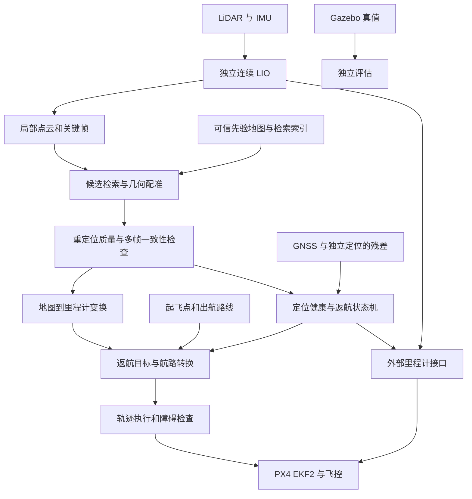

# 无人机重定位与自主返航技术路线

目标是在 GNSS 失效或被欺骗后，用 LiDAR/IMU 和可信地图恢复位置，并让无人机自主返回起飞点。第一版采用已有地图和已记录的出航路线，先验证定位到飞控再到返航的闭环；自主绕障与全局最短路径放在后续扩展。

本文保留技术选型与后续论文实验设计。2026 年 11 月 25 日已接入第一版工程基线：独立 LIO 水平位置反馈 PX4、先验地图描述子检索与 ICP、两次一致配准确认、出航路线记录与返航降落；[运行说明及实测结果](AUTONOMOUS_RETURN.md)给出已验证范围。当前从起飞前排除 GPS，尚未验证飞行中的受骗 GNSS 接管、LIO 重启恢复或 EGO-Planner 避障。

## 任务定义

| 任务 | 定义 | 第一版范围 |
| --- | --- | --- |
| 连续里程计 | 连续估计运动，允许随路程积累漂移 | 复用独立的 LiDAR/IMU 输出 |
| 地图重定位 | 将当前位置重新定位到已有地图，恢复地图到当前里程计的变换 | 优先支持最后可信位置附近的恢复，再扩展无位置初值的全局搜索 |
| 自主返航 | 规划并执行到起飞点的路径，具备状态检查和降落逻辑 | 先沿出航时记录的路线返回 |

“地图中的全局位置”不等于经纬度。仅使用地图坐标中的可信起飞点也能定义返航；需要地理任务时，再增加地图与地理坐标的可信锚定。

重定位应分别测试两种难度：一是有连续 LIO 和最后可信位置的恢复；二是 LIO 重启或无人机被移动后没有可靠位置初值的恢复。不能把前者的 ICP 成功率当成后者的全局重定位能力。

## 接入前的平台基础

检查时仓库已有功能包括 Gazebo/PX4 v1.16.1、FAST_GLIO LiDAR/IMU 前端、GPS 松组合、位置域 GPS 欺骗、点云地图保存、手动飞行，以及网页三维展示。

| 现有代码 | 已有能力 | 与新任务的差距 |
| --- | --- | --- |
| `lio_map_recorder.py` | 将 `/cloud_registered` 累计为 `map.pcd` | 当前是体素累计地图，没有回环优化和重定位索引 |
| `px4_live_loose.launch` | 独立 LIO 与可选 GPS 松组合 | 未将 LIO 位姿通过外部里程计接口反馈给 PX4 |
| `px4_teleop.py` | 连续 OFFBOARD 指令、起飞、悬停和降落 | 尚无地图重定位、返航航路或避障状态机 |
| `gps_relay.cpp` | 同一含噪声及欺骗的测量送入 PX4 和 ROS | 不负责判断地图定位是否可信，也不负责返航 |

上述为接入前的缺口。当前新增 `px4_autonomy.py` 统一发送外部位姿与控制目标，`autonomy_core.py` 实现地图匹配与门限，`build-relocalization-map.py` 制作独立先验地图，`evaluate-autonomy.py` 用真值和 ULog 独立核验。实测已检查空中 EKF 外部位置与 GNSS 选择标志，不能只凭 RViz 有轨迹就认定飞控已采用 LIO。

## 公开方法及可借鉴内容

| 方法或资料 | 已有工作 | 对本平台的用途 | 使用边界 |
| --- | --- | --- | --- |
| FAST-LIO-LOCALIZATION [1] | 在已有点云地图上做低频定位，结合高频 FAST-LIO 里程计 | 作为先验地图定位的工程基线 | 初始化需要粗略位姿；原工程依赖较旧，不能直接当作无初值全局定位 |
| hdl_global_localization [2] | 提供 BBS、FPFH/RANSAC、FPFH/TEASER 等全局定位入口 | 为无可靠初值时生成候选位姿 | 候选配准仍需验证，尤其要测试重复建筑和局部重叠不足 |
| Scan Context++ [3] | 用结构描述子处理旋转和横向变化下的地点识别 | 建立关键帧检索基线，缩小几何配准搜索范围 | 无人机高度、横滚和俯仰变化需单独评估 |
| There's No Place Like Home [4] | 出航建图，在模拟 GPS 失效后通过视觉定位沿路线自主返回 | 借鉴出航记录和反向路线执行 | 说明“GPS 失效后沿原路返航”本身已有实机研究 |
| PX4 外部定位接口 [5] | 支持外部位姿/里程计参与 EKF2 定位 | 将独立 LIO 接入飞控，形成控制闭环 | 必须验证坐标系、时间戳、外参、协方差和重置处理 |
| EGO-Planner [6] | 面向四旋翼的局部轨迹规划 | 在返航基线稳定后加入在线避障和局部重规划 | 需要另外适配地图、里程计和控制器；不能将已有轨迹倒放视为避障 |

较新的相关方向包括 SOAR 的无人机 LiDAR 重定位 [7]、TempLoc 的时序一致性重定位 [8]，以及先验地图 LiDAR 定位的安全量化与完整性监测 [9]。因此，“增加多帧约束”或“使用定位置信度”也不能未经进一步比较就声称为新的研究贡献。

## 拟实施架构

真值只进入评估，不进入重定位初值、置信度决策或飞行控制。先验地图使用提前采集的数据；评估查询帧不能同时参与生成自己的参考地图。

### 地图和坐标关系

维护地图坐标 `map`、连续里程计坐标 `odom` 和机体坐标 `base_link`。重定位主要修正 `map → odom`，连续 LIO 负责 `odom → base_link`。

不把重定位得到的坐标跳变直接当作飞机瞬时运动反馈给飞控。地图修正后的返航目标要转换到当前控制坐标，并约束目标变化率。LIO 本身重启时，还需处理真正的里程计重置，而不能把旧时间戳改成当前时间来掩盖中断。

原始 LIO 必须保持独立于可疑 GNSS 的分支。地图起飞点与出航路线应在可信阶段记录，不能在被欺骗后重新把当前错误位置设为 Home。

### 定位候选验证

局部恢复可以从最后可信位置搜索；全局恢复先检索多个候选，再做 ICP/GICP 等精配准。选择候选时至少检查有效重叠、残差分布、几何方向约束、候选之间的歧义，以及与连续运动的多帧一致性。

ICP 残差小并不能排除“匹配到另一栋相似建筑”。局部 Hessian 的逆也不能直接作为全局误匹配概率或经过认证的误差上界。论文若使用完整性或保护水平术语，需要给出对应假设、推导或独立校准结果。[9]

### 飞控与返航

当前 PX4 版本是 v1.16.1，应以对应版本的外部定位接口为准。[5] 第一阶段验证独立 LIO 的外部位姿接入和 EKF 接受情况，再验证 GNSS 被禁用或被排除后的悬停及航线飞行。

初版采用本地 OFFBOARD 返航控制器，明确处理起飞点、路线、定位新鲜度与降落条件。直接切换原生 RTL 并不能保证摆脱受骗的 GNSS 位置；若后续采用原生 Return，还需验证全局原点、Home 与 EKF 全局位置的完整配置。

反向路线执行过程中仍需在线检查障碍和地图变化。路线曾经通过，不代表当前仍可通过。定位质量不足时区分“连续 LIO 仍有效”和“所有定位均失效”：后者不能靠发送悬停位置指令保证悬停。

### 建议的状态机

`出航 → 定位异常候选 → 减速与诊断 → 重定位搜索 → 多帧确认 → 返航 → 到达起飞区域 → 降落`

异常分支包括搜索失败、候选歧义、地图覆盖不足、定位超时、返航通道被阻挡和任务中止。人工接管与 PX4 原有失效保护保持有效。GPS 检测器的单次报警只作为证据之一，不直接触发无条件切换。

## 论文选题建议

候选题目为“渐进式 GNSS 欺骗下无人机可信重定位与风险约束自主返航”。这是基于当前平台和已检索文献提出的研究方向，不是已证实的新颖性结论。

重点研究问题是：**当 GNSS 缓慢偏离、环境又存在重复结构或 LiDAR 退化时，怎样减少接受错误重定位的概率，并让定位恢复真正改善返航结果。**

可围绕一条主要方法线展开：对多个地图位置假设保留歧义信息，用独立 LIO 的短时运动和地图几何验证候选，将重定位风险传递给返航的速度与路径选择。定位误差界限较大时，允许减速、继续观测或选择几何约束更充分的已知航段；无法满足条件时拒绝接管返航。

研究贡献需要同时区别于已有的地点识别、时序重定位和 LiDAR 完整性监测。可检验的贡献包括：

1. 在同等传感器和地图条件下，显著降低重复环境中的危险误接受率，而不仅提高平均配准精度。
2. 对地图位置修正、GNSS 排除与返航目标变化给出可解释的处理规则，并减少接管时的控制瞬态。
3. 用闭环实验验证定位决策如何影响实际返航、碰撞和任务中止概率，而不是只展示离线轨迹。

上述工程接入中的坐标变换和连续里程计维护是必要基础，单独完成它们不构成论文创新。风险驱动规划也需要进一步检索直接相关工作，并与已有方法比较。

## 实验与评价

### 两层实验

定位层使用相同录包和独立先验地图，公平比较重定位算法。飞行层为每种控制方案重新运行仿真，让定位结果真实影响运动；不能用同一条离线轨迹宣称不同方法都完成了返航。

| 维度 | 建议测试 |
| --- | --- |
| 场景 | 复杂街区、工业场地、KSQL；增加重复建筑、开阔区和部分地图变化 |
| GNSS 故障 | 无故障、自然精度下降、完全失效、位置阶跃、不同速率和方向的渐进拖移 |
| LIO 状态 | 连续正常、长程漂移、点云稀疏/遮挡、估计器重启；分别记录是否有可靠初值 |
| 雷达 | VLP-16 与 Mid-360，采用同场景及可比飞行路线 |
| 地图 | 正常地图、覆盖不足、重复结构、动态障碍和独立测试航线 |
| 随机性 | 多噪声种子；训练、参数调整和测试场景分开 |

现有在线欺骗是位置解域模型。若不接入真实射频或原始观测链路，论文中应明确使用“位置域 GNSS 欺骗仿真”，不能声称完成射频攻击防御验证。

### 对照组

1. GNSS/PX4 原有导航及返航，展示原系统故障行为。
2. 纯 LiDAR/IMU 加出航路线反向执行，作为必要的强基线。
3. 地点检索与配准加返航，采用常规配准质量门限。
4. 候选方法，与上一组使用相同地图、传感器、路线和计算预算。

增加消融：移除多候选判断、移除多帧验证、只用 ICP 残差、移除风险对返航策略的影响。若比较 FAST-LIO-LOCALIZATION 的有初值模式，应在同样初值条件下比较，单独报告无初值场景。

### 主要指标

| 定位指标 | 控制与任务指标 |
| --- | --- |
| ENU 误差、姿态误差和误差尾部 | 返航成功率、实际落点误差 |
| 重定位召回率及危险误接受率 | 碰撞率、定位失效后的任务中止率 |
| 恢复耗时和单次计算延迟 | 接管时位置目标变化、速度和加速度峰值 |
| 候选歧义与报告置信度的校准 | 返回路程、耗时和最小障碍间距 |

成功条件和误接受阈值应在调参之前定义。仿真中的真实 Home、碰撞和误差仅用于独立评价。是否具备发表价值取决于方法相对强基线的增益、失效分析和实验充分性；仅增加界面按钮或将已有模块串联不足以支撑算法创新。

## 实施顺序与验收

| 阶段 | 产物 | 验收条件 |
| --- | --- | --- |
| 1 外部定位 | LIO 到 PX4 的坐标、时间戳与协方差接口 | 不使用真值控制，GNSS 不参与定位时仍能完成悬停和简单运动 |
| 2 地图重定位 | 地图包、关键帧索引、候选检索与配准 | 在独立查询数据上恢复已知扰动；对错误场景和歧义候选拒绝定位 |
| 3 闭环返航 | 可信 Home、出航记录与返航状态机 | 不用 GNSS 位置驱动返航，真实返回并降落；定位失效分支有记录 |
| 4 研究方法 | 可信候选判断与风险驱动策略 | 在重复结构和渐进欺骗中优于强基线，并完成消融 |
| 5 展示与复现 | RViz/网页状态、轨迹与一键实验报告 | 能区分原始 LIO、地图修正、飞控估计、返航路线与评价真值 |

新功能应作为显式选择的实验模式接入，初期不改变现有手动采集与 GPS 松组合的默认控制行为。

## 参考资料

1. [FAST-LIO-LOCALIZATION 官方项目](https://github.com/HViktorTsoi/FAST_LIO_LOCALIZATION)。先验地图定位、初始化条件与依赖说明。
2. [hdl_global_localization 官方项目](https://github.com/koide3/hdl_global_localization)。全局定位引擎与 ROS 服务。
3. [Scan Context++ 原论文](https://arxiv.org/abs/2109.13494)。结构地点识别与旋转/横向变化。
4. Warren et al. [There's No Place Like Home](https://arxiv.org/abs/1809.05757)。2018 年预印本，视觉引导的 GPS 失效应急返航。
5. [PX4 v1.16 外部定位官方文档](https://docs.px4.io/v1.16/en/ros/external_position_estimation)。外部位姿、坐标系和 EKF2 配置。
6. [EGO-Planner 官方项目](https://github.com/ZJU-FAST-Lab/ego-planner)。四旋翼局部规划。
7. Mu et al. [SOAR Regression based LiDAR Relocalization for UAVs](https://arxiv.org/abs/2602.13267)。使用已打开核对的修订版题名；检索摘要中的旧题名不作为当前版本名称。
8. [From Single Scan to Sequential Consistency](https://arxiv.org/abs/2602.03198)。时序一致性 LiDAR 重定位。
9. Zhang et al. [Safety Quantifiable Planar Feature based LiDAR Localization with a Prior Map](https://ira.lib.polyu.edu.hk/bitstream/10397/117431/1/Zhang_Safety-quantifiable_Planar-feature-based_LiDAR.pdf)。先验地图定位与完整性量化。
