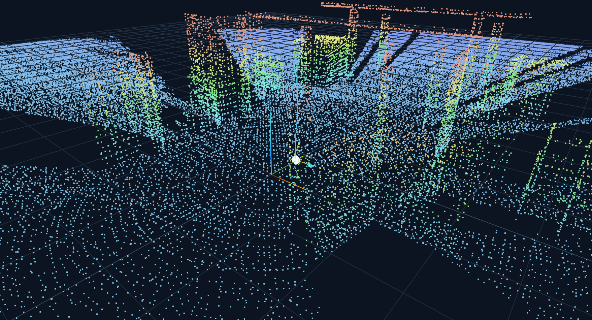
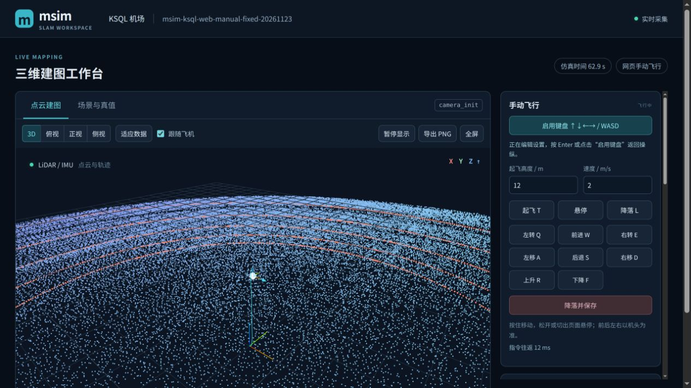
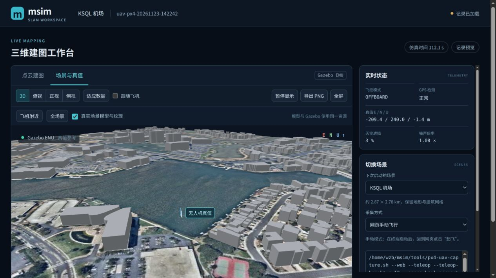

# 网页 SLAM 三维工作台

网页现在使用真正的 WebGL 三维视图，接收本机 Gazebo / PX4 / FAST_GLIO 的数据。它显示累计点云、当前配准帧、LiDAR / IMU 轨迹和已有的 GPS 松组合轨迹，并保留网页手动飞行控制。交互参考 [Foxglove 3D 面板](https://docs.foxglove.dev/docs/visualization/panels/3d)的图层与相机操作，以及 [Potree](https://github.com/potree/potree) 的三维点云浏览方式；实际渲染使用本地固定版本 Three.js r170，并未接入上述服务。

## 启动与操纵

```bash
cd /home/wzb/msim
./tools/px4-uav-capture.sh --web --teleop --scene complex_urban
```

打开 <http://127.0.0.1:8766/>。`--web` 自动启动无窗口仿真和 FAST_GLIO 实时估计；不启动 Gazebo GUI 或 RViz 窗口。物理、传感器、飞控和定位计算仍由本机原有程序执行。可加 `--web-port 8767` 更换端口。

网页显示控制器准备状态后，点击“起飞”。方向键 ↑↓←→ 或 W/S/A/D 平移，R/F 升降，Q/E 转向；T 起飞、L 降落，空格或 Esc 悬停。也可按住屏幕方向按钮。点击“启用键盘”后操纵；修改高度或速度后按 Enter 返回画布。输入框内编辑数字时不会触发飞行快捷键。松键、失焦或隐藏页面时清空方向输入，使飞行中的飞机保持位置，同时保留正在执行的起飞高度目标；只有明确按悬停、空格或 Esc 才中断爬升。控制器另有 0.35 秒输入心跳保护。关闭浏览器不会结束采集；点击“降落并保存”后等待飞机降落、录包和地图保存完成。

自动航线示例：

```bash
./tools/px4-uav-capture.sh --web --scene complex_urban \
  --duration-s 60 --flight-pattern route --route-clock sim --skip-signalsim
```

## 三维显示操作

| 操作 | 效果 |
| --- | --- |
| 左键拖动 / 右键或 Shift 拖动 / 滚轮 | 旋转 / 平移 / 缩放；俯视模式使用正交投影 |
| 3D、俯视、正视、侧视 | 切换预设视角 |
| 适应数据 / 双击视图 | 根据点云与轨迹重新取景 |
| 跟随飞机 | 以最新定位位置为相机观察中心；平移操作取消跟随 |
| 显示图层 | 独立开关累计地图、当前帧、两类定位轨迹、网格、坐标轴与飞机位姿 |
| 点大小、点云配色、显示预算 | 1～5 px，高度渐变或统一颜色，地图显示 3 / 6 / 9 万点 |
| 暂停显示 | 冻结点云与轨迹画面，采集和遥测继续；恢复后读取最新数据 |
| 导出 PNG | 保存当前三维画面到运行目录 `web-exports/`，页面给出下载链接；不含周围按钮和面板 |
| 下载已保存的完整地图 PCD | 下载完整 `map.pcd`，不受网页显示预算限制 |
| 飞机附近 / 全场景 | 查看飞机周围或完整机场；切换俯视等预设时保留当前场景范围 |
| 真实场景模型与纹理 | 显示或隐藏实际环境网格，真值和 GPS 轨迹单独保留 |
| 全屏 | 放大三维工作区 |

累计地图优先读取 `/msim/lio_map`，当前帧来自 `/cloud_registered`；没有累计地图节点时，网页服务用 0.4 m 体素累计配准帧，备用地图最多保留 40 万体素。地图数据传输上限为 9 万点、当前帧上限为 1.2 万点。网页抽样只影响显示，不改变原始 bag、算法输入或独立建图节点保存的地图。页面同时显示“实际显示点数 / 地图总点数”。

“点云建图”采用算法的 `camera_init` 坐标系，飞机朝向读取实际里程计四元数。“场景与真值”采用 Gazebo ENU，加载运行目录 SDF 指向的实际 DAE / STL 网格和纹理，以及盒体、圆柱、球体、平面。机场使用与 Gazebo 相同的地形、建筑和卫星图；保留模型 / 连杆 / 视觉节点的位姿、网格缩放、COLLADA 单位与 Z 轴方向。两个坐标系没有做旋转配准，因此分开显示。物理碰撞、传感器扫描和飞控仍在 Gazebo / PX4 中运行。

## 如何切换场景

```bash
./tools/px4-uav-capture.sh --list-scenes
```

| `--scene` | 场景 |
| --- | --- |
| `simple` | 原始城市走廊，省略场景参数时的默认值 |
| `complex_urban` | 错落建筑、立柱、斜墙与高架桥 |
| `industrial_yard` | 货架、托盘、货箱与多高度结构 |
| `ksql_airport` | 约 2.87 km × 2.78 km 的机场周边地形与建筑，选定 1 km × 1 km 测试区域 |

在页面右侧“切换场景”中选择下次场景和采集方式，再点“复制启动命令”。**这是下次运行的命令生成器，不会在当前飞行中热替换 Gazebo 世界。**先点“降落并保存”，等终端退出后，在 msim 目录执行复制的命令；保持原端口时刷新网页即可。每个场景创建独立运行目录，防止不同地图和坐标原点混入同一录包。

例如切到工业场地手动建图：

```bash
./tools/px4-uav-capture.sh --web --teleop --scene industrial_yard
```

切到机场：

```bash
# 首次运行先下载并校验资源；已有资源不用重复下载。
python3 tools/fetch-ksql-assets.py
./tools/px4-uav-capture.sh --web --teleop --scene ksql_airport
```

自定义场景可使用 `--world /绝对路径/自定义.world --scene-profile /绝对路径/配置.json`；需同步配置出生点、航线与传感器位置，详见 [场景说明](../../scenes/README.md)。网页场景命令保留当前 LiDAR / IMU / GPS 型号、点云时序和抽稀参数；机场手动模式的建议起飞高度为 12 m。自定义 world、欺骗参数和输出路径需要按实验要求自行追加。

## 查看已保存地图

```bash
/usr/bin/python3 tools/web-sim-console.py \
  --run /绝对路径/某次运行 --port 8767
```

打开 <http://127.0.0.1:8767/>。离线服务不需要 ROS：读取保存的 `map.pcd`、真值/GPS 记录和 `web-lio-state.json`。新版本实时运行每两秒保存网页轨迹缓存；旧录包若没有该缓存，仍可预览 PCD，但不会凭空补出定位轨迹和飞机位姿。离线模式不保存当前配准帧序列，也不开放飞行控制。PCD 预览当前支持未压缩 binary、float32 XYZ，输入数据最多 128 MiB；完整文件可直接下载。



## 验证记录（2026-11-23）

在工业场地进行了真实 PX4 / Gazebo / FAST_GLIO 网页链路验证：原生 GPS 噪声模式、8 m 起飞、平移、升高、悬停、降落并保存。运行目录为 `/tmp/msim-web3d-live-20261123-03`。`capture-session.json` 的 `recording_complete=true`，停止原因为 `teleop_finish`；`fastglio-live-report.json` 的 `pass_mapping_gate=true`。最终累计 409 帧、128,413 个地图体素，保存 `sensors.bag` 和 `map.pcd`。

飞行中校验二进制点云包：地图传输 90,000 / 92,533 点，当前帧 4,146 点，长度分别等于点数 × 12 字节，均为 `camera_init`，累计轨迹 75 个采样点。网页验证了三维/俯视、显示预算、图层开关、暂停/恢复、场景命令生成。Python 测试共 42 项，其中 40 项通过、2 项因当前测试解释器缺少 ROS 消息包跳过；另完成 JS、Python 与 shell 语法检查。PNG 按钮已在浏览器中实际导出 1758 × 950 的 PNG，并核验文件头与尺寸。

测试发现 `/home/wzb/msim` 所在分区剩余不足 1 GB，会触发 rosbag 低磁盘空间保护。因此最终验证使用空间更充足的 `/tmp` 分区，未删除原有数据。新增长时间采集前，请用 `df -h` 检查空间，通过 `--run /有足够空间的目录/新实验名` 指定保存位置。`/tmp` 仅适合临时验证，不适合长期保管实验数据。

`web-console.log` 保存在运行目录。三维库、控制器代码与字体回退均在本机，运行时不需要 CDN。第三方 Three.js 的来源、固定提交和校验值见 `web/sim-console/vendor/three/source.json`，MIT 授权见同目录 `LICENSE`。浏览器需支持 WebGL 2。

## 控制响应与磁盘清理（2026-11-23）

控制指令现在串行发送，连续方向只保留待发送的最新状态，续发间隔为 80 ms；控制器 50 Hz 处理，ROS 控制话题启用 TCP_NODELAY。面板显示指令往返耗时、当前按键和输入焦点提示。此处的往返时间是指令通信耗时，不等于机体达到目标速度所需的动力学响应时间。

已对 5 个旧录包做 LZ4 无损压缩，逐话题核对原始序列化消息、时间戳、连接头和消息数量后才替换原文件；文件名与路径保持不变，`rosbag play` 可直接读取。另删除 9 个可重新编译的 `.o` 中间文件，总计释放 8,905,252,857 字节（约 8.29 GiB）。地图、图表、配置、算法结果与原始消息均保留。具体路径、前后大小与校验结果见 `runs/cleanup-20261123.json`。

本轮复杂街区验证：在起飞过程中修改速度并按 Enter 返回画布，飞机仍达到 7.69 m 相对高度；随后完成平移、断续输入保护、正常降落与录包保存。HTTP 指令往返中位数 1.53 ms、最大 3.12 ms，3 次发送到控制器处理的观测为 18.77 / 2.52 / 15.90 ms；短程平移约 1.11 m。43 项 Python 测试全部通过，独立 Node 测试覆盖方向键别名、多输入来源、命令串行合并与连接失败。报告见 `runs/control-response-verification-20261123/report.json`。

## 机场启动、起飞与命令复制修正（2026-11-23）

`runs/uav-px4-20261123-133241/launch.log` 在 GNSS 等待超时之前已出现 `Segmentation fault (core dumped)`。因此这次错误表示仿真先崩溃，随后才没有 GNSS 数据，不能仅延长 GNSS 等待时间。代码审查发现 GPS 场景遮挡射线直接在 Gazebo Transport 通信回调中执行；现改为回调只把原生 GPS 样本放入最多 32 条的队列，在 `WorldUpdateEnd` 中计算碰撞、噪声和欺骗，再统一输出给 PX4 与 ROS。GPS 测量时间戳、原生噪声、附加偏差、报告方差和遮挡倍率均保留。

原始日志没有完整崩溃回溯，因此不能声称恢复了唯一的崩溃指令。修复的是明确存在的跨线程物理查询问题，并用原来同一套机场 / VLP-16 / standalone GPS / rolling 扫描 / 抽稀 2 配置验证：60 秒自动航线通过飞行、LiDAR 同步和松组合检查；最大爬升 12.59 m，最大位移 143.48 m。网页手动起飞通过，实际达到 11.69 m 相对高度，最终正常降落解除锁定，录包和地图保存完成。验证没有改为理想 GPS，也没有关闭遮挡模型。46 项 Python 测试全部通过，两个 Node 输入与命令测试通过。结果保存在 `runs/web-startup-verification-20261123/`。

采集器现在检查启动日志中的进程崩溃，发现后直接报告仿真崩溃，避免继续等待下游 GNSS。异常阶段、最后时钟、传感器计数和错误另写入运行目录的 `capture-failure.json`。网页端口被占用时，会在启动大型场景前给出提示。

**自动航线和网页手动飞行是不同模式。**

```bash
# 网页手动飞行：初始化后打开网页，点击“起飞”。
/home/wzb/msim/tools/px4-uav-capture.sh --web --teleop \
  --scene ksql_airport --teleop-height-m 12 --lidar-model vlp16 --point-filter-num 2

# 自动航线：初始化后自动解锁和起飞，无手动起飞面板。
/home/wzb/msim/tools/px4-uav-capture.sh --web --scene ksql_airport \
  --duration-s 300 --flight-pattern route --route-clock sim --skip-signalsim \
  --lidar-model vlp16 --point-filter-num 2
```

“复制命令到终端”不启动程序。页面先选中命令，并尝试浏览器复制；实际验证中，内嵌浏览器可能让复制 API 返回成功，却没有把文字交给系统剪贴板。因此页面不再直接宣称已经复制，且持续刷新时保持原选区。若终端粘贴为空，在命令框按 Ctrl+C 再粘贴，或点“下载启动脚本 .sh”，在终端用 `bash /实际下载路径/msim-ksql_airport-teleop.sh` 运行。Ctrl+C 路径已实际读回完整命令，下载脚本已核验 HTTP 响应、模式、绝对路径和传感器参数。网页不会绕过终端直接执行新场景，也不会替换正在运行的仿真。



## 外置盘存储与真实场景模型（2026-11-23）

`uav-px4-20261123-135640` 的 `record.log` 明确记录：第 62.446 秒，`rosbag` 因剩余空间低于 1 GB 而关闭录包。随后出现的 `simulation or recorder exited` 是这个事件的后续结果。它与之前的 Gazebo 段错误不是同一次问题，也不是 RAM 容量不足；本轮检查时可用内存约 17 GiB。新版本启动采集前要求至少 2 GiB 可用空间；录包退出时会区分磁盘不足、录包进程退出与仿真退出，错误写入 `capture-failure.json`。

PX4 采集默认目录由 [`config/run-storage.json`](../../config/run-storage.json) 指定，目前为 `/media/wzb/Elements/msim/runs`。外置盘未挂载时停止启动，不会默默回退写满系统盘。旧的 `/home/wzb/msim/runs` 路径保留兼容链接；新 PX4 采集也创建对应的本地入口。`--run` 可指定单次输出位置，`MSIM_RUN_ROOT` 可覆盖默认根目录。其他历史离线脚本可显式传入外置盘的输入 / 输出目录。

外置盘为 exFAT，不支持 POSIX 符号链接。因此 PX4 / ROS 临时运行目录位于本机 `/tmp/msim-runtime-*`，bag、地图和图表直接写入外置盘；进程停止后把运行日志按 SHA-256 校验归档至运行目录，原始链接目标记录在 `runtime-storage.json`，最后清理临时目录。归档仍保留 `ros-home/log/*.ulg` 和 `roslogs/`，便于回查日志。

迁移使用逐文件复制、目标 SHA-256 校验、原文件大小与修改时间复查，再原子地把旧文件替换为指向外置盘的链接。原有符号链接保留在本地兼容目录，完整链接清单及归档位于外置盘 `_migration-20261123/`。这样不修改录包内容，也保留现有图表和文档中的绝对路径。

迁移已完成：5,579 个普通文件，共 96,020,928,823 字节（89.43 GiB），全部通过 SHA-256 校验；360 个原有符号链接保持原目标。另将两个历史录包别名复制并校验到外置盘，便于直接从外置盘打开。最终审计 `passed=true`、`errors=[]`，本地兼容目录没有残留普通数据文件；系统盘可用空间恢复到约 91 GiB。审计结果位于 `/media/wzb/Elements/msim/runs/_migration-20261123/audit.json`，逐文件校验记录为同目录的 `verified-files.jsonl`。

场景视图的几何体直接来自本次运行的 `world.sdf` 及已下载资源。KSQL 两份网格共 81,881 个三角形，卫星贴图通过本机受限资源接口读取；浏览器不请求 Google、在线地图服务或任意外部纹理。地形范围约 2.870 × 2.783 km，连同边缘建筑的整体包围范围约 2.934 × 2.814 km。“飞机附近”默认查看局部环境，“全场景”展示完整范围。

飞机位置与姿态直接读取 `/ground_truth/state`，通过轻量位姿接口以 10 Hz 刷新；场景模型只加载一次，避免每帧重新传输大网格。飞机标签与实际地形同属 Gazebo ENU，未人为添加高度偏移。没有新真值缓存的旧记录会使用已记录的配对真值点。离线预览不会显示可操作的飞行按钮。

按用户原命令完成外置盘实测，运行目录为 `/media/wzb/Elements/msim/runs/uav-px4-20261123-142242`。手动起飞达到 11.69 m 相对高度，最终降落并保存；`capture-session.json` 的 `recording_complete=true`、停止原因为 `teleop_finish`，`fastglio-live-report.json` 的 `pass_mapping_gate=true`。录包约 1.18 GiB，运行日志已校验归档，临时运行目录已清理。原先因磁盘不足结束的录包仍可读取，保留 59.862 秒、50,152 条消息。

浏览器实际验证了完整机场俯视、飞机附近三维建筑和卫星贴图，并导出 1758 × 950 的 PNG。55 项 Python 测试全部通过，两个 Node 输入 / 命令测试通过。详细记录见本次运行的 `storage-scene-verification.json`。


